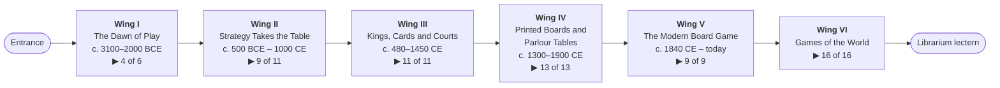
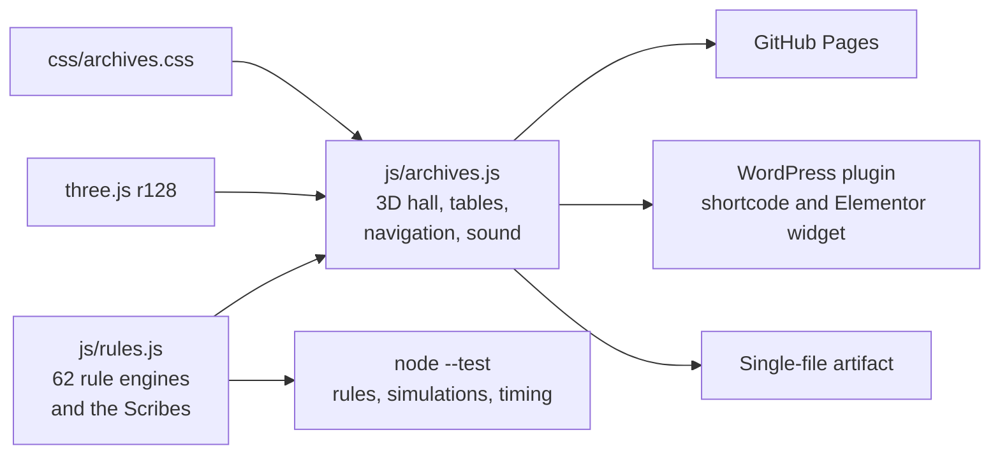

# Librarium Archives

A walkable 3D archive of the oldest board and card games, built for [Librarium Games](https://librarium.games). Visitors stroll a candlelit library hall, read the history of each game on its placard, and sit down to play the ones whose rules are known against an AI opponent, the Scribe.

| 66 exhibits | 62 playable tables | 6 wings | 3 Scribe levels | 271 rule tests |
| :---: | :---: | :---: | :---: | :---: |
| from Senet (c. 3100 BCE) to Hex (1942) | every one with its own board and pieces | walked in date order | Gentle · Fair · Sharp | plus simulated games and AI timing |

**Live:** [cptnope.github.io/Librarium-Archives](https://cptnope.github.io/Librarium-Archives/) · **Embedded:** the `[librarium_archives]` shortcode or the Elementor widget ([WordPress plugin](docs/wordpress.md))

The Archives were first called the Librarium Museum of Play, and the repository was `Librarium-Museum`. GitHub redirects the old repository address, but not the old Pages address.

## The hall



▶ playable tables of exhibits in the wing.

| Wing | Playable tables |
| --- | --- |
| I | Senet · Royal Game of Ur · Hazard (at the first dice) · Hounds and Jackals |
| II | Weiqi (Go) · Ludus latrunculorum · Duodecim scripta · Patolli · Nine Men's Morris · Oware · Alquerque · Brandubh · Hnefatafl |
| III | Tables (backgammon) · Chaturanga · Shatranj · Xiangqi · Chaturaji · Rithmomachia · Medieval chess (on the Lewis chessmen) · Courier chess · Four Seasons chess · Piquet (at the playing cards) · Tarocchi |
| IV | Fox and Geese · Chess · Draughts · International draughts · Pachisi · Game of the Goose · Cribbage · Dominoes · Tablut · Whist · Snakes and Ladders · Ludo · Mahjong |
| V | The Mansion of Happiness · The Checkered Game of Life · Reversi · Halma · Dots and Boxes · Chinese checkers · The Landlord's Game · Kalah · Hex |
| VI | Mū tōrere · Shogi · Gomoku · Hanafuda (koi-koi) · Jungle · Nard · Makruk · Bagh-chal · Kōnane · Yut Nori · Janggi · Fanorona · Bao · Morabaraba · Seega · Tâb |

Every exhibit, its date, how sure we are of its rules, and the rule choices made at each table are in **[the exhibits guide](docs/exhibits.md)**.

## How it fits together



No bundler, no framework, no audio files: a static page on three.js, with every sound synthesised in the browser.

## Documentation

| Guide | What's in it |
| --- | --- |
| [Visiting the Archives](docs/visiting.md) | Controls on touch and keyboard, getting around, the guided tour and passport, playing at a table (keyboard play included), playing a friend, saved games, options, sound |
| [The exhibits](docs/exhibits.md) | All 66 exhibits by wing, with timelines, rule status and the rule choices at each table |
| [The Scribe](docs/scribe.md) | How the AI plays each game, its three levels, and measured strength |
| [Architecture](docs/architecture.md) | Files, modules, the turn loop, table phases, conventions, stored progress |
| [Rule engines and presenters](docs/engines.md) | The contract every game implements, a feature matrix of all 62, and how to add a game |
| [WordPress plugin](docs/wordpress.md) | Install, shortcode attributes, how it loads, security, every exhibit id |
| [Development](docs/development.md) | Scripts, debug mode, tests, CI and deployment, workflow |
| [Sources](docs/sources.md) | Historical notes and the sources behind the placards |
| [Roadmap](docs/roadmap.md) | What's next, and how the Archives grew |
| [Changelog](CHANGELOG.md) | Every release |

## Quick start

```bash
npx serve .              # open the printed address; add ?debug for the console API
npm test                 # rule tests and simulated games (Node 18+)
npm run build:artifact   # dist/artifact.html
npm run test:plugin      # builds dist/librarium-archives.zip and runs the PHP tests
```

## Credits

Built by [Jeremy Anderson Tech](https://jeremyanderson.tech) for [Librarium Games](https://librarium.games). The hall ends at a lectern featuring Librarium's own games, Phoenix Farm, Calendra, The Great Chase and Royal Threadcount, under an arch signed *Different fables for different tables*.

Placard text is written for the Archives. Where scholarship is uncertain, the placards say so. Games whose rules are lost or only partly recorded (Senet, Hounds and Jackals, Ludus latrunculorum, Patolli and others) are played as modern reconstructions, and each placard names whose; see [sources](docs/sources.md).
