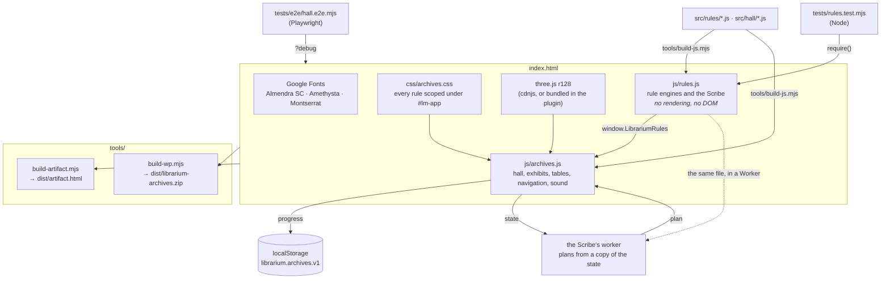
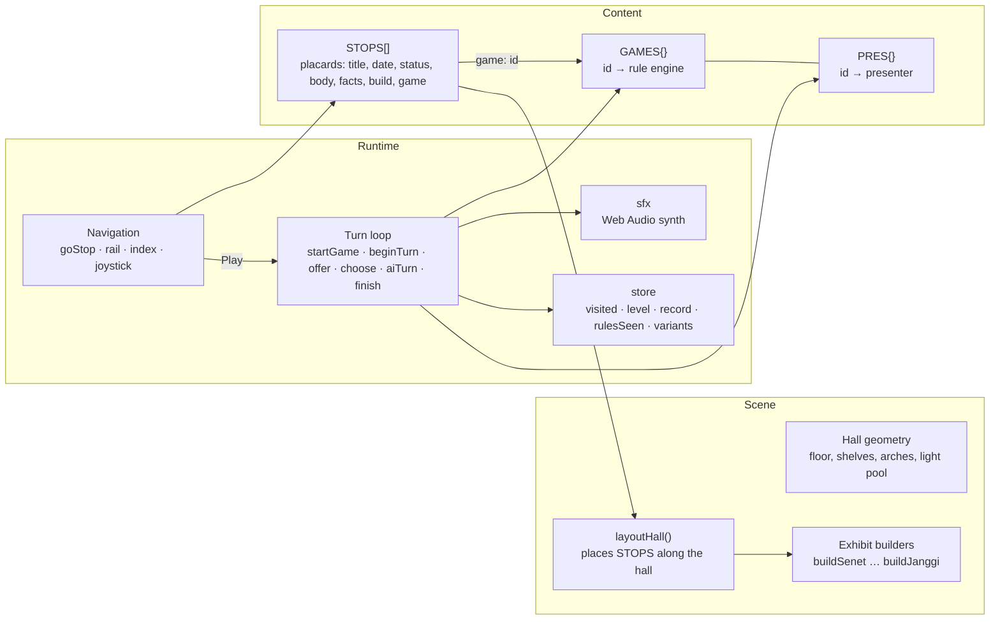
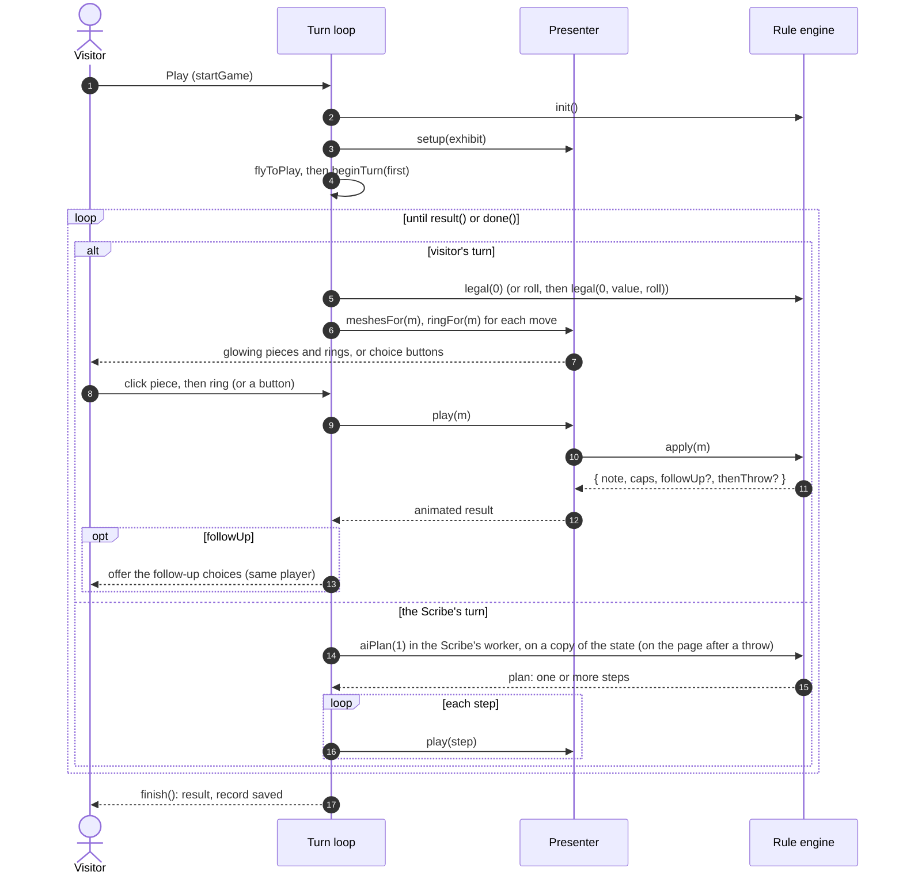
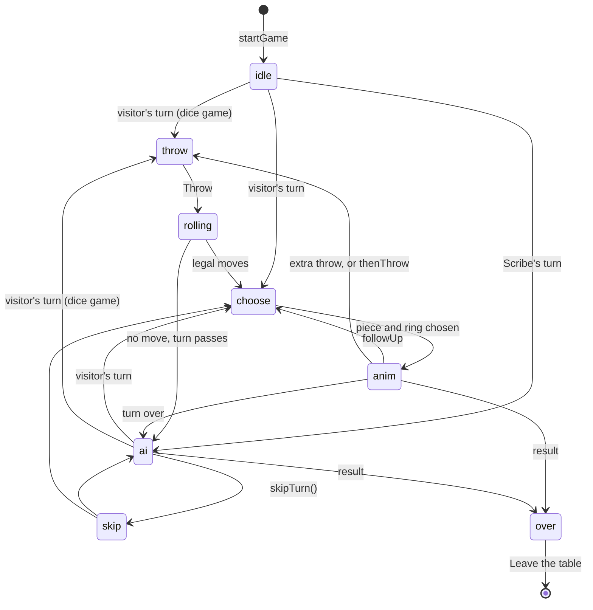
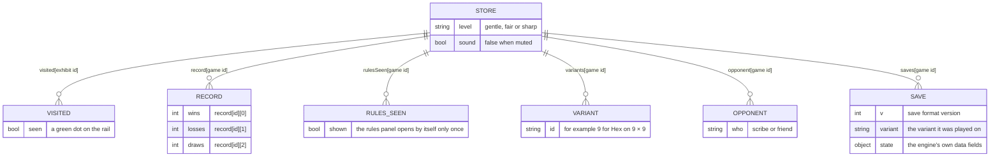

# Architecture

The Archives are a static site: one HTML page, one stylesheet, and two scripts on top of three.js r128. There is no bundler and no framework. The same files run on GitHub Pages, inside the WordPress plugin and inlined into a single Claude artifact.

## Files and how they load

| File | Lines | What lives there |
| --- | ---: | --- |
| `index.html` | ~100 | Markup for the HUD, placard, rail, index dialog and table controls; script order |
| `css/archives.css` | ~210 | All styles, scoped under `#lm-app`; ids are prefixed `lm-`; phone layout by container query |
| `src/rules/` | 62 files | One file per game, plus `00-core.js` (levels, search, Ur, Senet) and `zz-api.js` (saved state, export). `ORDER` lists them |
| `src/hall/` | 140 files | The hall's systems (`00-head.js` … `27-boot.js`), each exhibit's model (`build-*.js`), each table's presenter (`table-*.js`). `ORDER` lists them |
| `js/rules.js` | ~7,700 | Built from `src/rules/`: 62 rule engines, the shared negamax search, Monte Carlo searches (Go, Hex), card and tile AIs. UMD: `module.exports` in Node, `window.LibrariumRules` in the browser and in the Scribe's worker |
| `js/archives.js` | ~8,200 | Built from `src/hall/`: the three.js hall, 75 exhibit builders, the `STOPS` list, 62 table presenters, the turn loop, navigation, sound, storage |
| `tests/rules.test.mjs` | ~2,600 | Rule tests, simulated games, AI timing checks |
| `tests/plugin-render.test.php` | | Renders the shortcode with stubbed WordPress functions |
| `wordpress/` | | Plugin PHP, Elementor widget, `readme.txt` |
| `tools/` | | The artifact and plugin builders |
| `embed-demo.html` | | A stand-in WordPress page that embeds the Archives at 70vh |

## Inside `js/archives.js`

- **`STOPS`** is the single list of exhibits, in walking order. A stop has `id`, `wing`, `title`, `date`, `eyebrow`, `status`, `body` (paragraphs), `facts`, `build` and, if playable, `game`. Wing intros (`wing2` … `wing6`), the entrance (`hall`) and the closing lectern (`next`) are stops too.
- **`GAMES`** maps a game id to its rule engine from `js/rules.js`. **`PRES`** maps the same id to its presenter, which owns the 3D pieces and animation for that table.
- **`layoutHall()`** computes each stop's position from the order of `STOPS`, so adding an exhibit never means moving the others by hand.

### Start-up

Every plinth goes up at once: they are plain blocks, and the walk, the camera, the lights and the rail all need them. What stands on them is built near the visitor first. The wing they start in is built before the loader lifts, and the rest follows a slice of a frame at a time while the hall is already moving. Going to an exhibit, or sitting at its table, builds it at once if it is not ready. In the software-rendered test browser this halved the time to the first view, from about 20 seconds to about 10.

### The Scribe's worker

Search games plan in a Web Worker so the hall keeps moving while the Scribe thinks. The worker is started from a Blob holding the very same `rules.js` (its text when it is written into the page, as in the single-file build; an `importScripts` of its address otherwise). Each turn it is sent the engine's plain state (`packState`), the player and the level. It returns the plan as plain moves, which the page plays. Hints go the same way, at Sharp. If a worker cannot start or does not answer within 20 seconds, the Scribe thinks on the page as before. Dice tables plan in an instant and stay on the page.

## A turn at the table

## Table phases

`play.phase` drives what the visitor can do at any moment.

`play.token` is bumped whenever a game starts or is left, so any animation or Scribe move still in flight checks the token and quietly stops.

## Conventions

| Convention | Rule |
| --- | --- |
| Players | `0` is the visitor, `1` the Scribe, or a friend at the same screen in pass-and-play (`HOTSEAT` lists the eligible games; the turn loop then offers `legal(1)` instead of asking `aiPlan`, and Scribe lines read as the friend's). Mahjong, Chaturaji, Four Seasons chess and Whist seat four, with seat 0 the visitor and `1` standing for whichever Scribe is at play) |
| Board rows | Row 0 is nearest the visitor; world `+z` points toward the visitor |
| Moves | Plain objects. `label` makes a move a button instead of a piece-and-ring choice |
| Notes | `apply()` returns `note` text in the visitor's voice ("You capture…", "The Scribe…") |
| Randomness | Only in `roll()`, deals and the Scribe's choices; `snapshot()`/`restore()` must make planning side-effect free |
| Ids | Every DOM id is prefixed `lm-`; the plugin never renders two copies on one page |

## Visitor progress

Stored in the visitor's browser only, under `librarium.archives.v1`. If storage is blocked, everything still works for that visit.

## Sound

Every sound is synthesised on the spot with the Web Audio API (the `sfx` module): sticks, dice, pieces, stones, cards, and a low room tone with the odd candle crackle. There are no audio files to license or load. Nothing plays until the visitor's first click, tap or key, the speaker button mutes everything and is remembered, and sound pauses while the tab is hidden.
