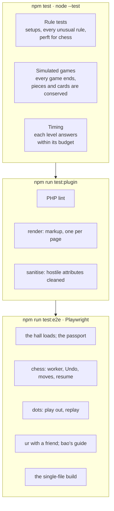
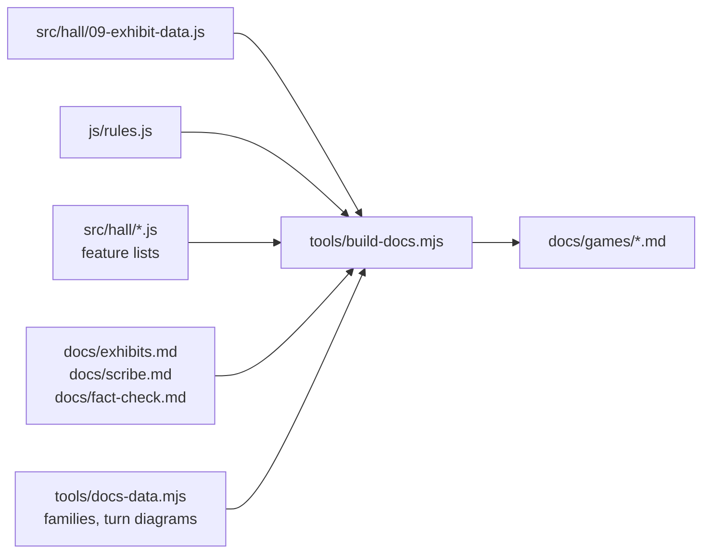
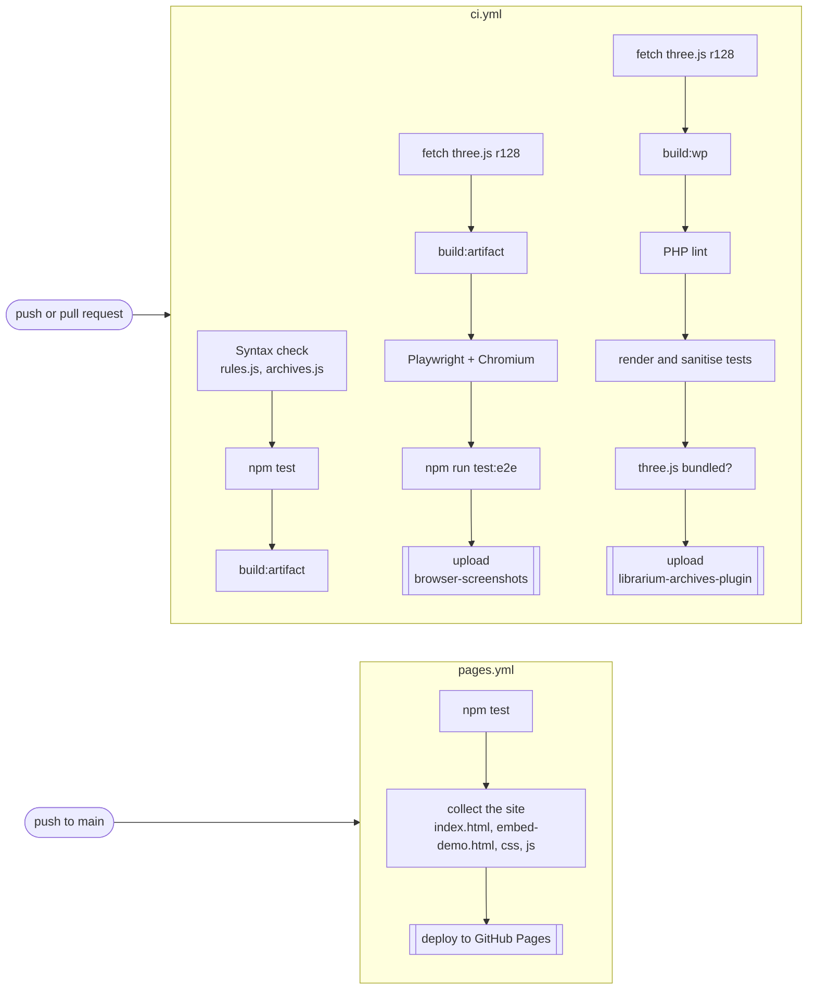
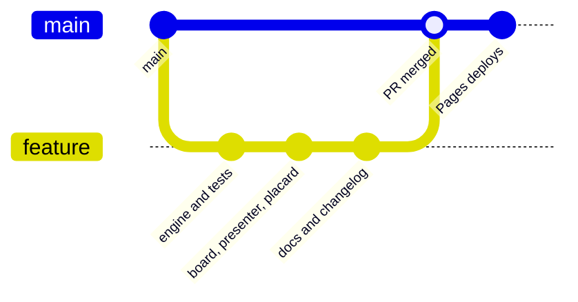

# Development

## Quick start

The site needs no build to run: serve the folder with any static server and open the printed address. The code is written in `src/` and joined into the two files in `js/` that the page loads. After editing anything in `src/`, run `npm run build:js`. Do not edit `js/` by hand: CI checks that it matches `src/`.

```bash
npx serve .                 # or: python3 -m http.server
npm run build:js            # joins src/rules and src/hall into js/rules.js and js/archives.js
npm test                    # rule tests and simulated games (Node 18+)
npm run build:artifact      # writes dist/artifact.html (everything inlined)
npm run build:wp            # writes dist/librarium-archives.zip
npm run test:plugin         # builds the plugin, then runs the PHP render and sanitise tests (needs php and zip)
npm run test:e2e            # browser tests (needs Playwright and Chromium, see Testing)
```

Local plugin builds load three.js from cdnjs unless `vendor/three.min.js` exists; CI downloads it and bundles it.

## Project layout

```text
index.html                    Page markup, fonts, script order
css/archives.css              All styles (brand: Almendra SC, Amethysta, Montserrat; logo gold #F6A01A)
src/rules/                    The rule engines, one file per game, plus 00-core.js (levels, search,
                              Ur and Senet) and zz-api.js (saved state, the export); ORDER lists them
src/hall/                     The hall in parts: 00-head … 27-boot for the systems, build-*.js for the
                              exhibits' models, table-*.js for each table's presenter; ORDER lists them
js/rules.js                   Built from src/rules: 62 rule engines and the Scribe (runs in Node too)
js/archives.js                Built from src/hall: the three.js hall, its tables and systems
tests/rules.test.mjs          Rule tests, simulated games and AI timing checks
tests/e2e/hall.e2e.mjs        Browser tests (Playwright)
tools/build-js.mjs            Joins src/ into js/ (--check fails if js/ is out of date)
tests/plugin-render.test.php  Renders the shortcode with stubbed WordPress functions
tools/build-artifact.mjs      Inlines everything into dist/artifact.html
tools/build-wp.mjs            Builds the WordPress plugin into dist/librarium-archives.zip
wordpress/                    Plugin PHP, Elementor widget and readme.txt
embed-demo.html               A stand-in WordPress page that embeds the Archives
docs/                         This documentation
```

## Debug mode

Add `?debug` to the address to expose the live state as `window.__archives`. Debug mode also keeps the scene ticking when the browser pauses animation frames in a hidden tab, so headless tests can drive it.

| Member | What it is |
| --- | --- |
| `play` | The live table: `game`, `P` (presenter), `phase`, `moves`, `token`, `roll` |
| `GAMES`, `PRES`, `STOPS` | The engine and presenter maps, and the exhibit list |
| `jump(id)` | Put the camera at an exhibit straight away, without the glide |
| `goStop(i)` | Travel to the exhibit at index `i` |
| `startGame(stop)`, `leaveGame()` | Sit down at a table, or leave it |
| `choose(move)` | Make one of `play.moves`, as if clicked |
| `humanThrow()` | Throw the dice, as if the button were pressed |
| `snap()` | Render one frame and return a small JPEG of the 3D view |
| `cam`, `camera`, `view`, `joy` | Camera and input state |
| `renderer`, `scene` | The three.js renderer and scene, for `renderer.info` and the like |
| `mergeStats` | How many static meshes were found and how many were merged away |
| `RES` | The adaptive resolution: the pixel ratio now, its ceiling and floor, and the frame-time average |
| `bootTimes` | How long the first wing and all the exhibits took to build |

Two more switches help when measuring. `?nomerge` leaves every mesh as built, and `?fixedres` keeps the pixel ratio where it starts.

### Profiling

```bash
node tools/profile-hall.mjs                  # draw calls, triangles, meshes, textures, render time and heap at seven places
node tools/profile-hall.mjs --nomerge        # the same without merging, to compare
node tools/profile-hall.mjs --json=out.json  # also save the numbers
```

It runs Playwright's Chromium with SwiftShader, so render times are those of software rendering, and they jump about when the GPU queue backs up. Compare runs on one machine, and trust the draw calls and triangles over the milliseconds. A browser test checks that Wing IV and Wing VI stay under 800 draw calls.

```js
const A = window.__archives;
A.jump('hex');
A.startGame(A.STOPS.find(s => s.id === 'hex'));
// later, on the visitor's turn:
A.choose(A.play.moves[0]);
```

## Testing



- **Rule tests** pin down each game's setup and every rule that is easy to get wrong: Tablut's king capture beside the throne, Janggi's cannon screens, cribbage's 29 hand, the Landlord's Game's jail. Chess is checked by perft: 20, 400 and 8,902 positions from the start, and 48 and 2,039 from the Kiwipete position.
- **Simulated games** play every level against every other with random or AI moves, and check that games always end and that nothing is lost (64 seeds in Bao, 28 dominoes, every card in cribbage).
- **Strength** is measured outside the test suite with small scripts that play level against level with seats swapped; the results are in [the Scribe](scribe.md#measured-strength).

### Browser tests

`tests/e2e/hall.e2e.mjs` runs the page in a headless, software-rendered Chromium. It opens the page with `?debug`, jumps to tables, plays through `window.__archives`, and checks the things that span every table:
- The hall loads and the passport has a stamp for every exhibit.
- At chess, the Scribe answers from its worker. Undo takes back a turn and trims the move list. A game you leave is resumed.
- Dots and Boxes is played to the end, then replayed, with the board matching each step.
- Ur against a friend: each player throws for themselves.
- Bao opens a first game with the guide.
- The single-file build loads, and its Scribe thinks in a worker too.

Any page error fails the run. Screenshots go to `test-results/`, which CI keeps.

To run it locally: `npm install --no-save playwright@1.63.0 && npx playwright install chromium`, then `npm run test:e2e`. It uses `vendor/three.min.js` when present, so it needs no network. Software rendering is slow: the run takes ten to twenty minutes, and a screenshot alone can take a few.

For one-off checks (a new table's first turns, a screenshot of a layout), write a small script in the same way: `?debug`, `jump`, `startGame`, `choose`.

### Layout audit

`node tools/audit-layout.mjs [out-dir] [--shots] [--only=phone-se,ipad-land]` opens the hall at 16 common screen sizes, from a 320 px phone to a 1920 px desktop, in portrait and landscape. At each size it steps through the hall, a placard, the index, the passport, and several tables with their rules, moves, Options sheet, guide and end card. In each of these states it measures:

| Check | What it catches |
| --- | --- |
| offscreen | a control not wholly inside the window |
| covered | a control with something else on top of it, so a tap lands elsewhere |
| overlap | two panels on top of each other |
| noexit | an open panel with no visible, tappable way to close it |
| small | a control under 24 × 24 px |
| overflow | a panel taller than the window that cannot scroll, or text cut off sideways |

It writes `report.md` and `report.json`, plus screenshots with `--shots`. It slows the 3D loop to two frames a second, which leaves the layout unchanged. A run takes about two hours in the software renderer, so it isn't part of CI. Run it after any change to the stylesheet or to the HUD markup.

Its measurements drive the layout rules in the stylesheet:

- `layoutHud()` measures the play screen's bars and the bottom bar into `--hud-top`, `--hud-bot` and `--rail-h`. Panels are fitted between them.
- `lm-compact` (a window 720 px wide or less, or 500 px tall or less) folds the play screen's secondary controls into the Options sheet.

## The game pages

`docs/games/` holds a page for every exhibit and an index. They are written by `npm run build:docs` (`tools/build-docs.mjs`) from:

- the placards (`src/hall/09-exhibit-data.js`),
- the rule engines (`js/rules.js`: rules, source, options, seats),
- the hall's feature lists (pass-and-play, Undo, Hint, saved games, the Pack switch),
- the per-game rows of `docs/exhibits.md`, `docs/scribe.md` and `docs/fact-check.md`.

The families, the other names a game goes by in those guides, and the hand-drawn turn diagrams for games whose turns are not a plain dice race or a plain move are in `tools/docs-data.mjs`.



Don't edit the pages by hand. Change the source, then run `npm run build:docs`. CI runs `node tools/build-docs.mjs --check` and fails if a page is out of date, as it does for `js/`. A new game needs a family in `docs-data.mjs`, and the build fails until it has one.

## CI and deployment



- **GitHub Pages** deploys `main` after the tests pass. In the repository's **Settings › Pages**, set **Source** to **GitHub Actions** once.
- **CI** runs on every push and pull request. It uploads the plugin zip as the `librarium-archives-plugin` artifact and the browser tests' screenshots as `browser-screenshots`.

## Workflow



Each batch of work goes on its own branch and arrives as a pull request with the checks listed in its description. Versions follow the changelog: a minor version for new exhibits or features, a patch for fixes.

## Writing for the Archives

- Placards and rules are written for visitors: plain words, dates with era (BCE/CE), and honest about uncertainty ("Rules: reconstructed", "Accounts differ").
- Never invent rules for a game whose rules are lost; put it on display and say why.
- Notes from `apply()` speak to the visitor ("You capture…", "The Scribe…").
- New exhibits draw their own boards and pieces: no copied artwork, logos or trademarked designs.
