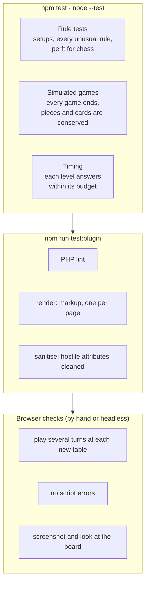
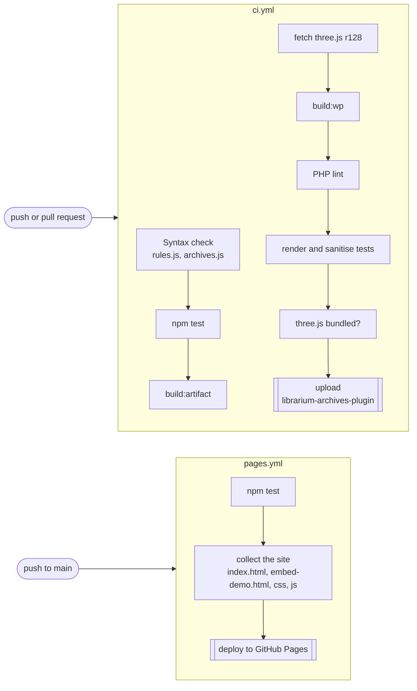
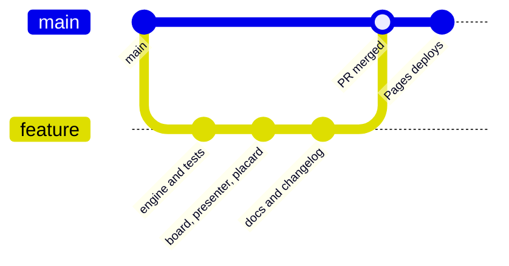

# Development

## Quick start

There is no build step for the site itself: serve the folder with any static server and open the printed address.

```bash
npx serve .                 # or: python3 -m http.server
npm test                    # rule tests and simulated games (Node 18+)
npm run build:artifact      # writes dist/artifact.html (everything inlined)
npm run build:wp            # writes dist/librarium-archives.zip
npm run test:plugin         # builds the plugin, then runs the PHP render and sanitise tests (needs php and zip)
```

Local plugin builds load three.js from cdnjs unless `vendor/three.min.js` exists; CI downloads it and bundles it.

## Project layout

```text
index.html                    Page markup, fonts, script order
css/archives.css              All styles (brand: Almendra SC, Amethysta, Montserrat; logo gold #F6A01A)
js/rules.js                   49 rule engines and the Scribe (no rendering; runs in Node)
js/archives.js                three.js hall, 64 exhibits, table presenters, turn loop, navigation, sound
tests/rules.test.mjs          Rule tests, simulated games and AI timing checks
tests/plugin-render.test.php  Renders the shortcode with stubbed WordPress functions
tools/build-artifact.mjs      Inlines everything into dist/artifact.html
tools/build-wp.mjs            Builds the WordPress plugin into dist/librarium-archives.zip
wordpress/                    Plugin PHP, Elementor widget and readme.txt
embed-demo.html               A stand-in WordPress page that embeds the Archives
docs/                         This documentation
```

## Debug mode

Add `?debug` to the address to expose the live state as `window.__archives`. Debug mode also keeps the scene ticking when the browser pauses animation frames in a hidden tab, so headless tests can drive it.

| Member | What it is |
| --- | --- |
| `play` | The live table: `game`, `P` (presenter), `phase`, `moves`, `token`, `roll` |
| `GAMES`, `PRES`, `STOPS` | The engine and presenter maps, and the exhibit list |
| `jump(id)` | Put the camera at an exhibit straight away, without the glide |
| `goStop(i)` | Travel to the exhibit at index `i` |
| `startGame(stop)`, `leaveGame()` | Sit down at a table, or leave it |
| `choose(move)` | Make one of `play.moves`, as if clicked |
| `humanThrow()` | Throw the dice, as if the button were pressed |
| `snap()` | Render one frame and return a small JPEG of the 3D view |
| `cam`, `camera`, `view`, `joy` | Camera and input state |

```js
const A = window.__archives;
A.jump('hex');
A.startGame(A.STOPS.find(s => s.id === 'hex'));
// later, on the visitor's turn:
A.choose(A.play.moves[0]);
```

## Testing



- **Rule tests** pin down each game's setup and every rule that is easy to get wrong: Tablut's king capture beside the throne, Janggi's cannon screens, cribbage's 29 hand, the Landlord's Game's jail. Chess is checked by perft: 20, 400 and 8,902 positions from the start, and 48 and 2,039 from the Kiwipete position.
- **Simulated games** play every level against every other with random or AI moves, and check that games always end and that nothing is lost (64 seeds in Bao, 28 dominoes, every card in cribbage).
- **Strength** is measured outside the test suite with small scripts that play level against level with seats swapped; the results are in [the Scribe](scribe.md#measured-strength).

### Browser checks

Chromium and Playwright run the page headless at a small viewport. A check script opens the page with `?debug`, jumps to a table, starts a game, plays turns through `window.__archives`, records the message bar and score after each turn, takes a screenshot, and reports any page errors. Software rendering is slow, so a screenshot can take several minutes; keep the viewport small.

## CI and deployment



- **GitHub Pages** deploys `main` after the tests pass. In the repository's **Settings › Pages**, set **Source** to **GitHub Actions** once.
- **CI** runs on every push and pull request and uploads the plugin zip as the `librarium-archives-plugin` artifact.

## Workflow



Each batch of work goes on its own branch and arrives as a pull request with the checks listed in its description. Versions follow the changelog: a minor version for new exhibits or features, a patch for fixes.

## Writing for the Archives

- Placards and rules are written for visitors: plain words, dates with era (BCE/CE), and honest about uncertainty ("Rules: reconstructed", "Accounts differ").
- Never invent rules for a game whose rules are lost; put it on display and say why.
- Notes from `apply()` speak to the visitor ("You capture…", "The Scribe…").
- New exhibits draw their own boards and pieces: no copied artwork, logos or trademarked designs.
