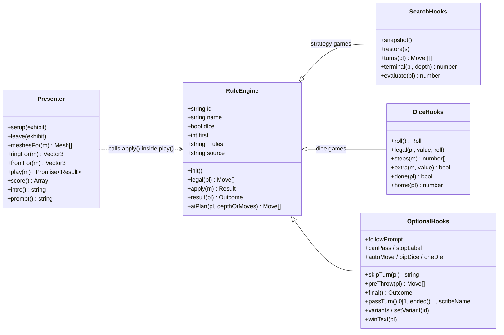
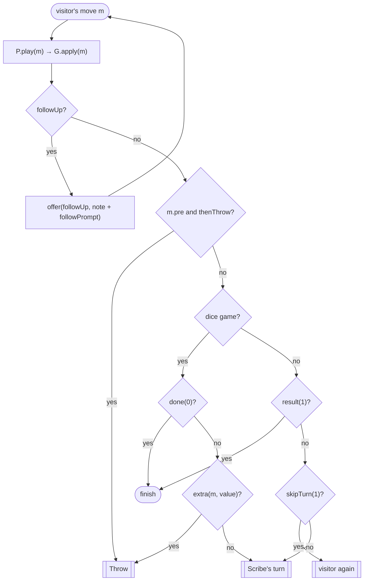
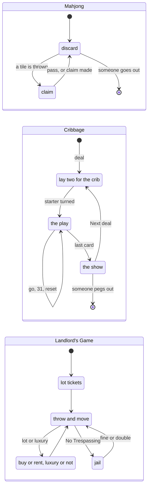

# Rule engines and presenters

Every playable table is two objects with the same id: a **rule engine** in `js/rules.js`, which knows the rules and nothing about the screen, and a **presenter** in `js/archives.js`, which owns the 3D pieces and the animation. The turn loop in `js/archives.js` drives both.

## The rule engine

### Required of every engine

| Member | Purpose |
| --- | --- |
| `id`, `name` | Matches the `GAMES`/`PRES` key and the stop's `game`; the name is shown in the HUD |
| `first` | `0` if the visitor moves first, `1` if the Scribe does |
| `rules`, `source` | The *How to play* panel: a list of short rules, and one sentence on where they come from |
| `init()` | Set up a fresh game (and a fresh deal, for card and tile games) |
| `legal(pl)` | Every move player `pl` may make now. An empty list means no move |
| `apply(m)` | Make the move and return `{ note, caps, followUp?, ... }` |
| `result(pl)` | `null` while play goes on; otherwise `{ winner: 0 \| 1 \| -1, text }`, where `-1` is a draw |
| `aiPlan(...)` | The Scribe's move or moves (see [the Scribe](scribe.md)) |

### What `apply(m)` may return

| Field | Effect in the turn loop |
| --- | --- |
| `note` | Shown in the message bar, worded for the visitor |
| `caps` | Captured squares or pieces, for the presenter and the capture sound |
| `followUp` | More choices for the **same** player (a Morris removal, the second die in Tables, the next card after winning a trick, a Kalah extra move). The loop offers them with `followPrompt` |
| `thenThrow` | After a choice made before throwing (lot tickets, a jail fine), the visitor now throws |
| `trace`, `events`, `path`, ... | Anything the presenter needs to animate the move faithfully (sowing traces, card events, hop paths) |

### Strategy games: hooks for the shared search

| Hook | Purpose |
| --- | --- |
| `snapshot()` / `restore(s)` | Save and restore the whole position cheaply; planning must leave no trace |
| `turns(pl)` | Whole turns as arrays of moves, best-looking first (so alpha-beta prunes more). A turn can be a chain: a capture sequence, a Kalah extra move |
| `terminal(pl, depth)` | `null`, or a score for a finished position (`±1000 ± depth` prefers quicker wins and slower losses) |
| `evaluate(pl)` | A heuristic score from `pl`'s side |

With these, `aiPlan(pl, depth)` is usually one line: `return bestPlan(this, pl, depth, maxDepth)`.

### Dice games

| Hook | Purpose |
| --- | --- |
| `dice: true`, `roll()` | Returns `{ value, faces }`; `pipDice` draws dice, `oneDie` draws one, otherwise sticks or shells |
| `legal(pl, value, roll)` | Moves for this throw |
| `steps(m)` | The squares to animate through |
| `extra(m, value)` | `true` for another throw (a six in Ludo, a yut in Yut Nori) |
| `done(pl)` / `home(pl)` | Has `pl` finished, and how many pieces are home. Dice games end on `done`, not `result` |
| `final()` | Optional: decide the winner on points when the game ends (the Landlord's Game) |
| `preThrow(pl)` | Optional: choices before throwing (lot tickets, paying a jail fine) |
| `toggles`, `setToggle(id, on)` | Optional: on-off rules shown beside the variants and remembered per table (Hex's swap rule). Changing one restarts the game |
| `passTurn()`, `ended()`, `scribeName` | Optional, for several Scribes (Chaturaji): `passTurn` moves play to the next seat and returns `0` for the visitor or `1` for a Scribe; `ended` is checked at the start of every turn; `scribeName` names the Scribe at play in the message bar |
| `aiPlan(pl, moves)` | The Scribe's pick from this throw's moves |

### How the loop routes a move

### Turn order that is not simple alternation

Most games alternate. The three Scribes of Chaturaji and Four Seasons chess each take a turn through `passTurn`. Three more use a small state machine of their own, and always hand the visitor's choices back through `legal(0)` and `followUp`:

## The presenter

| Member | Purpose |
| --- | --- |
| `setup(ex)` | Put the pieces where the fresh engine says; hide any display-only pieces on the exhibit |
| `leave(ex)` | Put the exhibit back as it stands in the hall |
| `meshesFor(m)` | The mesh to glow and click for a move; return `[]` (with a `label` on the move) for a button |
| `ringFor(m)` / `fromFor(m)` | Where to draw the target ring and the last-move ember; `null` for none |
| `play(m)` | Animate the move and call `G.apply(m)` at the right moment; return its result |
| `score()` | `[[name, value], [name, value], suffix]` for the score strip |
| `intro()`, `prompt()` | The first message and the standing instruction |
| `choosePrompt(moves)` | Optional wording after a throw |
| `onFinish()` | Optional flourish when the game ends (Gomoku lifts the winning line) |
| `camW`, `camD`, `camElev`, `ringScale`, `ringOpacity`, `ringTone` | Camera framing at the table (width, depth, and how steeply it looks down; long boards such as Rithmomachia look from higher up) and ring styling |

Presenters always check `play.token` after an `await`: if the visitor left the table mid-animation, the presenter stops.

## Feature matrix

| Game | id | Kind | Scribe | Special hooks |
| --- | --- | --- | --- | --- |
| Senet | `senet` | Race, sticks | Heuristic | `extra` on throws of 1, 4 and 5 |
| Hazard | `hazard` | Dice, stakes | Calls a main of 7; stakes by level | `preThrow` and `aiPre` for stake and main, `extra` while the chance is open, `passTurn` for the caster |
| Royal Game of Ur | `ur` | Race, dice | Heuristic | `extra` on rosettes |
| Hounds and Jackals | `hounds` | Race, sticks (modern reconstruction) | Heuristic | `extra` on holes 15 and 25, `steps` with slides |
| Weiqi (Go) | `go` | Placement | MCTS with RAVE | `canPass` |
| Ludus latrunculorum | `latrunculi` | Placement, then custodian captures (modern reconstruction) | Search | no stepping straight back |
| Patolli | `patolli` | Race, beans, stakes (modern reconstruction) | Heuristic with danger | a labelled offering move, `extra` on the tips |
| Nine Men's Morris | `morris` | Placement, then moves | Search | `followUp` removals; shares its engine with Morabaraba |
| Oware | `oware` | Sowing | Search | |
| Alquerque | `alquerque` | Captures | Search | |
| Brandubh | `brandubh` | Tafl | Search | |
| Tables | `tables` | Race, dice | Full-turn scoring | `followUp` for the second die |
| Duodecim scripta | `xii` | Race, three dice (modern reconstruction) | Full-turn scoring | `followUp` per die, `rollName` |
| Chaturaji | `chaturaji` | Chess family, dice, four seats | Every use of the throw, with danger odds | `followUp` for the second die, `stopLabel`, `passTurn`, `scribeName` |
| Four Seasons chess | `fourseasons` | Chess family, four seats | Every move, then the next player's reply | `passTurn`, `scribeName`, armies change hands |
| Chaturanga | `chaturanga` | Chess family (modern reconstruction) | Search | shatranj's engine under Sanskrit names |
| Shatranj | `shatranj` | Chess family | Search | |
| Medieval chess | `lewischess` | Chess family (modern reconstruction) | Search | shatranj's engine; only checkmate wins |
| Courier chess | `courier` | Chess family, 12 × 8 | Search | opening leaps made before play |
| Piquet | `piquet` | Cards: exchange, declarations, tricks | Sampled exchange (Sharp), card-play heuristic | `followUp` to mark discards, `passTurn`, `variants`, a labelled Next deal move |
| Xiangqi | `xiangqi` | Chess family | Search | |
| Rithmomachia | `rithmo` | Number captures (modern reconstruction) | Search | captures made for the mover after each move |
| Tarocchi | `tarocchi` | Trick-taking | Sampling over hidden cards | `followUp` to lead |
| Fox and Geese | `foxgeese` | Hunt | Search (as the geese) | |
| Chess | `chess` | Chess | Search | |
| Draughts | `draughts` | Captures | Search | a multi-jump is one move |
| Pachisi | `pachisi` | Race, cowries | Heuristic | `variants` |
| Game of the Goose | `goose` | Race, dice | Heuristic | `skipTurn` |
| Cribbage | `cribbage` | Cards | Heuristic over every starter | own turn order, `variants` |
| Dominoes | `dominoes` | Tiles | Heuristic, hidden hand | `followUp` to draw |
| Tablut | `tablut` | Tafl | Search | Scribe moves first |
| Whist | `whist` | Trick-taking, four seats in partnerships | Card-play heuristic | `passTurn`, `scribeName`, a labelled Next deal move |
| Snakes and Ladders | `snakes` | Race, one die | None needed | `oneDie` |
| Ludo | `ludo` | Race, one die | Heuristic with danger | `extra` on a six |
| Mahjong | `mahjong` | Tiles, four seats | Shanten and ukeire | own turn order, claims |
| The Mansion of Happiness | `mansion` | Race, teetotum | None needed | `autoMove`, `skipTurn` for sentences, `extra` |
| The Checkered Game of Life | `lifegame` | Race on a board, teetotum, points | Heuristic, Sharp looks one spin ahead | `skipTurn` for Prison |
| Reversi | `reversi` | Placement | Search, exact endgame | `skipTurn` for passes |
| Halma | `halma` | Race on a board | Search | `skipTurn` |
| Dots and Boxes | `dotsboxes` | Lines | Exact endgame solver | `followUp`, `variants` |
| Chinese checkers | `chinese` | Race on a board | Search | `skipTurn` |
| The Landlord's Game | `landlord` | Race, dice, money | Heuristic | `preThrow`, `final`, `variants` |
| Kalah | `kalah` | Sowing | Search over move chains | `followUp`, `variants` |
| Hex | `hex` | Connection | MCTS with RAVE | `toggles` (the swap rule, off by default), `variants` |
| Mū tōrere | `mutorere` | Blocking | Search | |
| Shogi | `shogi` | Chess family | Search | drops |
| Gomoku | `gomoku` | Placement | Threat search | |
| Jungle | `jungle` | Animal ranks, rivers and dens | Search | threefold repetition is a draw |
| Makruk | `makruk` | Chess family | Search | endgame counts |
| Kōnane | `konane` | Captures | Search | |
| Yut Nori | `yut` | Race, sticks | Heuristic | `extra`, stacking |
| Janggi | `janggi` | Chess family | Search | passing, points |
| Fanorona | `fanorona` | Captures | Search | capture chains, `stopLabel` |
| Bao | `bao` | Sowing | Search | |
| Morabaraba | `morabaraba` | Placement, then moves | Search | shared morris engine |
| Bagh-chal | `baghchal` | Hunt, placement then moves | Search | `variants` choose your side; no repeated positions |
| Seega | `seega` | Placement, then custodian captures | Search over capture chains | `followUp` for the second placement, chains and opening a way; `skipTurn` |
| Nard | `nard` | Race, dice, blocking | Full-turn scoring | extends `tables`; `final` for a mars |
| Hanafuda (koi-koi) | `koikoi` | Cards: matching by month | Greedy card choice; Sharp presses koi-koi only when safe | labelled stop / koi-koi and Next month moves, `variants` |
| Tâb | `tab` | Race and capture, sticks | Heuristic with danger | `extra` on 1, 4 and 6; `steps` |

## Adding a game

```mermaid
flowchart LR
    a["1 · Research<br/>rules and history<br/>from checkable sources"] --> b["2 · Engine<br/>js/rules.js<br/>export in api{}"]
    b --> c["3 · Tests<br/>rules, simulations,<br/>AI timing"]
    c --> d["4 · Board builder<br/>js/archives.js<br/>return the surface height"]
    d --> e["5 · Presenter<br/>register in GAMES and PRES"]
    e --> f["6 · STOPS entry<br/>placard and game id"]
    f --> g["7 · Plugin<br/>exhibit id in<br/>librarium_archives_exhibits()"]
    g --> h["8 · Docs<br/>exhibits, Scribe,<br/>changelog"]
    h --> i["9 · Browser check<br/>play turns,<br/>screenshot the board"]
```

1. **Research first.** If a game's rules cannot be checked against a source, it stays on display. The placard says how sure we are.
2. **Engine.** Add it to `js/rules.js` and to the exported `api` object. Keep it free of rendering; it must run in Node.
3. **Tests.** At least: the setup, one test per unusual rule, simulated games that always end, and that every level answers within its time budget.
4. **Board builder.** A `buildX(group)` that adds the board to the exhibit group and returns the height of the playing surface. Put display-only pieces in `group.userData.display` so the presenter can hide them.
5. **Presenter.** Add it to `PRES`, and the engine to `GAMES`.
6. **Stop.** Add a `STOPS` entry in walking order, with `game: '<id>'`. Update the wing intro's list of tables.
7. **Plugin.** Add the id to `librarium_archives_exhibits()` so it can be a `start` exhibit.
8. **Docs.** Add the game to [exhibits](exhibits.md), [the Scribe](scribe.md) and the changelog.
9. **Browser check.** Play several turns headless and look at a screenshot (see [development](development.md#browser-checks)).
