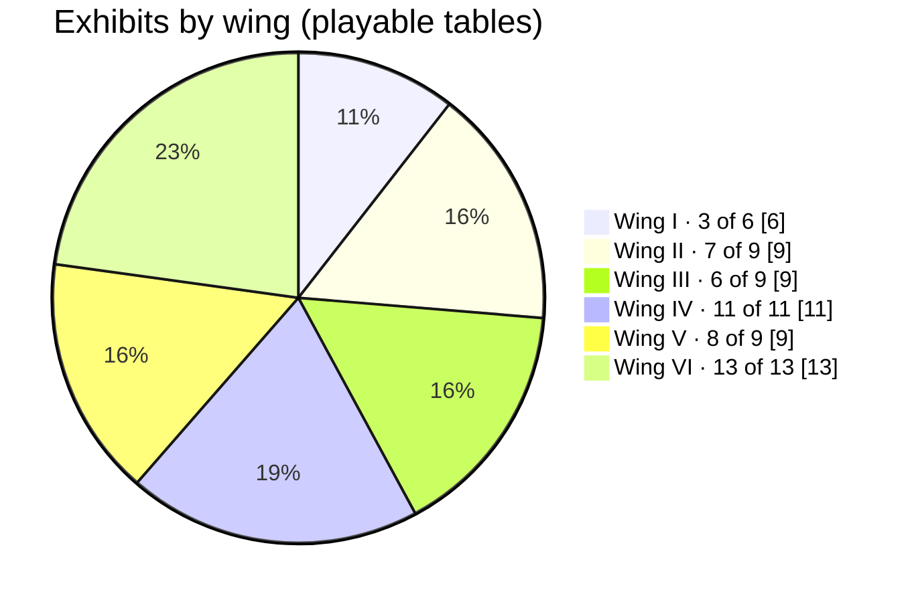
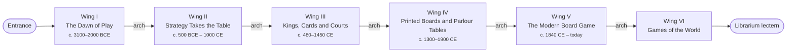
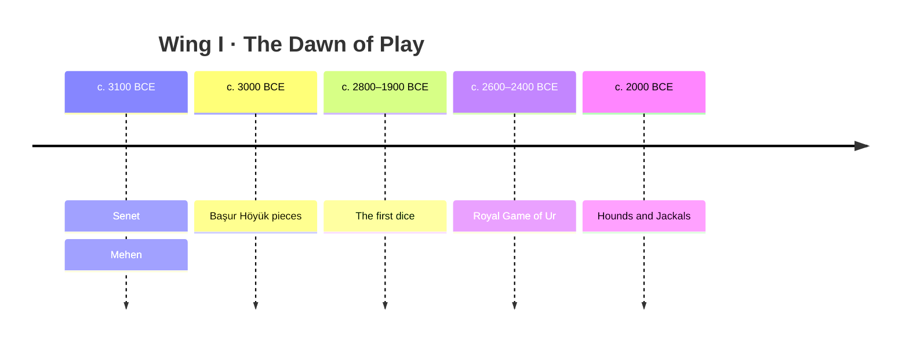
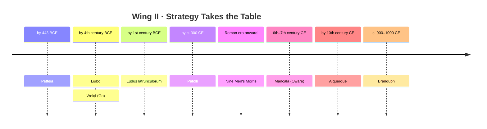
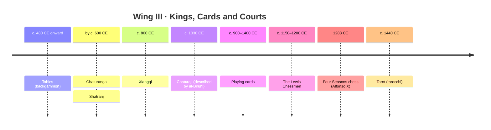
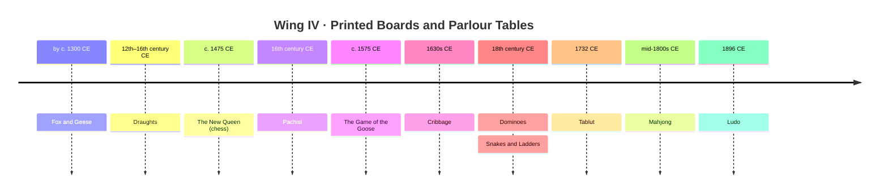
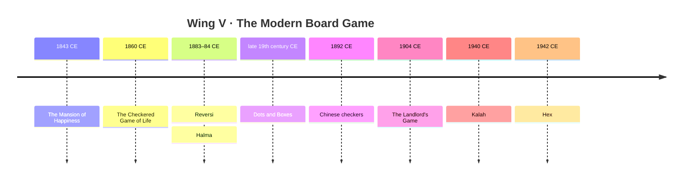
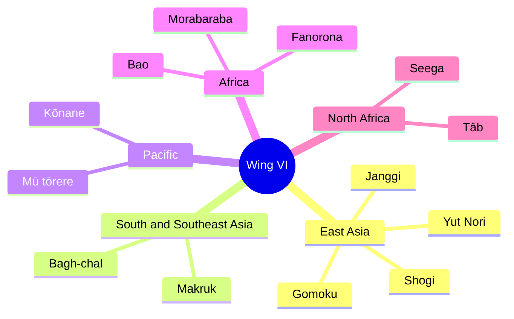

# The exhibits

The Archives are one long hall in six wings, walked in date order from the first board games to games still played around the world today. Each exhibit has a placard (history, dates and how sure we are of the rules) and, where the rules are known well enough, a table where the visitor plays the Scribe.

**57 exhibits, 48 of them playable.** The hall ends at a lectern featuring Librarium's own games (Phoenix Farm, Calendra, The Great Chase and Royal Threadcount) under an arch signed *Different fables for different tables*.

How the **Rules** column reads:

| Status | Meaning |
| --- | --- |
| Unbroken tradition / Still played | The game never stopped being played; we follow today's rules. |
| Survive in writing / in print / in the patent | A historical text gives the rules; the placard names it. |
| Reconstructed / Partly reconstructed | No full rules survive; we play a modern reconstruction and say whose. |
| Lost / Game unknown | Shown on display only; we do not invent rules. |

The **id** used in the plugin's `start` attribute and the debug API is listed for each wing in [WordPress](wordpress.md#exhibit-ids).

## Wing I: The Dawn of Play (c. 3100–2000 BCE)

| Exhibit | Date | Rules | In the Archives |
| --- | --- | --- | --- |
| Senet | c. 3100 BCE | Reconstructed (after Kendall, 1979) | Playable |
| Mehen | c. 3100–2300 BCE | Lost | On display |
| Başur Höyük pieces | c. 3000 BCE | Game unknown | On display |
| Royal Game of Ur | c. 2600–2400 BCE | Survive in writing (tablet, c. 177 BCE; Finkel) | Playable |
| The first dice | c. 2800–1900 BCE | Still rolled | On display (Burnt City and Indus-style dice, newly made) |
| Hounds and Jackals | c. 2000 BCE | Lost | Playable as a modern reconstruction (Howard Carter, 1912) |

Senet's rules were never written down, so the table plays a modern reconstruction (after Kendall). The Royal Game of Ur follows Irving Finkel's reading of a Babylonian rules tablet of c. 177 BCE. Mehen and the Başur Höyük pieces are shown without rules because none survive.

- **Hounds and Jackals:** a modern reconstruction, and the placard says so. It follows the route Howard Carter proposed in 1912, which "Hounds and Jackals in Modern Times" (ISAW Papers 22.4) calls the likeliest. Each side races five pins up its own track of 29 holes to the goal; one pin to a hole, the goal by exact throw. Landing on 20 slides a pin back to 6, and landing on 10 back to 8; holes 15 and 25 (the "good" signs) give another throw. The four stick dice (1 to 4 white sides, none counting 5) are our choice; Carter suggested dice or knucklebones.

## Wing II: Strategy Takes the Table (c. 500 BCE – 1000 CE)

| Exhibit | Date | Rules | In the Archives |
| --- | --- | --- | --- |
| Petteia | by 443 BCE | Mostly lost | On display (the board is our guess) |
| Liubo | by the 4th century BCE | Lost; reconstructions only | On display (after the Mawangdui set) |
| Weiqi (Go) | by the 4th century BCE | Unbroken tradition | Playable on a 9 × 9 board; the 17 × 17 Han-style board is on display |
| Ludus latrunculorum | by the 1st century BCE | Lost | Playable as a modern reconstruction (Locus Ludi, "Piso" rules) |
| Patolli | by c. 300 CE | Partly recorded (Durán) | Playable as a modern reconstruction (reed mat, beans and stones) |
| Nine Men's Morris | Roman era onward | Survive in tradition | Playable |
| Mancala (Oware) | c. 6th–7th century CE (Aksum) | Survive in tradition (abapa) | Playable |
| Alquerque | by the 10th century CE | Reconstructed (R. C. Bell, from Alfonso X) | Playable |
| Brandubh | c. 900–1000 CE (Ballinderry board) | Reconstructed | Playable, as the king's side |

Rule choices, each a modern reconstruction stated as such on the placard:

- **Ludus latrunculorum:** the "Piso" rules of Locus Ludi (University of Fribourg). An 8 × 8 board; twenty counters each, placed one at a time with no captures. Then a counter steps one square orthogonally, and may not step straight back to the square it just left. A counter trapped between the mover and another enemy counter along a line is taken, several at once if so; a counter in a corner is trapped by the two squares beside it; moving between two enemies is safe. The game ends when a player is down to one counter or cannot move, and whoever has taken more wins. House rule: 30 moves each without a capture also ends it.
- **Patolli:** the reconstruction most often given today, from Diego Durán's account. 52 houses; six markers and six treasures each; five beans (1 to 4 marks move that many, all five move 10, none costs an offering to Macuilxochitl). A 1 enters a marker on its centre house; markers run the whole circuit clockwise and leave by exact count. No landing on an occupied house except in the centre, where an enemy is sent back and its owner pays a treasure. Dark houses cost a treasure; red tips give another throw. Our choices: a treasure is paid for each completed circuit, the game is one round, and when one side has all six markers home (or after 150 throws each) the side with more treasures wins. A player who cannot pay loses.

## Wing III: Kings, Cards and Courts (c. 480–1450 CE)

| Exhibit | Date | Rules | In the Archives |
| --- | --- | --- | --- |
| Tables (backgammon) | c. 480 CE onward | Modern backgammon, no cube | Playable |
| Chaturanga | by c. 600 CE | Partly lost (the elephant's move) | On display, on an ashtapada board |
| Shatranj | c. 600–1200 CE | Survive in writing (al-Adli, as-Suli) | Playable |
| Xiangqi (Chinese chess) | c. 800 CE | Modern rules, settled by the Song dynasty | Playable |
| Chaturaji (chess for four) | described c. 1030 CE | Partly reconstructed (al-Biruni, read by Murray) | Playable, you and three Scribes |
| The Lewis Chessmen | c. 1150–1200 CE | Medieval European chess | On display (simplified figures, not copies) |
| Four Seasons chess | 1283 CE | Partly reconstructed (Alfonso X's Book of Games) | Playable, you and three Scribes |
| Playing cards | c. 900–1400 CE | Earliest games lost | On display (new designs in old styles) |
| Tarot (tarocchi) | c. 1440 CE | Still played as a card game | Playable as a simplified tarocchi for two; trumps on display (new paintings in the Milan style) |

Rule choices:

- **Chaturaji:** al-Biruni's game as H. J. R. Murray read it, each of the four armies for itself. Two ordinary dice: 1 or 5 moves the king or a pawn, 2 the boat, 3 the horse, 4 or 6 the elephant; each die is one optional move, in either order. The elephant moves like a rook and the boat jumps two squares diagonally; there is no check, and kings are captured. A pawn on the far edge becomes the piece whose line it reached, but only if that piece has been lost. A boat that completes a square of four boats takes the other three. Captures score king 5, elephant 4, horse 3, boat 2, pawn 1. A player without a king is out, and that army stays on the board. You win by being the last king standing (taking all three yourself is chaturaji) and lose with your king; after 30 rounds the highest score among the kings left wins. Left out: partnerships, the throne rule (sinhasana) and ransoming kings, on which accounts differ.
- **Four Seasons chess:** Alfonso X's acedrex de los quatro tiempos as Murray and Bodlaender read it, each army for itself and without dice. Armies of king, rook, knight, alfil and four pawns start in the corners (you are Red, in a1); Green moves first and play goes Green, Red, Black, White. The alfil leaps exactly two squares diagonally; pawns step one square without a double step, two of each army's pawns going along the files and two along the ranks, and become generals (one square diagonally) at the edge. You may not leave your king in check. A player checkmated is out and the whole army passes to the mater; taking a king counts the same; a player stalemated is out and the army leaves the board. Mates and stalemates are judged as soon as a move is made. The last army left wins; after 60 rounds the strongest army still in play wins (rook 5, knight 3, general 2, alfil 1½, pawn 1). The centre diagonals are decoration.
- **Tarocchi:** the rules of the first tarot games of the 1440s were never written down, so the table plays a simplified two-player game built on what every tarot game still shares: follow suit, trump if you cannot, and the Fool as an excuse. Thirteen cards each; kings 5, queens 4, knights 3, jacks 2, trumps I and XXI and the Fool 5, and 1 for each trick.

## Wing IV: Printed Boards and Parlour Tables (c. 1300–1900 CE)

| Exhibit | Date | Rules | In the Archives |
| --- | --- | --- | --- |
| Fox and Geese | by c. 1300 CE | Survive in tradition; many local variants | Playable, as the fox |
| The New Queen (chess) | c. 1475 CE | Survive in writing (*Scachs d'amor*; Lucena) | Playable as modern chess; the old firzan and the new queen stand beside the board |
| Draughts | c. 1100s–1500s CE | English draughts (checkers) | Playable |
| Pachisi (chaupar) | 16th century CE | Still played; ancestor of Ludo | Playable for two (you play two partner colours), short or full game |
| The Game of the Goose | c. 1575 CE | Survive in print | Playable |
| Cribbage | 1630s CE | Still played | Playable: two-player six-card cribbage, to 61 or 121, pegged on a board |
| Dominoes | 18th century CE (Europe) | Still played | Playable: the two-player Draw game |
| Tablut | recorded 1732 CE (Linnaeus) | Partly reconstructed | Playable, as the king's side |
| Snakes and Ladders (gyan chaupar) | 18th–19th century CE | Still played | Playable, with virtues and vices from an old Indian board |
| Ludo | 1896 CE | Still played | Playable: red against yellow, one die |
| Mahjong | mid-1800s CE | Still played | Playable at a table of four: you and three Scribes |

Rule choices:

- **Fox and Geese** is played on the plain cross board (no diagonal lines) with 13 geese that may move forward or sideways but never back. A **house rule** lets the fox win if the geese go twenty moves each without advancing or losing a goose: without it, games with sideways moves can go on forever.
- **Chess:** modern rules, with castling and en passant. Pawns always promote to a queen; there is no draw by repetition, but stalemate, bare kings and the fifty-move rule are draws.
- **Pachisi:** six cowries (2, 3, 4, 5; one mouth up is 10, none 25, all six 6). A 6, 10 or 25 is a grace and earns another throw, as does a capture. Each colour's first piece may come out on any throw, later ones only on a grace. Castles are safe and can't be entered while the enemy holds them. No throw is 1, so a piece may not stop on the last square before home. The short game gives each colour two pieces (about a hundred throws), the full game four.
- **The Goose:** a throw of 9 from the start goes to 26 (6 and 3) or 53 (5 and 4), whenever the piece is at the start, since geese every nine squares would otherwise fly it straight home. With two players, the Well and the Prison hold a player for two and three turns instead of until someone else arrives.
- **Cribbage:** the standard two-player six-card game. The Scribe deals first and the deal alternates; the play, the go and the show are scored for you, and pegs leapfrog along the board. One game to 61 by default, or 121 (a lurch is noted but not doubled).
- **Dominoes:** the Draw game for two from pagat.com: seven tiles each, draw from the boneyard until you can play but never the last two, and the lower pip count wins when the hand ends. One hand is played rather than a game to 100.
- **Tablut:** Linnaeus's 9 × 9 game read as most players read it today: the Muscovites move first, the king escapes to any edge square, he is armed, and he is captured by two except on or beside the throne (four, or three and the throne). Only the king may stop on the throne. House rule: a hundred moves each without a result is a draw.
- **Ludo:** two players, red and yellow, from opposite corners. A six brings a token out or moves one, and earns another throw; landing on an enemy token sends it to its yard; your home column is safe; the finish needs the exact throw. There are no blocks or safe squares on the track.
- **Mahjong:** a basic Chinese game with the 136 tiles (no flowers or seasons). Go out with four sets and a pair, seven pairs or the thirteen orphans. You may claim a discard for a pung or kong from anyone, a chow only from the player on your left, and a win from anyone; a win beats a pung or kong, which beats a chow. A kong draws a replacement tile. There is no scoring: whoever goes out first wins the hand, and an empty wall is a draw.

## Wing V: The Modern Board Game (c. 1840 CE – today)

| Exhibit | Date | Rules | In the Archives |
| --- | --- | --- | --- |
| The Mansion of Happiness | 1843 CE | Survive in print | Playable: all 67 squares of the 1843 Ives board, with a teetotum |
| The Checkered Game of Life | 1860 CE | Survive in print | On display |
| Reversi | 1883 CE | Survive in print; played today as Othello | Playable, from the Othello opening |
| Halma | 1883–84 CE | Still played, as Chinese checkers | Playable, two players with 19 men each |
| Dots and Boxes | late 19th century CE | Survive in print (Lucas's *pipopipette*) | Playable, on a 4 × 4 or 5 × 5 grid of boxes |
| Chinese checkers (Stern-Halma) | 1892 CE | Still played | Playable, two players with ten marbles each |
| The Landlord's Game | 1904 CE | Survive in the patent | Playable, on a board read from the patent drawing |
| Kalah | 1940 CE | Survive in print | Playable, with 3, 4 or 6 seeds a pit |
| Hex | 1942 CE | Still played | Playable on 7 × 7, 9 × 9 or 11 × 11, with the swap rule |

- **The Mansion of Happiness:** every square read from a scan of the 1843 W. & S. B. Ives board, played by the seventeen rules printed with the game (as reprinted for the 1894 edition). A teetotum of 1 to 6. Poverty, the Whipping Post, the Pillory, the Stocks, Prison and Ruin are not counted when moving. The thirteen virtues advance six squares; Audacity, Cruelty, Immodesty and Ingratitude send you back to where you were; the Water (6) carries you to 10 and the Inn (9) to 12. Passion goes to the Water, Idleness to Poverty, the Road to Folly back to Prudence, a Sabbath Breaker to the Whipping Post, a Perjurer to the Pillory, a Drunkard to the Stocks and the Summit of Dissipation to Ruin; a Cheat spends one turn in the House of Correction and a Robber two in Prison, then begin again, unless freed by another player guilty of the same crime. Landing on another counter sends it back to where you came from. Exact count to 67; an overshoot goes to the Seat of Expectation (60), a second one to the start. Left out: two clauses of the rule for crimes on an occupied square. The squares reached by a virtue's six do not act again. You play the red counter against one Scribe.

Rule choices:

- **Reversi** starts from the four centre discs of Othello rather than the empty board of the 1880s. A player with no legal move passes; the game ends when neither can move.
- **Halma:** a man in the far camp may not leave it, and a full far camp with at least one of your men in it wins, so neither side can block by staying home. A house rule ends the game after two hundred moves each.
- **Dots and Boxes:** closing a box scores it and you must draw again. The Scribe plays the whole of its turn, so it may take several boxes in a row.
- **Chinese checkers:** ten marbles each in opposite points of the star. A move is a step or a chain of hops over single marbles of either colour; nothing is captured. A full far point with at least one of your marbles in it wins. House rule: after a hundred and fifty moves each, more marbles home wins.
- **The Landlord's Game** follows U.S. Patent 748,626 (1904). The board's forty spaces, prices, rents and taxes are read from the patent drawing: Mother Earth, 22 lots priced at ten times their number, four absolute necessities, four railroads, three luxuries, two franchises, Legacy, the Public Park and poorhouse, the jail, and Lord Blueblood's No Trespassing corner. The rules are the patent's, for two players: lot tickets at the start, buy or rent, $100 wages, $5 taxes and fares, $50 luxuries worth $60 at the end, franchise charters, jail with a $50 fine or a double, railroad rides on a double, Bank notes at $5 interest, and the poorhouse. It is three times round by default, or five as in the patent (a table variant). The patent's rule for two checkers sharing a lot is left out, and loans and repayments are made for you.
- **Kalah:** sow anticlockwise past your own store but never the Scribe's; a last seed in your store moves again, and one in your own empty pit captures the pit opposite (if it holds seeds). When a side is empty, the other side keeps its seeds.
- **Hex:** red (you) joins the near and far edges, blue the sides. After your first stone the Scribe may use the swap rule: it takes the stone, reflected across the board into blue, and you move again.

## Wing VI: Games of the World

Games from the Pacific, Africa and Asia that the long road of the earlier wings passes by, grouped by where they are played rather than by date.

| Exhibit | Date | Rules | In the Archives |
| --- | --- | --- | --- |
| Mū tōrere | first described in 1917 (Elsdon Best) | Accounts differ | Playable |
| Shogi | oldest pieces c. 1058 CE (Kōfuku-ji) | Unbroken tradition | Playable, with drops |
| Gomoku | named renju in 1899 | Still played | Playable, freestyle on 15 × 15 |
| Makruk | traditional | Still played | Playable, with the counting rules kept for you |
| Bagh-chal | traditional | Still played | Playable as either side |
| Kōnane | by 1778–79 (Cook's expedition) | Still played | Playable on an 8 × 8 papamū |
| Yut Nori | traditional | Still played | Playable, with shortcuts, stacking and extra throws |
| Janggi | traditional | Still played | Playable, with passing and bikjang decided on points |
| Fanorona | traditional | Still played | Playable (fanoron-tsivy, 5 × 9) |
| Bao | in verse by the 1820s | Still played | Playable (Bao la Kujifunza, the learners' game) |
| Morabaraba | traditional | Still played | Playable: twelve cows each, on the board with diagonals |
| Seega | recorded in the 1820s (Lane, 1836) | Survive in writing | Playable on the five-cup board |
| Tâb | recorded in the 1820s (Lane, 1836) | Survive in writing | Playable on four rows of nine, without stacking |

Rule choices:

- **Mū tōrere:** a man may move into the centre only from an arm next to an enemy man, the rule most often given today (without it the first player can win at once). House rule: thirty moves each is a draw; perfect play draws anyway.
- **Shogi:** drops follow the full rules (no second unpromoted pawn on a file, no dead pieces, no pawn-drop mate). Promotion is automatic whenever it is allowed, and a 150-move limit replaces the repetition rule.
- **Gomoku:** freestyle: five or more in a row wins, with none of renju's restrictions on black.
- **Makruk:** Thai rules: no castling, no double pawn step, promotion on the sixth rank to a met, stalemate drawn. The counts: once no unpromoted pawn is left, mate must come within 64 moves; once a side has only its khun, the other must mate within a limit set by its pieces (8 with two rueas, 16 with one, 22 with two khons, 32 with two horses, 44 with one khon, otherwise 64), counted from the number of pieces on the board.
- **Kōnane:** black lifts a stone from the centre or a corner, white lifts one beside the gap, and from then on every move is a capture. Multiple jumps run in a straight line and may stop anywhere. The first player who cannot capture loses.
- **Yut Nori:** a piece that starts its move on a corner or the centre takes the shortcut; your own pieces stack and move together; a yut, a mo or a capture earns another throw. Each throw is moved at once rather than saved up, and there is no back-do.
- **Janggi:** the inner-elephant setup for both sides (horse, elephant, elephant, horse). Pieces move as in Korea, cannons included; you may pass unless in check. If the generals face each other on an open file (bikjang) and the next player does not block it, or both sides pass in a row, or after two hundred moves each, the game is decided on points: chariot 13, cannon 7, horse 5, elephant 3, guard 3, soldier 2, and 1.5 to Han. Repetition is not policed.
- **Fanorona:** captures by approach or withdrawal take the whole unbroken line. You choose a capture by clicking the first enemy stone it would take, which also settles approach against withdrawal. A capture chain may not revisit a point or repeat a direction, and the **Stop** button ends it early. House rule: twenty moves each without a capture is a draw.
- **Bao la Kujifunza:** every pit starts with two seeds and the house is an ordinary pit. A move sows a pit of two or more seeds either way round your own sixteen pits. If you can capture you must: a last seed landing in an occupied pit of your inner row takes the Scribe's seeds opposite, which are sown from an end of your row (the nearer end for a capture in the two pits at either end, otherwise the end that keeps your direction). Landing in any other occupied pit picks it up and sows on; a turn ends in an empty pit. A turn that cannot capture must start from the inner row if it can, and never captures. An empty inner row, or no move, loses. House rule: after a hundred moves each, the side with more seeds wins.
- **Bagh-chal:** four tigers on the corners against twenty goats placed one a turn, goats first; goats move only once all are down. A tiger takes one goat a turn by jumping it along a line; capture is never compulsory. Tigers win with five goats, goats by leaving the tigers no move. Once all goats are placed no position may repeat. A side with no move loses; a hundred moves each without a result is a draw (house rule). You choose your side.
- **Seega:** Lane's five-cup board: twelve pieces each, placed two at a time, never on the centre; the first move must enter the centre. A piece trapped between the mover and another enemy piece along a row or column is taken (several at once if so), moving between two enemies is safe, and a player who has captured keeps moving while another capture is open. A player whose move leaves the other side no move must lift one of their own pieces to open a way, as Lane describes for the opening. Taking every enemy piece wins; twenty moves each without a capture end the game in favour of the larger side (house rule).
- **Tâb:** four rows of nine. Four palm sticks: 1 (a tâb), 2, 3, 4, or 6 for no white face; a tâb, 4 or 6 throws again. A piece needs a tâb to start. Pieces run along their own row, back along the next, out along the third, then round the two middle rows; once in its life a piece may go through the enemy's home row instead, and it cannot move there while its owner has pieces at home. Landing on an enemy piece takes it; you may not land on your own. Each throw is moved at once, and Lane's stacking is left out. Taking every enemy piece wins; after 150 throws each the side with more pieces wins (house rule).
- **Morabaraba:** Mind Sports South Africa's rules on the board with diagonals: twelve cows each, mills along any line including the diagonals, flying at three, and a draw when both sides have three and no cow is shot in ten moves each. The rule that a broken mill cannot be remade at once is left out, and a mill always shoots.

## Not yet playable

| Exhibit | Why it stays on display |
| --- | --- |
| Mehen, Başur Höyük pieces | No rules survive. |
| Petteia, Liubo | Only partial or competing reconstructions. |
| Chaturanga | The elephant's move is uncertain. Its four-handed relative, chaturaji, is playable next to Xiangqi. |
| The Lewis Chessmen, Playing cards | Shown as objects; their games are covered at Shatranj and Tarocchi. |
| The Checkered Game of Life | The rules sit square by square on the original board; we need a checkable scan or transcription. |
| Hare and Hounds (not yet an exhibit) | Sources disagree on the lines of its eleven-point board. |

See the [roadmap](roadmap.md).
