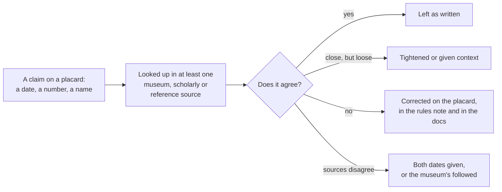
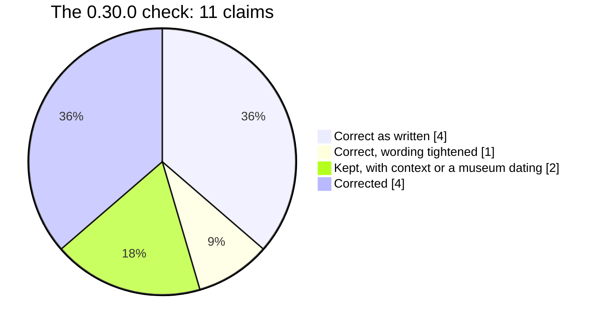

# Placard fact-check

The placards' dates, numbers and attributions were checked for 0.30.0. This page lists the claims that looked shaky, what the sources say, and what changed. Claims not listed here were read and left alone.

| Placard | Claim as it stood | What the sources say | Verdict |
| --- | --- | --- | --- |
| Senet | Rules follow "Timothy Kendall's 1979 work" | Kendall's *Passing Through the Netherworld* is dated 1978; the first printing of his rules is sometimes given as 1979 | Changed to "first published in 1978 and revised since" (also in the rules note and docs/exhibits.md) |
| Dice | "On one of them the opposite faces add up to seven" | Most Indus dice put 1 opposite 2, 3 opposite 4, 5 opposite 6 (Marshall, via harappa.com); at least one Mohenjo-daro die sums to seven | Kept, and the usual numbering added so the exception isn't read as the rule |
| Petteia | Cratinus mentions it in 443 or 442 BCE | His *Drapetides*, 443/442 BCE, is the earliest known reference | Correct |
| Liubo | Rule slips "found in the tomb of the Marquis of Haihun in 2019" | The tomb was excavated by 2015; the 1,000+ liubo slips were reported in March 2019 | Changed to "opened in 2015, were reported in 2019" |
| Tables | "Backgammon" first appears in English in 1647 | The OED's first citation is 1647; Louis IX's ban 1254, Alfonso X's book 1283, the doubling cube 1920s New York | Correct |
| Lewis chessmen | Four warders bite their shields; fourteen plain discs; a buckle | Four berserker warders; fourteen tablemen, largely undecorated; a belt buckle | Correct; "plain discs" softened to "mostly plain discs" |
| Tarot | "Etteilla wrote about divination with tarot around 1770" | 1770 was his method for ordinary cards; his tarot book is 1783, his deck 1789. Court de Gébelin 1781 and Rider-Waite 1909 hold | Changed to "a way of reading ordinary cards in 1770 … the tarot in 1783" |
| Game of the Goose | "a goose about every nine squares" | Geese stand on 5, 9, 14, 18, 23, 27 … : two runs nine apart, so one every four or five squares | Changed to "geese every four or five squares" |
| Game of the Goose | A French game of chronology in 1638 | The *Jeu chronologique* of 1638 is the earliest known teaching adaptation | Correct |
| Reversi | Goro Hasegawa, a salesman, patented Othello in 1971 | Patented in Japan in 1971, when he was a 38-year-old salesman | Correct |
| Jungle | Waddington's Jungle King in the 1950s | The V&A dates its Waddington set to the 1950s; Wikipedia says the 1960s | Kept, on the museum's dating |

## Sources

- [Lewis chessmen](https://en.wikipedia.org/wiki/Lewis_chessmen), Wikipedia
- [Etteilla](https://en.wikipedia.org/wiki/Etteilla), Wikipedia
- [Backgammon](https://en.wikipedia.org/wiki/Backgammon), Wikipedia
- [Game of the Goose](https://www.wikiwand.com/en/articles/Game_of_the_Goose), Wikipedia via Wikiwand
- [Reversi](https://www.wikiwand.com/en/Reversi), Wikipedia via Wikiwand
- [Dice](https://en.wikipedia.org/wiki/Dice), Wikipedia
- [Ancient Indus die](https://www.harappa.com/blog/ancient-indus-die) and [ancient Indus dice](https://www.harappa.com/blog/ancient-indus-dice), Harappa.com
- [Rules of liubo found in China](https://archaeology.org/news/2019/03/13/190313-china-game-rules/), Archaeology, 13 March 2019
- [Polis (board game)](https://wiki.krisyotam.com/content/wikipedia_en_all_nopic_2026-03/Petteia), Wikipedia mirror
- [Senet](https://encycloreader.org/r/wikipedia.php?q=Senet), Wikipedia via EncycloReader
- [Jungle (board game)](https://en.wikipedia.org/wiki/Jungle_(board_game)) and the [V&A's Jungle King](https://collections.vam.ac.uk/item/O26146/jungle-king-board-game-john-waddington-ltd)

## The card room (0.32.0)

The four new placards were written from these sources. Each claim was checked against at least one of them.

| Placard | Claims | Source |
| --- | --- | --- |
| Court Cards | The English courts descend from Pierre Marechal's Rouen pack of c. 1565, which survives at Rouen; Tudor headdresses; the "suicide king"; French court names fixed by the 1600s (David, Charles, Caesar, Alexander), never adopted in England; double-ended courts from the mid-1800s | WOPC, History of Court Cards |
| Cards Not for Playing | Card money in New France under Jacques de Meulles, 1685, to pay the troops; values on the plain backs, corners cut to tell the values apart, signed by officials; withdrawn 1717 | Bank of Canada Museum; Wikipedia, Card money |
| | Grace's Card: the six of hearts, "Tell your master I despise his offer", Baron Grace of Courtstown, Kilkenny | Brewer's *Dictionary of Phrase and Fable*; WOPC, Secondary Uses (which dates it 1689) |
| | University of Pennsylvania admission cards, 1765; Voltaire's note "est venu quatre fois"; invitations on card backs | WOPC, Secondary Uses |
| Scopa | "Broom"; especially popular in Naples in the 1700s; Latin suits from the Mamluk coins, cups, swords and polo sticks; chkobba; scopone in partnerships | Wikipedia, Scopa; pagat.com; WOPC, History of Playing Cards |
| Bézique | First printed rules in Paris, 1847; most fashionable around 1860; reached England 1861; Churchill and six-pack bézique; binokel and pinochle | Wikipedia, Bezique; pagat.com |

The rules of both new tables follow pagat.com. Not checked, so left out: the claim that Scopa came from Spanish games played by pirates in Naples' port, and Wilkie Collins as a bézique player.

- [WOPC: History of Court Cards](https://www.wopc.co.uk/playing-cards/history-of-court-cards)
- [WOPC: Secondary Uses of Playing Cards](https://www.wopc.co.uk/playing-cards/secondary-uses-of-playing-cards)
- [WOPC: History of Playing Cards](https://www.wopc.co.uk/the-history-of-playing-cards/)
- [Playing cards as money](https://bankofcanadamuseum.ca/?p=8362), Bank of Canada Museum, and [Card money](https://en.wikipedia.org/wiki/Card_money), Wikipedia
- [Grace's Card](https://words.fromoldbooks.org/Brewer-DictionaryOfPhraseAndFable/g/graces-card-or-grace-card.html), Brewer's Dictionary of Phrase and Fable
- [Scopa](https://en.wikipedia.org/wiki/Scopa), Wikipedia, and [Scopa](https://www.pagat.com/fishing/scopa.html), pagat.com
- [Bezique](https://en.wikipedia.org/wiki/Bezique), Wikipedia, and [Bezique and variations](https://www.pagat.com/marriage/Bezique_and_Variations.html), pagat.com

## The card room, part two (0.34.0)

| Placard | Claims | Source |
| --- | --- | --- |
| Euchre | Probably from Jucker of Alsace; "Eucre" in America in 1810; bowers on a Midwest steamboat in 1829; first surviving rules 1844; the national card game in the late 1800s; bower from German *Bauer*; still played in the Midwest, upstate New York, Canada, Australia, New Zealand, Cornwall and Devon | Wikipedia, Euchre |
| | The Joker added for euchre as an extra top trump, first called the Best Bower: "1850s" (pagat.com, Wikipedia) or "around 1863" in American packs (WOPC); in English packs around 1880; early jokers as jesters, some sinister; makers' identifiers | pagat.com; WOPC, The Joker; Wikipedia |
| Patience | First in print in 1788 in *Das neue Königliche L'Hombre-Spiel*; after cartomantic layouts of about 1765; Danish and Norwegian *kabal*; France early 1800s, Britain and America later; Lady Cadogan's *Illustrated Games of Patience*, about 1870 (1874 in the references); Klondike with Windows from 1990 | Wikipedia, Patience (game) |
| Ganjifa | Persian origin, popular at the Mughal court in the 16th century; Babur sent a pack in 1527; ivory with stones, tortoiseshell, and cheap packs of wood, palm leaf, cloth or pasteboard; 96 cards in 8 suits of 12, mir and wazir; the eight suits named; Dashavatara's ten avatars; three or more players, tricks, no trumps, reversed suits, day and night leads; decline in the 20th century; still made in Sawantwadi, Odisha, Bishnupur and elsewhere | Wikipedia, Ganjifa; WOPC, Ganjifa |

Ganjifa is on display only. Its rules survive from about 1600, but the details of play, such as the *deni* and *utari* leads, are not set out in any source checked here, so no table was built.

- [Euchre](https://en.wikipedia.org/wiki/Euchre), Wikipedia, and [Euchre](https://www.pagat.com/euchre/euchre.html), pagat.com
- [The Joker](https://www.wopc.co.uk/playing-cards/the-joker-card), WOPC
- [Patience (game)](https://ipfs.ssi.eecc.de/ipns/en.wikipedia-on-ipfs.org/wiki/Patience_(game)), Wikipedia mirror
- [Ganjifa](https://en.wikipedia.org/wiki/Ganjifa), Wikipedia, and [Ganjifa](https://www.wopc.co.uk/explore/suit/ganjifa/), WOPC

## The card room, part three (0.35.0)

| Placard | Claims | Source |
| --- | --- | --- |
| Karnöffel | First named in a Nördlingen ordinance of 1426 among the games allowed at the annual fair; Meissner's poem of about 1450; the chosen Unter beats everything, the Devil, Pope and Emperor next; a sermon of 1496 attacked the game for its upside-down order; a satirical dialogue of 1546 between the Pope and the Devil; played in Switzerland by about 1500, then Berlin and Lübeck; the Kaiserspiel found again in the 1970s; Bräus on Gotland and Brús in Iceland | Wikipedia, Karnöffel; David Parlett, The oldest card game |
| Ombre | From Spain around 1600; *hombre*, "the man"; the first game with trumps set by bidding; English rules printed in 1660; said to have come with Catherine of Braganza; a three-sided table by 1700; Belinda's game in Pope's *The Rape of the Lock* (1714), detailed enough to reconstruct the deal; overtaken by quadrille and whist; l'Hombre in Denmark, the Faroes and Iceland, Tresillo, Rocambor | Wikipedia, Ombre; pagat.com, L'Hombre |
| Cassino | First recorded in 1792 in Robert Long's *Short Rules for Playing the Game of Casino*; no evidence of play in Italy, and scopa and scopone are mentioned later; Austrian rules of 1795 with English terms; revived in America in the later 1800s and eclipsed by gin rummy; Cassino in the US, casino in Europe; big cassino the ten of diamonds, little cassino the two of spades | Wikipedia, Cassino (card game) |
| Conquian | First known mention in Mexico City, 1857, with a 40-card Spanish pack; in Texas by the 1860s, popular in neighbouring states by 1900; the first full English description in Foster's *Complete Hoyle* (1897); Foster's 1913 book subtitled "also called Rum"; the ancestor of the western rummies | pagat.com, Conquian |

Karnöffel's rules are a reconstruction: the descriptions agree on the chosen suit's powers but differ in detail (whether the Devil is barred from the first trick or only from leading to it, and how the stake was raised), and the table follows Wikipedia's account and a point a deal. Not used: the name of the preacher of 1496, which only one source gives.

- [Karnöffel](https://en.wikipedia.org/wiki/Karn%C3%B6ffel), Wikipedia, and [The oldest card game](https://parlettgames.uk/histocs/karnoeffel.html), David Parlett
- [Ombre](https://en.wikipedia.org/wiki/Ombre), Wikipedia, and [L'Hombre](https://pagat.com/lhombre/lhombre.html), pagat.com
- [Cassino (card game)](https://ipfs.ssi.eecc.de/ipns/en.wikipedia-on-ipfs.org/wiki/Cassino_(card_game)), Wikipedia mirror
- [Conquian](https://www.pagat.com/rummy/conquian.html), pagat.com

