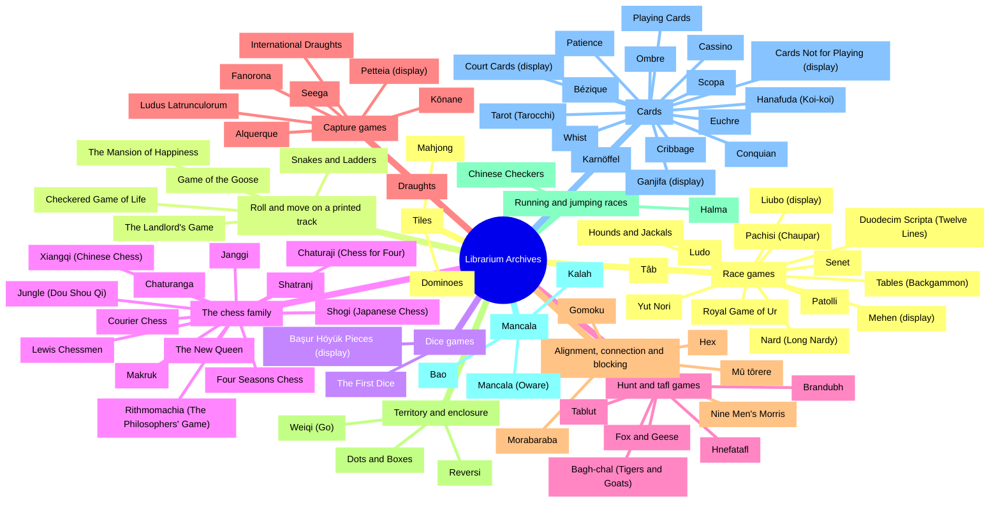
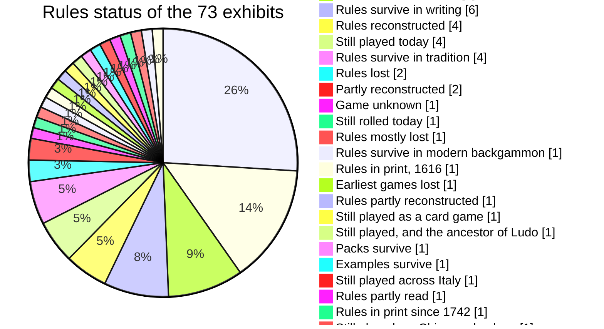
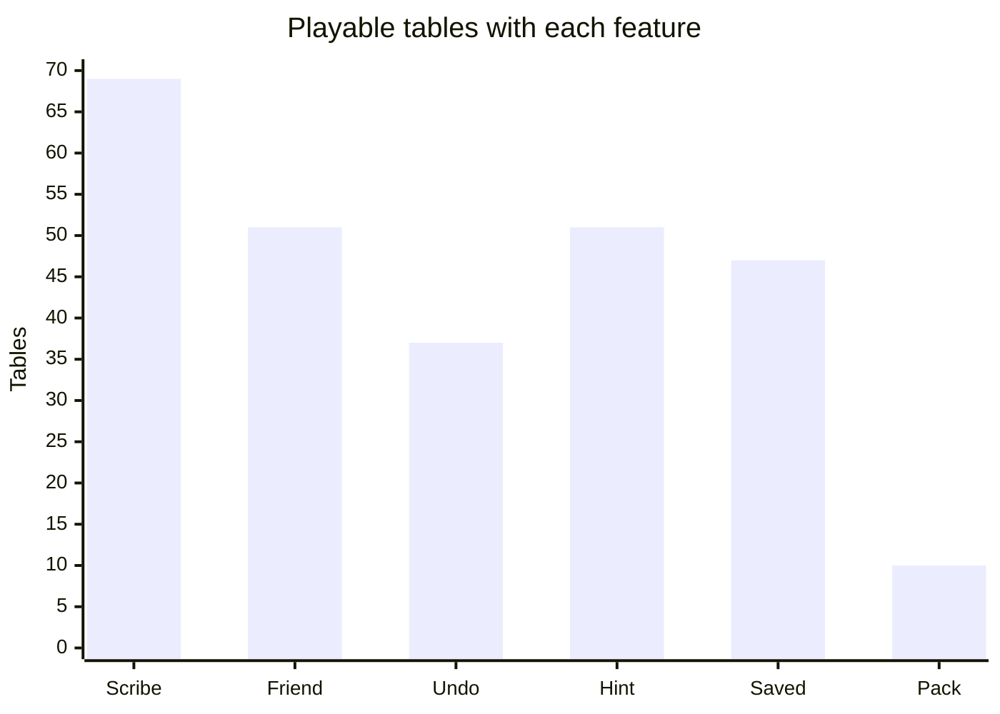
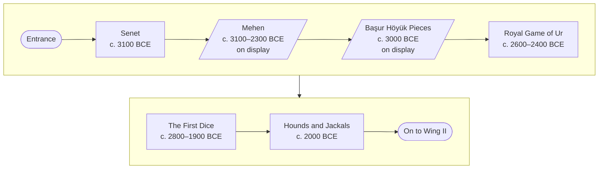
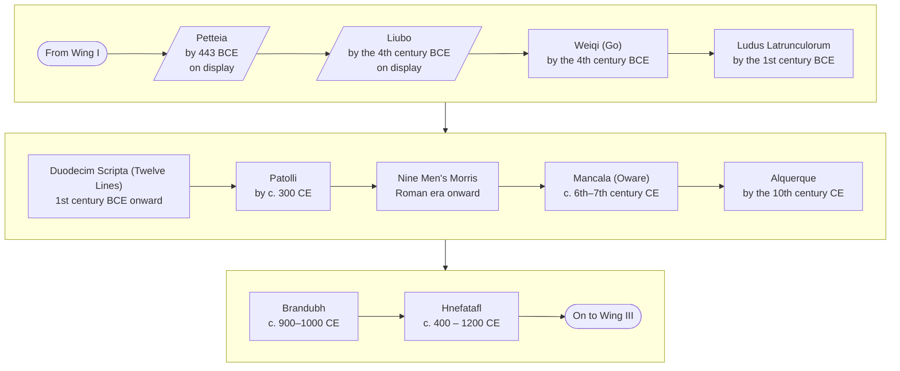
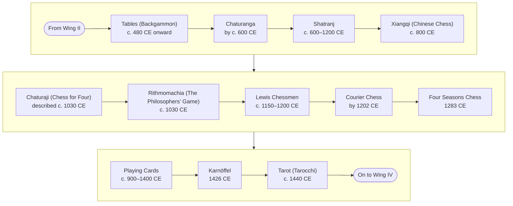
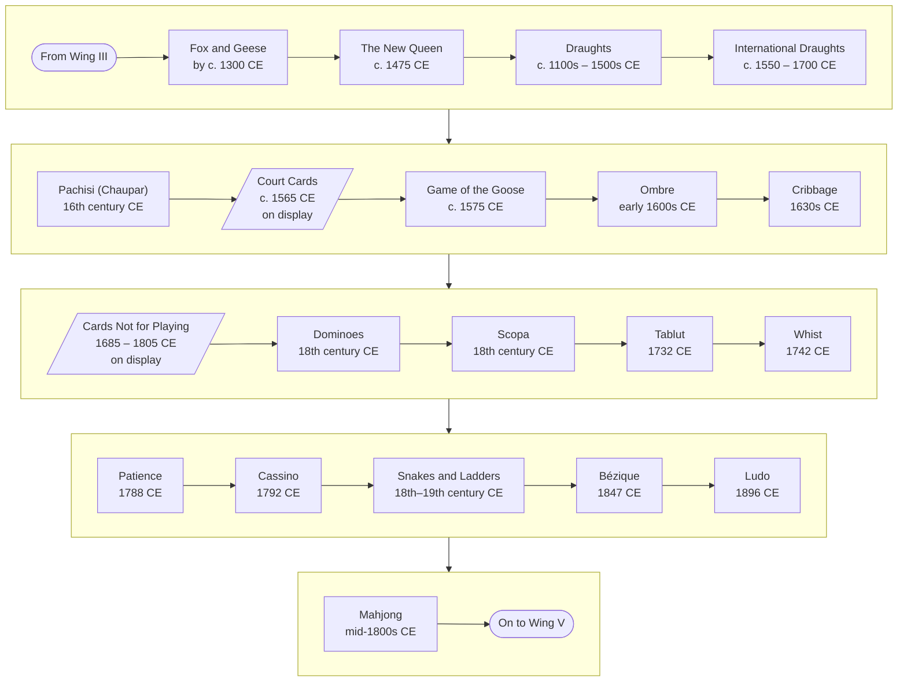
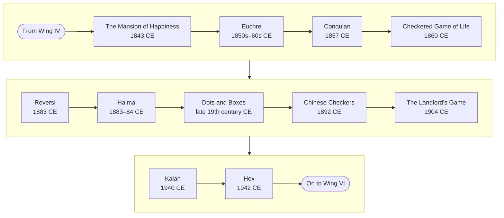
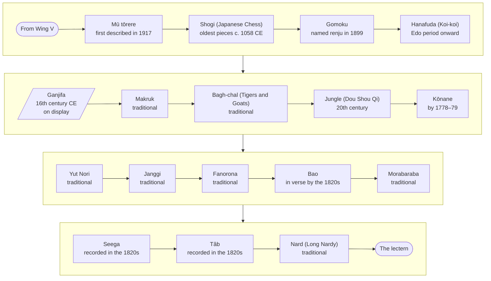

<!-- Written by tools/build-docs.mjs from the sources. Edit those, then run npm run build:docs. -->

# Game by game

One page for each of the hall's **77 exhibits**, 70 of them playable, in the order you walk them. Each page has the placard's history, a diagram of a turn, the rules as the table plays them and where they come from, what the table offers (the Scribe, a friend, Undo, Hint, saved games), how the Scribe plays and how strong it is, and the files that make it.

The pages are written from the code and the other guides by `tools/build-docs.mjs`, so they change when the games do. For the reasoning behind the rule choices see [the exhibits guide](../exhibits.md); for the AI, [the Scribe](../scribe.md).

## The games by family

### Race games

Dice or sticks decide how far; the first home wins.

[Senet](senet.md) · [Mehen](mehen.md) (display) · [The Royal Game of Ur](ur.md) · [Hounds and Jackals](hounds.md) · [Liubo](liubo.md) (display) · [Ludus Duodecim Scriptorum](xii.md) · [Patolli](patolli.md) · [Tables](tables.md) · [Nard](nard.md) · [Pachisi (Chaupar)](pachisi.md) · [Ludo](ludo.md) · [Yut Nori](yut.md) · [Tâb](tab.md)

### Roll and move on a printed track

One counter each on a printed course, with squares that help or hinder.

[The Game of the Goose](goose.md) · [Snakes and Ladders](snakes.md) · [The Mansion of Happiness](mansion.md) · [The Checkered Game of Life](lifegame.md) · [The Landlord's Game](landlord.md)

### Dice games

The dice themselves, and betting on them.

[The Başur Höyük Pieces](basur.md) (display) · [The First Dice](dice.md)

### The chess family

Armies with a king (or general) to trap.

[Chaturanga](chaturanga.md) · [Shatranj](shatranj.md) · [Xiangqi](xiangqi.md) · [Chaturaji](chaturaji.md) · [The Lewis Chessmen](lewis.md) · [Courier Chess](courier.md) · [Four Seasons Chess](fourseasons.md) · [The New Queen](newqueen.md) · [Shogi](shogi.md) · [Makruk](makruk.md) · [Janggi](janggi.md) · [Jungle](jungle.md) · [Rithmomachia](rithmo.md)

### Hunt and tafl games

Unequal sides: a king escaping a larger army, or hunters against a flock.

[Brandubh](brandubh.md) · [Hnefatafl](hnefatafl.md) · [Tablut](tablut.md) · [Fox and Geese](foxgeese.md) · [Bagh-chal](baghchal.md)

### Capture games

Equal armies that take by jumping or by trapping between two.

[Petteia](petteia.md) (display) · [Ludus Latrunculorum](latrunculi.md) · [Seega](seega.md) · [Alquerque](alquerque.md) · [Draughts](draughts.md) · [International Draughts](idraughts.md) · [Fanorona](fanorona.md) · [Kōnane](konane.md)

### Alignment, connection and blocking

Make a line, join two edges, or leave the other side with no move.

[Nine Men's Morris](morris.md) · [Morabaraba](morabaraba.md) · [Gomoku](gomoku.md) · [Hex](hex.md) · [Mū tōrere](mutorere.md)

### Territory and enclosure

Surround, close in or flip to own the most of the board.

[Weiqi (Go)](go.md) · [Dots and Boxes](dotsboxes.md) · [Reversi](reversi.md)

### Running and jumping races

Move a whole army across the board by steps and chains of hops.

[Halma](halma.md) · [Chinese Checkers](chinese.md)

### Mancala

Sow seeds round a row of pits and capture by count.

[Mancala (Oware)](oware.md) · [Kalah](kalah.md) · [Bao](bao.md)

### Cards

Tricks, bidding, melds, rummy, fishing, combinations and patience, and cards made for other uses.

[Playing Cards](cards.md) · [Karnöffel](karnoffel.md) · [Tarot (Tarocchi)](tarot.md) · [Court Cards](courtcards.md) (display) · [Ombre](ombre.md) · [Cribbage](cribbage.md) · [Cards Not for Playing](notforplay.md) (display) · [Scopa](scopa.md) · [Whist](whist.md) · [Patience](patience.md) · [Cassino](cassino.md) · [Bézique](bezique.md) · [Euchre](euchre.md) · [Conquian](conquian.md) · [Hanafuda](koikoi.md) · [Ganjifa](ganjifa.md) (display)

### Tiles

Dominoes and mahjong.

[Dominoes](dominoes.md) · [Mahjong](mahjong.md)

## How sure we are of the rules

## What the tables offer

## Wing I: The Dawn of Play

Long before anyone wrote rules down, people were already sitting across a board from each other, moving pieces and trusting their luck. This wing gathers the oldest board games we know of, from the Nile valley to the city of Ur.

| Exhibit | Date | Rules | Scribe | Friend | Undo | Hint | Saved |
| --- | --- | --- | :---: | :---: | :---: | :---: | :---: |
| [Senet](senet.md) | c. 3100 BCE | Rules reconstructed | ✓ | ✓ | · | ✓ | · |
| [Mehen](mehen.md) | c. 3100–2300 BCE | Rules lost (display) |  |  |  |  |  |
| [The Başur Höyük Pieces](basur.md) | c. 3000 BCE | Game unknown (display) |  |  |  |  |  |
| [The Royal Game of Ur](ur.md) | c. 2600–2400 BCE | Rules survive in writing | ✓ | ✓ | · | ✓ | · |
| [The First Dice](dice.md) | c. 2800–1900 BCE | Still rolled today | ✓ | ✓ | · | · | · |
| [Hounds and Jackals](hounds.md) | c. 2000 BCE | Modern reconstruction | ✓ | ✓ | · | ✓ | · |

## Wing II: Strategy Takes the Table

The games in the first wing were races, and the dice or sticks had the final word. Here the luck drains away. These are games of position, where you win by surrounding, trapping or outthinking the person across from you.

| Exhibit | Date | Rules | Scribe | Friend | Undo | Hint | Saved |
| --- | --- | --- | :---: | :---: | :---: | :---: | :---: |
| [Petteia](petteia.md) | by 443 BCE | Rules mostly lost (display) |  |  |  |  |  |
| [Liubo](liubo.md) | by the 4th century BCE | Rules lost (display) |  |  |  |  |  |
| [Weiqi (Go)](go.md) | by the 4th century BCE | Still played today | ✓ | ✓ | ✓ | ✓ | ✓ |
| [Ludus Latrunculorum](latrunculi.md) | by the 1st century BCE | Modern reconstruction | ✓ | ✓ | ✓ | ✓ | ✓ |
| [Ludus Duodecim Scriptorum](xii.md) | 1st century BCE onward | Modern reconstruction | ✓ | ✓ | · | ✓ | · |
| [Patolli](patolli.md) | by c. 300 CE | Modern reconstruction | ✓ | ✓ | · | ✓ | · |
| [Nine Men's Morris](morris.md) | Roman era onward | Rules survive in tradition | ✓ | ✓ | ✓ | ✓ | ✓ |
| [Mancala (Oware)](oware.md) | c. 6th–7th century CE | Rules survive in tradition | ✓ | ✓ | ✓ | ✓ | ✓ |
| [Alquerque](alquerque.md) | by the 10th century CE | Rules reconstructed | ✓ | ✓ | ✓ | ✓ | ✓ |
| [Brandubh](brandubh.md) | c. 900–1000 CE | Rules reconstructed | ✓ | ✓ | ✓ | ✓ | ✓ |
| [Hnefatafl](hnefatafl.md) | c. 400 – 1200 CE | Rules reconstructed | ✓ | ✓ | ✓ | ✓ | ✓ |

## Wing III: Kings, Cards and Courts

Board games became courtly pastimes. In this wing chess travels from India through Persia to the far North, the dice games of Rome and Persia settle into tables, and paper cards arrive from the East and change how Europe plays.

| Exhibit | Date | Rules | Scribe | Friend | Undo | Hint | Saved |
| --- | --- | --- | :---: | :---: | :---: | :---: | :---: |
| [Tables](tables.md) | c. 480 CE onward | Rules survive in modern backgammon | ✓ | ✓ | · | ✓ | · |
| [Chaturanga](chaturanga.md) | by c. 600 CE | Modern reconstruction | ✓ | ✓ | ✓ | ✓ | ✓ |
| [Shatranj](shatranj.md) | c. 600–1200 CE | Rules survive in writing | ✓ | ✓ | ✓ | ✓ | ✓ |
| [Xiangqi](xiangqi.md) | c. 800 CE | Still played today | ✓ | ✓ | ✓ | ✓ | ✓ |
| [Chaturaji](chaturaji.md) | described c. 1030 CE | Partly reconstructed | ✓ | · | · | · | · |
| [Rithmomachia](rithmo.md) | c. 1030 CE | Modern reconstruction | ✓ | ✓ | ✓ | ✓ | ✓ |
| [The Lewis Chessmen](lewis.md) | c. 1150–1200 CE | Modern reconstruction | ✓ | ✓ | ✓ | ✓ | ✓ |
| [Courier Chess](courier.md) | by 1202 CE | Rules in print, 1616 | ✓ | ✓ | ✓ | ✓ | ✓ |
| [Four Seasons Chess](fourseasons.md) | 1283 CE | Partly reconstructed | ✓ | · | · | · | · |
| [Playing Cards](cards.md) | c. 900–1400 CE | Earliest games lost | ✓ | · | · | · | ✓ |
| [Karnöffel](karnoffel.md) | 1426 CE | Rules partly reconstructed | ✓ | · | · | · | ✓ |
| [Tarot (Tarocchi)](tarot.md) | c. 1440 CE | Still played as a card game | ✓ | · | · | · | · |

## Wing IV: Printed Boards and Parlour Tables

Printing changed how people played. Rules were set down in books, boards were sold as printed sheets, and court games became family games at the kitchen table. This wing follows chess's new queen and the rise of draughts, and games that travelled from India and China into parlours around the world.

| Exhibit | Date | Rules | Scribe | Friend | Undo | Hint | Saved |
| --- | --- | --- | :---: | :---: | :---: | :---: | :---: |
| [Fox and Geese](foxgeese.md) | by c. 1300 CE | Rules survive in tradition | ✓ | · | ✓ | ✓ | ✓ |
| [The New Queen](newqueen.md) | c. 1475 CE | Rules survive in writing | ✓ | ✓ | ✓ | ✓ | ✓ |
| [Draughts](draughts.md) | c. 1100s – 1500s CE | Rules survive in tradition | ✓ | ✓ | ✓ | ✓ | ✓ |
| [International Draughts](idraughts.md) | c. 1550 – 1700 CE | Rules survive in writing | ✓ | ✓ | ✓ | ✓ | ✓ |
| [Pachisi (Chaupar)](pachisi.md) | 16th century CE | Still played, and the ancestor of Ludo | ✓ | ✓ | · | ✓ | · |
| [Court Cards](courtcards.md) | c. 1565 CE | Packs survive (display) |  |  |  |  |  |
| [The Game of the Goose](goose.md) | c. 1575 CE | Rules survive in print | ✓ | ✓ | · | · | · |
| [Ombre](ombre.md) | early 1600s CE | Rules survive in print | ✓ | · | · | · | ✓ |
| [Cribbage](cribbage.md) | 1630s CE | Still played | ✓ | · | · | · | · |
| [Cards Not for Playing](notforplay.md) | 1685 – 1805 CE | Examples survive (display) |  |  |  |  |  |
| [Dominoes](dominoes.md) | 18th century CE | Still played | ✓ | · | · | · | · |
| [Scopa](scopa.md) | 18th century CE | Still played across Italy | ✓ | · | · | · | ✓ |
| [Tablut](tablut.md) | 1732 CE | Rules partly read | ✓ | ✓ | ✓ | ✓ | ✓ |
| [Whist](whist.md) | 1742 CE | Rules in print since 1742 | ✓ | · | · | ✓ | ✓ |
| [Patience](patience.md) | 1788 CE | Still played | · | · | ✓ | ✓ | ✓ |
| [Cassino](cassino.md) | 1792 CE | Rules survive in print | ✓ | · | · | · | ✓ |
| [Snakes and Ladders](snakes.md) | 18th–19th century CE | Still played today | ✓ | ✓ | · | · | · |
| [Bézique](bezique.md) | 1847 CE | Still played | ✓ | · | · | · | ✓ |
| [Ludo](ludo.md) | 1896 CE | Still played | ✓ | ✓ | · | ✓ | · |
| [Mahjong](mahjong.md) | mid-1800s CE | Still played today | ✓ | · | · | · | ✓ |

## Wing V: The Modern Board Game

With cheap colour printing, board games became products. Publishers in Salem, Springfield, London and Ravensburg sold games about virtue, money and getting ahead, and inventors patented their ideas. This wing runs from the first American board games to the ancestors of games still on the shelf, and ends with Librarium's own.

| Exhibit | Date | Rules | Scribe | Friend | Undo | Hint | Saved |
| --- | --- | --- | :---: | :---: | :---: | :---: | :---: |
| [The Mansion of Happiness](mansion.md) | 1843 CE | Rules survive in print | ✓ | ✓ | · | · | · |
| [Euchre](euchre.md) | 1850s–60s CE | Still played | ✓ | · | · | · | ✓ |
| [Conquian](conquian.md) | 1857 CE | Rules survive in print | ✓ | · | · | · | ✓ |
| [The Checkered Game of Life](lifegame.md) | 1860 CE | Rules survive in print | ✓ | ✓ | · | ✓ | · |
| [Reversi](reversi.md) | 1883 CE | Rules survive in print | ✓ | ✓ | ✓ | ✓ | ✓ |
| [Halma](halma.md) | 1883–84 CE | Still played, as Chinese checkers | ✓ | ✓ | ✓ | ✓ | ✓ |
| [Dots and Boxes](dotsboxes.md) | late 19th century CE | Rules survive in print | ✓ | ✓ | ✓ | ✓ | ✓ |
| [Chinese Checkers](chinese.md) | 1892 CE | Rules survive in print | ✓ | · | ✓ | ✓ | ✓ |
| [The Landlord's Game](landlord.md) | 1904 CE | Rules survive in the patent | ✓ | ✓ | · | · | · |
| [Kalah](kalah.md) | 1940 CE | Rules survive in print | ✓ | ✓ | ✓ | ✓ | ✓ |
| [Hex](hex.md) | 1942 CE | Rules survive in print | ✓ | ✓ | ✓ | ✓ | ✓ |

## Wing VI: Games of the World

The other wings follow one long road, from Egypt and Mesopotamia through Europe to the shop shelf. But play has many homelands. This wing gathers games from the Pacific, Africa and Asia: some ancient, some first written down by visitors, all still played today.

| Exhibit | Date | Rules | Scribe | Friend | Undo | Hint | Saved |
| --- | --- | --- | :---: | :---: | :---: | :---: | :---: |
| [Mū tōrere](mutorere.md) | first described in 1917 | Still played | ✓ | ✓ | ✓ | ✓ | ✓ |
| [Shogi](shogi.md) | oldest pieces c. 1058 CE | Still played | ✓ | ✓ | ✓ | ✓ | ✓ |
| [Gomoku](gomoku.md) | named renju in 1899 | Still played | ✓ | ✓ | ✓ | ✓ | ✓ |
| [Hanafuda](koikoi.md) | Edo period onward | Still played | ✓ | · | · | ✓ | · |
| [Ganjifa](ganjifa.md) | 16th century CE | Still painted by hand (display) |  |  |  |  |  |
| [Makruk](makruk.md) | traditional | Still played | ✓ | ✓ | ✓ | ✓ | ✓ |
| [Bagh-chal](baghchal.md) | traditional | Still played | ✓ | ✓ | ✓ | ✓ | ✓ |
| [Jungle](jungle.md) | 20th century | Still played | ✓ | ✓ | ✓ | ✓ | ✓ |
| [Kōnane](konane.md) | by 1778–79 | Still played | ✓ | ✓ | ✓ | ✓ | ✓ |
| [Yut Nori](yut.md) | traditional | Still played | ✓ | ✓ | · | ✓ | · |
| [Janggi](janggi.md) | traditional | Still played | ✓ | ✓ | ✓ | ✓ | ✓ |
| [Fanorona](fanorona.md) | traditional | Still played | ✓ | ✓ | ✓ | ✓ | ✓ |
| [Bao](bao.md) | in verse by the 1820s | Still played | ✓ | ✓ | ✓ | ✓ | ✓ |
| [Morabaraba](morabaraba.md) | traditional | Still played | ✓ | ✓ | ✓ | ✓ | ✓ |
| [Seega](seega.md) | recorded in the 1820s | Rules survive in writing | ✓ | ✓ | ✓ | ✓ | ✓ |
| [Tâb](tab.md) | recorded in the 1820s | Rules survive in writing | ✓ | ✓ | · | ✓ | · |
| [Nard](nard.md) | traditional | Still played | ✓ | ✓ | · | ✓ | · |

## The end of the hall

From Senet to the Landlord's Game, every table in this hall began with someone deciding how a game should feel. Five thousand years on, people still gather to throw dice, shuffle tiles and corner each other's kings, and Librarium Games carries the tradition on with tables of its own.

[Phoenix Farm](https://librarium.games/phoenix-farm/) · [Calendra](https://librarium.games/calendra/) · [The Great Chase](https://librarium.games/the-great-chase/) · [Royal Threadcount](https://librarium.games/royal-threadcount/)
