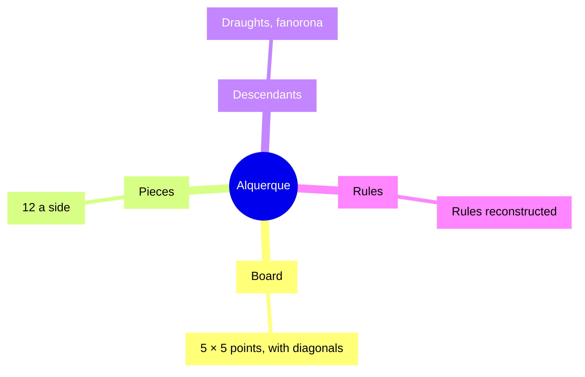
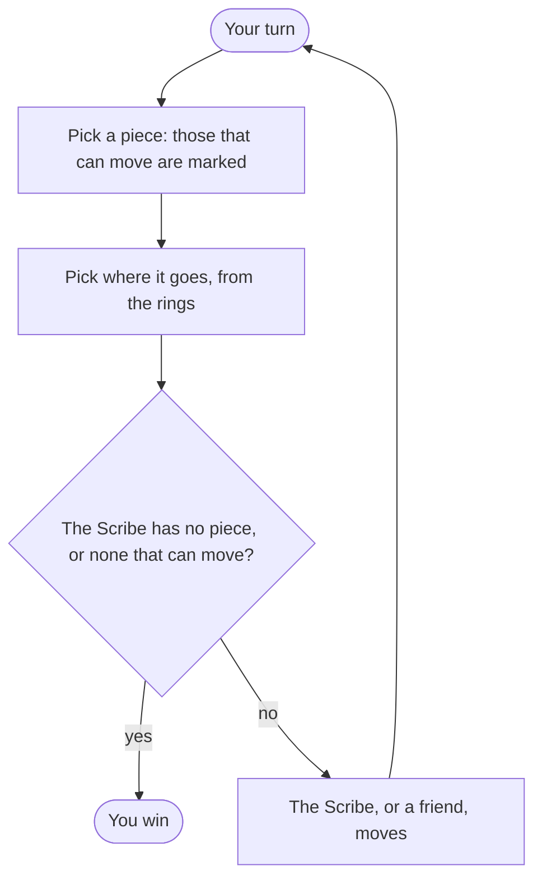

<!-- Written by tools/build-docs.mjs from the sources. Edit those, then run npm run build:docs. -->

# Alquerque

**Wing II · Strategy Takes the Table** · by the 10th century CE · The Islamic world and Spain

[← Mancala (Oware)](oware.md) · [All games](README.md) · [Brandubh →](brandubh.md)

| | |
| --- | --- |
| In the Archives | Playable against the Scribe, or a friend on the same screen |
| Rules | Rules reconstructed |
| How we know them | Reconstructed (R. C. Bell, from Alfonso X) |
| Family | [Capture games](README.md#capture-games) |
| Exhibit id | `alquerque`: `[librarium_archives start="alquerque"]` |

## At a glance

| | |
| --- | --- |
| Board | 5 × 5 points, with diagonals |
| Pieces | 12 a side |
| Descendants | Draughts, fanorona |

## The placard

Alquerque, from the Arabic al-qirkat, is first named late in the 10th century, in Abu al-Faraj al-Isfahani's Book of Songs, which does not bother to give the rules: everyone knew them. The game crossed into Spain, and in 1283 Alfonso X of Castile had it described in his Book of Games.

Its board of lines and diagonals, with twelve pieces a side that capture by jumping, made it the parent of draughts, which moved the idea onto a chessboard, and of the Malagasy game fanorona. Alfonso's book leaves gaps, so the rules played here are R. C. Bell's widely used reconstruction.

## A turn

## The rules as played here

1. You play the dark pieces and move first. A piece moves along a line to the next point, if it is empty.
2. Pieces never move backwards. A piece that reaches the far row may only move again to capture.
3. Capture by jumping along a line over an enemy piece to the empty point beyond, in any direction. Keep jumping while you can. If you can capture, you must.
4. You win when the Scribe has no pieces left, or none that can move.

**Source:** The rules in Alfonso X's Libro de los juegos (1283) are incomplete; these follow R. C. Bell's widely used reconstruction, with compulsory capture instead of huffing.

## At the table

| | |
| --- | --- |
| The Scribe | Gentle, Fair or Sharp (see [the Scribe](../scribe.md#levels)) |
| Pass-and-play with a friend | Yes |
| Undo | Yes |
| Hint | Yes |
| Saved and resumed | Yes |

Keys, the move list, replays and the guide are the same at every table: see [Visiting the Archives](../visiting.md#at-a-table).

## How the Scribe plays

**Method:** Shared search: negamax with alpha-beta; captures played out at the leaves; iterative deepening; time budget per level. See [the Scribe](../scribe.md).

## Sources

The sources for every placard are listed in [Historical notes and sources](../sources.md).

## In the code

| | |
| --- | --- |
| Rules and the Scribe | [`src/rules/alquerque.js`](../../src/rules/alquerque.js) |
| Table presenter | [`src/hall/table-alquerque.js`](../../src/hall/table-alquerque.js) |
| 3D model | [`src/hall/build-backfill-tables.js`](../../src/hall/build-backfill-tables.js) |
| Placard | [`src/hall/09-exhibit-data.js`](../../src/hall/09-exhibit-data.js) |
