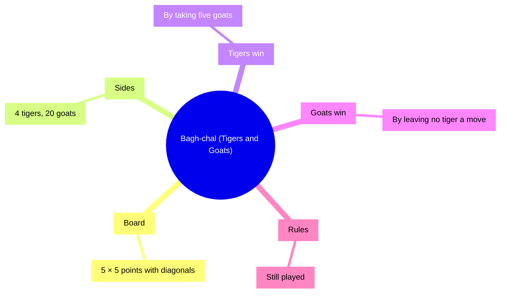
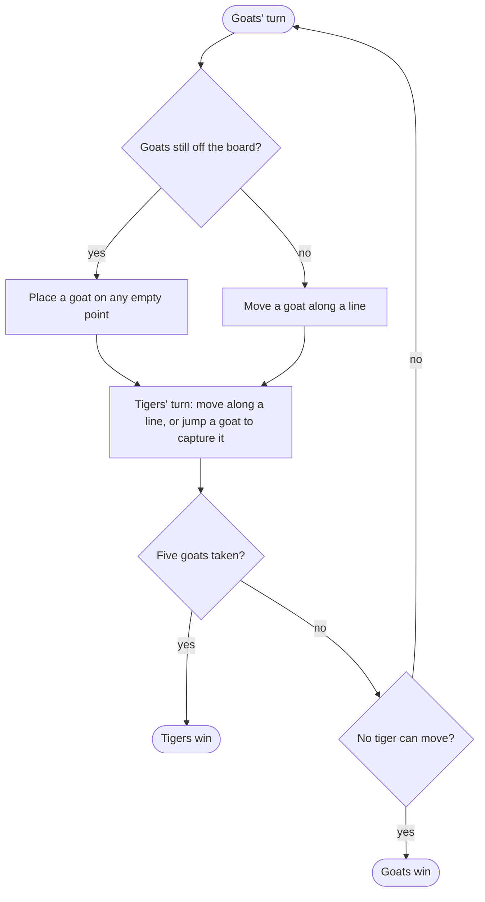

<!-- Written by tools/build-docs.mjs from the sources. Edit those, then run npm run build:docs. -->

# Bagh-chal

**Wing VI · Games of the World** · traditional · Nepal

[← Makruk](makruk.md) · [All games](README.md) · [Jungle →](jungle.md)

| | |
| --- | --- |
| In the Archives | Playable against the Scribe, or a friend on the same screen |
| Rules | Still played |
| How we know them | Still played |
| Family | [Hunt and tafl games](README.md#hunt-and-tafl-games) |
| Exhibit id | `baghchal`: `[librarium_archives start="baghchal"]` |
| Side | **You lead the goats** · You lead the tigers |

## At a glance

| | |
| --- | --- |
| Board | 5 × 5 points with diagonals |
| Sides | 4 tigers, 20 goats |
| Tigers win | By taking five goats |
| Goats win | By leaving no tiger a move |

## The placard

Bagh-chal, "the tigers' move", is the hunt game of Nepal. Four tigers face twenty goats on a board of lines like alquerque's: the tigers try to eat five goats, and the goats try to hem every tiger in so that none can move.

Hunt games that pit a few strong pieces against many weak ones are played all over South Asia, from the lambs and tigers of southern India to the tiger games of Bengal. In Nepal, Bagh-chal is played on boards scratched on the ground as well as on cast brass sets with tiger and goat pieces.

You may lead either side. The goats are the harder, more patient role. Once all twenty are down, no position may repeat, so the goats cannot simply wait.

## A turn

## The rules as played here

1. You lead the twenty goats and the Scribe the four tigers. You can swap sides above. The tigers start on the four corners; the goats start off the board, and move first.
2. Pieces move along a line to the next empty point. Diagonal lines run only through some points.
3. While goats remain off the board, each goat turn places one on any empty point; goats may not move until all twenty are down. Tigers move from the start.
4. A tiger captures by jumping along a line over a goat next to it, to the empty point beyond. Capturing is never compulsory, and only one goat is taken a turn. Goats never capture.
5. The tigers win by taking five goats. The goats win by leaving no tiger a move.
6. Once all goats are placed, no move may bring back a position seen before. A side with no move loses; after 100 moves each with no result, the game is drawn.

**Source:** Traditional rules of Nepal, as commonly played today. The 100-move draw is our house rule.

### Rule choices

- **Bagh-chal:** four tigers on the corners against twenty goats placed one a turn, goats first; goats move only once all are down. A tiger takes one goat a turn by jumping it along a line; capture is never compulsory. Tigers win with five goats, goats by leaving the tigers no move. Once all goats are placed no position may repeat. A side with no move loses; a hundred moves each without a result is a draw (house rule). You choose your side.

### Side

Chosen at the table under Options. Changing it restarts the game.

| Choice | |
| --- | --- |
| You lead the goats | the default |
| You lead the tigers |  |

## At the table

| | |
| --- | --- |
| The Scribe | Gentle, Fair or Sharp (see [the Scribe](../scribe.md#levels)) |
| Pass-and-play with a friend | Yes |
| Undo | Yes |
| Hint | Yes |
| Saved and resumed | Yes |

Keys, the move list, replays and the guide are the same at every table: see [Visiting the Archives](../visiting.md#at-a-table).

## How the Scribe plays

**Method:** Shared search: negamax with alpha-beta; captures played out at the leaves; iterative deepening; time budget per level. See [the Scribe](../scribe.md).

**Measured strength**

| Fair vs Gentle | Sharp vs Fair | Games |
| --- | --- | --- |
| 19–0, 1 draw | 16–4 | 20 each, sides swapped |

**Game by game:** Goats taken, goats open to a jump, and how much room the tigers have; the same score read from either side

## Sources

The sources for every placard are listed in [Historical notes and sources](../sources.md).

## In the code

| | |
| --- | --- |
| Rules and the Scribe | [`src/rules/bagh-chal.js`](../../src/rules/bagh-chal.js) |
| Table presenter | [`src/hall/table-baghchal.js`](../../src/hall/table-baghchal.js) |
| 3D model | [`src/hall/build-bagh-chal.js`](../../src/hall/build-bagh-chal.js) |
| Placard | [`src/hall/09-exhibit-data.js`](../../src/hall/09-exhibit-data.js) |
