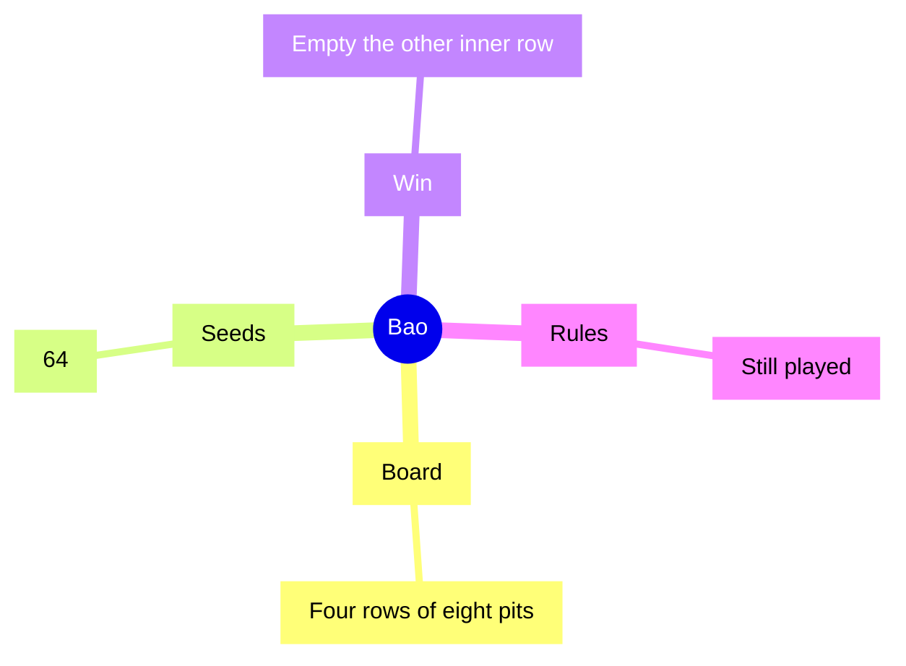
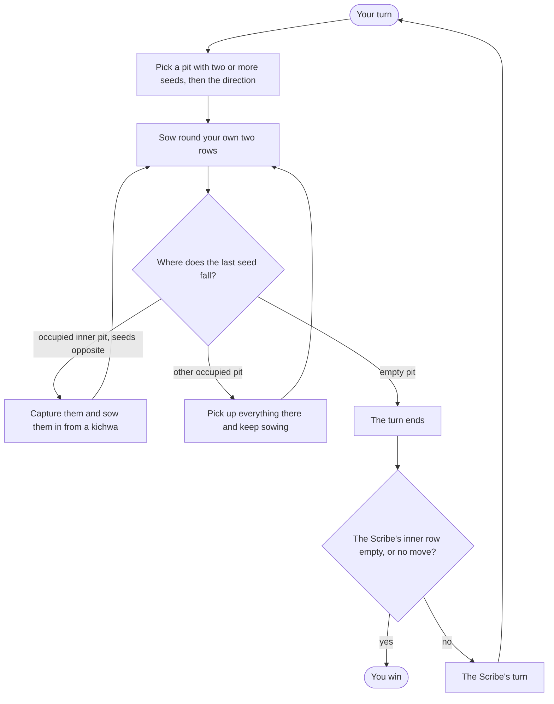

<!-- Written by tools/build-docs.mjs from the sources. Edit those, then run npm run build:docs. -->

# Bao

**Wing VI · Games of the World** · in verse by the 1820s · East Africa · the Swahili coast

[← Fanorona](fanorona.md) · [All games](README.md) · [Morabaraba →](morabaraba.md)

| | |
| --- | --- |
| In the Archives | Playable against the Scribe, or a friend on the same screen |
| Rules | Still played |
| How we know them | Still played |
| Family | [Mancala](README.md#mancala) |
| Exhibit id | `bao`: `[librarium_archives start="bao"]` |

## At a glance

| | |
| --- | --- |
| Board | Four rows of eight pits |
| Seeds | 64 |
| Win | Empty the other inner row |

## The placard

Bao, Swahili for "board", is the mancala of East Africa, most popular among the Swahili of Tanzania and Kenya, and one of the most complex of all mancala games. The board has four rows of eight pits, two for each player, and a larger square pit, the nyumba or house, with powers of its own.

The poet Muyaka bin Haji of Mombasa praised the game in verse in the 1820s. In Bao la Kiswahili, the masters' version, players start with most of their 32 seeds in hand and sow them in one by one. Zanzibar's bao masters are held in high respect, and tournaments are held in Tanzania, Zanzibar, Kenya and Malawi.

This table plays Bao la Kujifunza, the learners' game: every seed starts on the board, two to a pit, and the house is an ordinary pit. Captures still fly from one end of the row to the other.

## A turn

## The rules as played here

1. You own the two rows nearest you: sixteen pits that you sow round as a loop, never into the Scribe's side. Every pit starts with two seeds.
2. Pick up all the seeds of one of your pits holding two or more, and sow them one by one into the following pits, in either direction: pick a pit, then the ring on the side you want to sow toward.
3. Capture: if your last seed lands in an occupied pit of your inner row, and the Scribe's pit opposite has seeds, take them. Sow them into your own pits starting from an end of your inner row (a kichwa): the nearer end if the capture was in one of the two pits at either end, otherwise the end that keeps your direction. If you can capture, you must.
4. If your last seed lands in any other occupied pit, pick up everything there and keep sowing. The turn ends when a last seed falls into an empty pit. A turn that does not start with a capture captures nothing, and must start from your inner row if it can.
5. You lose if your inner row is empty, or if you cannot move.

**Source:** Bao la Kujifunza, the beginners' Bao, as transcribed from Zanzibari masters: every seed starts on the board and the house (nyumba) has no special powers.

### Rule choices

- **Bao la Kujifunza:** every pit starts with two seeds and the house is an ordinary pit. A move sows a pit of two or more seeds either way round your own sixteen pits. If you can capture you must: a last seed landing in an occupied pit of your inner row takes the Scribe's seeds opposite, which are sown from an end of your row (the nearer end for a capture in the two pits at either end, otherwise the end that keeps your direction). Landing in any other occupied pit picks it up and sows on; a turn ends in an empty pit. A turn that cannot capture must start from the inner row if it can, and never captures. An empty inner row, or no move, loses. House rule: after a hundred moves each, the side with more seeds wins.

## At the table

| | |
| --- | --- |
| The Scribe | Gentle, Fair or Sharp (see [the Scribe](../scribe.md#levels)) |
| Pass-and-play with a friend | Yes |
| Undo | Yes |
| Hint | Yes |
| Saved and resumed | Yes |

Keys, the move list, replays and the guide are the same at every table: see [Visiting the Archives](../visiting.md#at-a-table).

## How the Scribe plays

**Method:** Shared search: negamax with alpha-beta; captures played out at the leaves; iterative deepening; time budget per level. See [the Scribe](../scribe.md).

**Measured strength**

| Fair vs Gentle | Sharp vs Fair | Games |
| --- | --- | --- |
| 31–9 | 29–11 | 40 each |

**Game by game:** Seeds, the inner row, and the best capture on offer; cheap to search, so Sharp looks twelve plies ahead

## Sources

The sources for every placard are listed in [Historical notes and sources](../sources.md).

## In the code

| | |
| --- | --- |
| Rules and the Scribe | [`src/rules/bao-la-kujifunza.js`](../../src/rules/bao-la-kujifunza.js) |
| Table presenter | [`src/hall/table-bao.js`](../../src/hall/table-bao.js) |
| 3D model | [`src/hall/build-games-of-the-world.js`](../../src/hall/build-games-of-the-world.js) |
| Placard | [`src/hall/09-exhibit-data.js`](../../src/hall/09-exhibit-data.js) |
