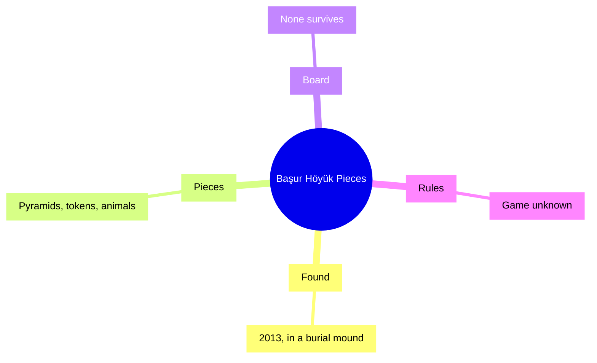

<!-- Written by tools/build-docs.mjs from the sources. Edit those, then run npm run build:docs. -->

# The Başur Höyük Pieces

**Wing I · The Dawn of Play** · c. 3000 BCE · Southeast Turkey · Early Bronze Age

[← Mehen](mehen.md) · [All games](README.md) · [The Royal Game of Ur →](ur.md)

| | |
| --- | --- |
| In the Archives | On display |
| Rules | Game unknown |
| How we know them | Game unknown |
| Family | [Dice games](README.md#dice-games) |
| Exhibit id | `basur`: `[librarium_archives start="basur"]` |

## At a glance

| | |
| --- | --- |
| Found | 2013, in a burial mound |
| Pieces | Pyramids, tokens, animals |
| Board | None survives |

## The placard

In 2013, archaeologists excavating a Bronze Age burial mound at Başur Höyük found a set of small carved and painted stones: pyramids, round tokens and little animal figures. At around 5,000 years old, they are often called the oldest gaming pieces yet found.

Nobody knows the game they belonged to. Their different shapes and colors may have marked opposing sides or kept score. They are a reminder that the oldest boards we know are only the ones that happened to survive.

> On display. No board survives to play on.

## Sources

The sources for every placard are listed in [Historical notes and sources](../sources.md).

## In the code

| | |
| --- | --- |
| 3D model | [`src/hall/build-basur-hoyuk-pieces.js`](../../src/hall/build-basur-hoyuk-pieces.js) |
| Placard | [`src/hall/09-exhibit-data.js`](../../src/hall/09-exhibit-data.js) |
