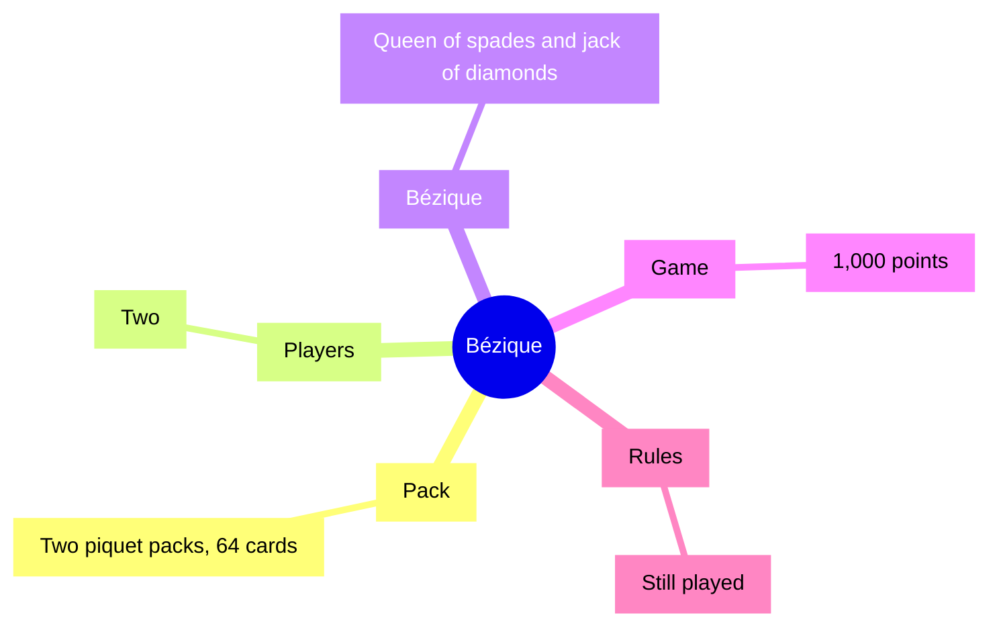
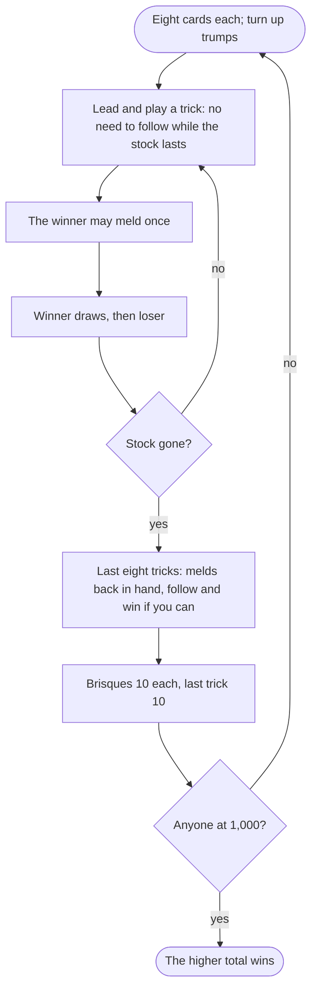

<!-- Written by tools/build-docs.mjs from the sources. Edit those, then run npm run build:docs. -->

# Bézique

**Wing IV · Printed Boards and Parlour Tables** · 1847 CE · Paris and London · 19th century

[← Snakes and Ladders](snakes.md) · [All games](README.md) · [Ludo →](ludo.md)

| | |
| --- | --- |
| In the Archives | Playable against the Scribe |
| Rules | Still played |
| How we know them | Still played |
| Family | [Cards](README.md#cards) |
| Exhibit id | `bezique`: `[librarium_archives start="bezique"]` |
| Game | **To 1,000** · One deal |
| Suits drawn | French by default; the Pack switch redraws it in French, German, Swiss or Italian suits |

## At a glance

| | |
| --- | --- |
| Pack | Two piquet packs, 64 cards |
| Players | Two |
| Bézique | Queen of spades and jack of diamonds |
| Game | 1,000 points |

## The placard

Bézique is a French game of tricks and melds for two, descended from piquet. The word bésigue is older, but the first printed rules, for a single 32-card pack, appeared in Paris in 1847, and the game was at its most fashionable there around 1860.

It reached England in 1861, played with two packs shuffled together, which made room for double bézique and large scores: a game ran to 1,000 points. Winston Churchill was its most famous player, an expert at the six-pack form.

The melds reached America by another road. The German game binokel, played with German-suited cards, became pinochle, and two-handed pinochle is nearly the same game as two-handed bézique.

> The cards are our own, in the French style. The little box on the display is a bézique marker, which kept the score on two dials.

## A turn

## The rules as played here

1. Two 32-card packs shuffled together, 64 cards. Cards rank ace, ten, king, queen, jack, nine, eight, seven. Each of you gets eight; the next card is turned up for trumps and the rest are the stock. If the turn-up is a seven, the dealer scores 10.
2. While the stock lasts you need not follow suit. The higher card of the suit led wins, a trump beats any other suit, and of two identical cards the first played wins. The winner may then meld once, and draws first; the loser draws next.
3. Melds are laid face up and can still be played to tricks. Bézique (queen of spades and jack of diamonds) 40, double bézique 500. Marriage (king and queen of a suit) 20, in trumps 40. Sequence (ace, ten, king, queen, jack of trumps) 250. Four aces 100, four kings 80, four queens 60, four jacks 40. A card may be used again in another kind of meld but not the same kind, and every meld needs at least one card from your hand. The seven of trumps can be swapped for the turn-up, or shown, for 10.
4. When the stock is gone (the loser of that trick takes the turn-up), melds return to the hand and the last eight tricks are played strictly: follow suit and win the trick if you can; if you cannot follow, trump if you can.
5. At the end of the deal each ace and ten you took in tricks (a brisque) scores 10, and the last trick 10. The first to 1,000 at the end of a deal wins.

**Source:** Two-handed Bézique as played in England from the 1860s, after pagat.com. One meld after each trick won; melds are chosen from a list rather than laid out by hand.

### Rule choices

- **Bézique:** two-handed Bézique with 64 cards, as on pagat.com: one meld after each trick won while the stock lasts, chosen from a list; a card may count again in another kind of meld but never the same kind, a marriage cannot be taken out of a sequence, and every meld needs a card from the hand. The seven of trumps scores 10 when turned up, swapped or shown. After the stock, melds return to the hand and you must follow suit, win if you can, and trump if void. Brisques and the last trick score 10 each; a game is to 1,000, or one deal.

### Game

Chosen at the table under Options. Changing it restarts the game.

| Choice | |
| --- | --- |
| To 1,000 | the default |
| One deal |  |

## At the table

| | |
| --- | --- |
| The Scribe | Gentle, Fair or Sharp (see [the Scribe](../scribe.md#levels)) |
| Pass-and-play with a friend | No |
| Undo | No |
| Hint | No |
| Saved and resumed | Yes |
| Pack switch | Yes |

Keys, the move list, replays and the guide are the same at every table: see [Visiting the Archives](../visiting.md#at-a-table).

## How the Scribe plays

**Method:** Hidden information: plays only from what it can see. See [the Scribe](../scribe.md).

**Games with hidden cards and tiles:** Values each card for what it can still meld (marriages, bézique, fours, the sequence, the seven of trumps) and for brisques. While the stock lasts it leads its least useful card, and wins a trick cheaply when there is a brisque to take or a meld to show; Sharp plays for the big melds. In the last eight it leads cards nothing unseen can beat. Gentle sometimes skips a meld or plays at random

## Sources

Checked in [the placard fact-check](../fact-check.md):

- **Claims:** First printed rules in Paris, 1847; most fashionable around 1860; reached England 1861; Churchill and six-pack bézique; binokel and pinochle **Source:** Wikipedia, Bezique; pagat.com

The sources for every placard are listed in [Historical notes and sources](../sources.md).

## In the code

| | |
| --- | --- |
| Rules and the Scribe | [`src/rules/bezique.js`](../../src/rules/bezique.js) |
| Table presenter | [`src/hall/table-bezique.js`](../../src/hall/table-bezique.js) |
| 3D model | [`src/hall/build-card-room.js`](../../src/hall/build-card-room.js) |
| Placard | [`src/hall/09-exhibit-data.js`](../../src/hall/09-exhibit-data.js) |
