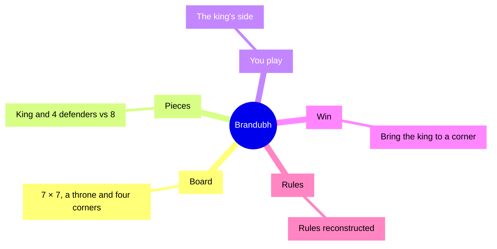
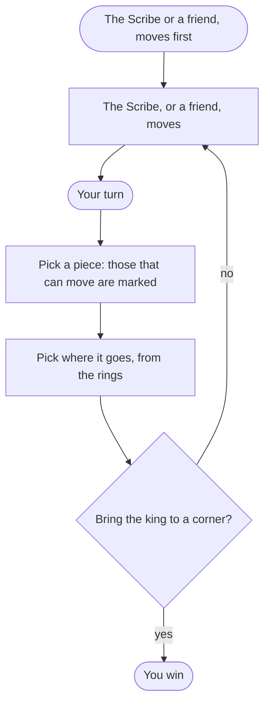

<!-- Written by tools/build-docs.mjs from the sources. Edit those, then run npm run build:docs. -->

# Brandubh

**Wing II · Strategy Takes the Table** · c. 900–1000 CE · Ireland · Early Middle Ages

[← Alquerque](alquerque.md) · [All games](README.md) · [Hnefatafl →](hnefatafl.md)

| | |
| --- | --- |
| In the Archives | Playable against the Scribe, or a friend on the same screen |
| Rules | Rules reconstructed |
| How we know them | Reconstructed |
| Family | [Hunt and tafl games](README.md#hunt-and-tafl-games) |
| Exhibit id | `brandubh`: `[librarium_archives start="brandubh"]` |

## At a glance

| | |
| --- | --- |
| Board | 7 × 7, a throne and four corners |
| Pieces | King and 4 defenders vs 8 |
| You play | The king's side |
| Win | Bring the king to a corner |

## The placard

Brandubh, usually translated "black raven", was the Irish member of the tafl family: Norse and Celtic games in which a king tries to escape while a larger army closes in. Irish poems describe it played with five pieces against eight, one of the five being a chief.

The most famous board was found in 1932 at the Ballinderry crannog in County Westmeath, a lake dwelling lived in from the late 9th to the 11th century. It is carved from yew, has 49 peg holes and carved heads for handles, and may have been made in Viking Dublin. No rules survive. Ours follow modern reconstructions built from the poems, the 7 × 7 boards and Linnaeus's 1732 notes on the related Sámi game tablut.

Librarium's own Calendra comes from the same Celtic world.

## A turn

## The rules as played here

1. The Scribe commands the eight attackers and moves first. You command the king and his four defenders.
2. Every piece moves like a chess rook: any distance in a straight line, without jumping.
3. Only the king may stop on the central throne or the four corners. Other pieces may pass over the empty throne.
4. Trap an enemy piece between two of yours to capture it. The corners and the empty throne count as an enemy to both sides, and the king can help capture.
5. The king is caught by two attackers on opposite sides, by three when he stands beside the throne, and by four on the throne.
6. You win when the king reaches a corner. The Scribe wins by capturing him.

**Source:** A modern reconstruction. The ancient Irish rules did not survive.

## At the table

| | |
| --- | --- |
| The Scribe | Gentle, Fair or Sharp (see [the Scribe](../scribe.md#levels)) |
| Pass-and-play with a friend | Yes |
| Undo | Yes |
| Hint | Yes |
| Saved and resumed | Yes |

Keys, the move list, replays and the guide are the same at every table: see [Visiting the Archives](../visiting.md#at-a-table).

## How the Scribe plays

**Method:** Shared search: negamax with alpha-beta; captures played out at the leaves; iterative deepening; time budget per level. See [the Scribe](../scribe.md).

## Sources

The sources for every placard are listed in [Historical notes and sources](../sources.md).

## In the code

| | |
| --- | --- |
| Rules and the Scribe | [`src/rules/brandubh.js`](../../src/rules/brandubh.js) |
| Table presenter | [`src/hall/table-brandubh.js`](../../src/hall/table-brandubh.js) |
| 3D model | [`src/hall/build-brandubh-board.js`](../../src/hall/build-brandubh-board.js) |
| Placard | [`src/hall/09-exhibit-data.js`](../../src/hall/09-exhibit-data.js) |
