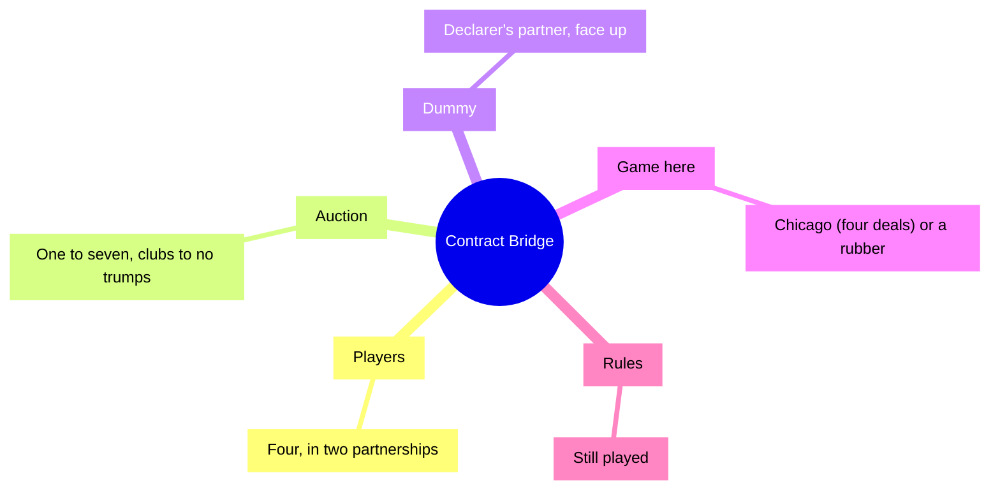
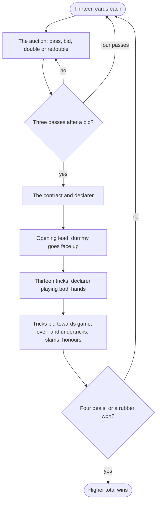

<!-- Written by tools/build-docs.mjs from the sources. Edit those, then run npm run build:docs. -->

# Contract Bridge

**Wing V · The Modern Board Game** · 1925 CE · From whist, by way of London and New York

[← Gin Rummy](gin.md) · [All games](README.md) · [Spades →](spades.md)

| | |
| --- | --- |
| In the Archives | Playable against the Scribe, in 4 seats |
| Rules | Still played |
| How we know them | Still played |
| Family | [Cards](README.md#cards) |
| Exhibit id | `bridge`: `[librarium_archives start="bridge"]` |
| Game | **Four deals (Chicago)** · A rubber |

## At a glance

| | |
| --- | --- |
| Players | Four, in two partnerships |
| Auction | One to seven, clubs to no trumps |
| Dummy | Declarer's partner, face up |
| Game here | Chicago (four deals) or a rubber |

## The placard

Bridge grew out of whist. Biritch, or Russian whist, brought in the dummy hand, no-trump play and the score kept above and below the line; John Collinson printed its rules in London in 1886. Bridge whist was the rage of Britain and America in the 1890s, and London's Portland Club took it up in 1894. Auction bridge, from 1904, let the players bid against each other for the right to name trumps.

Contract bridge added one idea: only the tricks you bid count towards a game, so the auction became the heart of the game. Players had tried it before, but in 1925, on a cruise, Harold Vanderbilt rewrote the scoring and added vulnerability, and his rules swept the world. By 1941 a survey found bridge played in 44 per cent of American households.

The first official world championship was held in Budapest in 1937, and the World Bridge Federation was founded in 1958. Today bridge is a mind sport, played in clubs, at tournaments and online.

> The Scribes bid a simple natural system of their own: points, five-card majors, 1NT on 15 to 17.

## A turn

Seats: You, West, North, East.

## The rules as played here

1. You sit South, with North, played by the Scribe, as your partner, against West and East. Thirteen cards each.
2. The auction goes round from the dealer. Each player passes, bids, doubles an opponent's bid or redoubles a double. A bid names a number of tricks over six (one to seven) and trumps: clubs, diamonds, hearts, spades or no trumps, in that order, and must outrank the last bid. To bid, choose the level, then the strain. Three passes after a bid end the auction; four passes at the start throw the deal in.
3. The last bid is the contract. Of the side that won it, the player who first named its trumps is declarer. The player on declarer's left leads, then declarer's partner lays their hand face up as dummy, and declarer plays both hands. When your side wins the contract, you play both your hand and North's.
4. Follow suit if you can; the highest trump wins the trick, or the highest card of the suit led. Aces are high.
5. Only the tricks bid count towards game: 20 a trick in clubs and diamonds, 30 in hearts and spades, 40 for the first in no trumps and 30 after; doubled twice that, redoubled four times. A hundred of these makes a game. Extra tricks, slams (twelve or thirteen tricks bid and made) and honours score besides. A side that falls short pays for each trick it is down, more when vulnerable or doubled.
6. Chicago (the default) plays four deals: the first with neither side vulnerable, the second and third with the dealer's side vulnerable, the fourth with both; a game made scores 300, or 500 vulnerable, and a part score 50. A rubber is the best of three games, with 700 or 500 for winning it. The higher total wins.

**Source:** Contract bridge as Wikipedia gives its laws: the auction, the dummy, Vanderbilt's contract scoring with vulnerability, doubles, slams and honours, and the Chicago and rubber forms.

### Rule choices

- **Contract Bridge:** the laws as Wikipedia gives them: the auction with doubles and redoubles, the declarer as the first of the side to name the strain, the dummy laid down after the opening lead, and contract scoring with vulnerability, overtricks, undertricks, the insult, slams and honours. When your side wins the contract you play both your hand and North's. Chicago is the default (four deals, vulnerability by deal, 300 or 500 for a game and 50 for a part score); a rubber is the best of three games, with 700 or 500. A deal passed out is dealt again.

### Game

Chosen at the table under Options. Changing it restarts the game.

| Choice | |
| --- | --- |
| Four deals (Chicago) | the default |
| A rubber |  |

## At the table

| | |
| --- | --- |
| The Scribe | Gentle, Fair or Sharp (see [the Scribe](../scribe.md#levels)) |
| Pass-and-play with a friend | No |
| Undo | No |
| Hint | No |
| Saved and resumed | Yes |

Keys, the move list, replays and the guide are the same at every table: see [Visiting the Archives](../visiting.md#at-a-table).

## How the Scribe plays

**Method:** Sampling the unseen cards: deals what it cannot see at random and plays each deal out, as Tarocchi's Sharp does. See [the Scribe](../scribe.md).

**Games with hidden cards and tiles:** Bids a simple natural system: high-card points and a point for each card over four; opens 1NT on 15–17 even, five-card majors, a pre-empt with seven cards; overcalls good five-card suits; then aims, with its partner's calls read for the least they promise, at a part score, game (3NT on 25 high-card points, four of a major on 26, five of a minor on 29) or slam (33 and 37), bidding towards it a step at a time and doubling opponents who outbid their points. Plays Whist's book, with no-trump play and an opening lead from partner's suit or the fourth best of the longest. Sharp, as declarer or defender, deals the hidden hands many times and plays each deal out, valuing tricks and making or beating the contract

**Measured strength**

| Fair vs Gentle | Sharp vs Fair | Games |
| --- | --- | --- |
| 41–17, 2 level | 28–12 | 60 and 40 Chicago games of four deals |

## Sources

Checked in [the placard fact-check](../fact-check.md):

- **Claims:** Biritch with dummy, no-trumps and above-and-below-the-line scoring, Collinson 1886; bridge whist in the 1890s and the Portland Club, 1894; auction bridge 1904; bidding to game known before, the name in print about 1920; Vanderbilt's scoring and vulnerability on his 1925 cruise; 44 per cent of US households in 1941; Budapest 1937; the WBF, 1958 **Source:** Wikipedia, Contract bridge; ACBL, Bridge history myths

The sources for every placard are listed in [Historical notes and sources](../sources.md).

## In the code

| | |
| --- | --- |
| Rules and the Scribe | [`src/rules/bridge.js`](../../src/rules/bridge.js) |
| Table presenter | [`src/hall/table-card-room-6.js`](../../src/hall/table-card-room-6.js) |
| 3D model | [`src/hall/build-card-room-6.js`](../../src/hall/build-card-room-6.js) |
| Placard | [`src/hall/09-exhibit-data.js`](../../src/hall/09-exhibit-data.js) |
