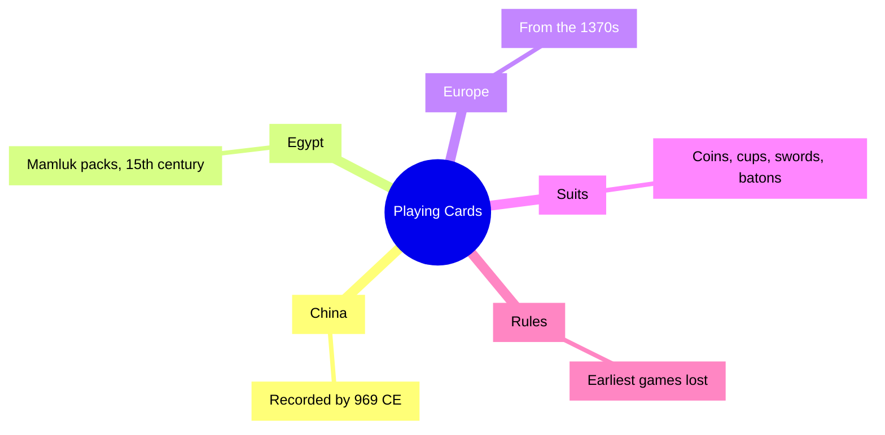
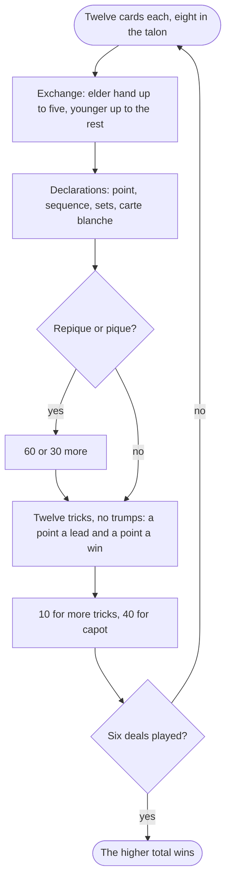

<!-- Written by tools/build-docs.mjs from the sources. Edit those, then run npm run build:docs. -->

# Playing Cards

**Wing III · Kings, Cards and Courts** · c. 900–1400 CE · China, Mamluk Egypt and Europe

[← Four Seasons Chess](fourseasons.md) · [All games](README.md) · [Tarot (Tarocchi) →](tarot.md)

| | |
| --- | --- |
| In the Archives | Playable against the Scribe |
| Rules | Earliest games lost |
| How we know them | Earliest games lost |
| Family | [Cards](README.md#cards) |
| Exhibit id | `cards`: `[librarium_archives start="cards"]` |
| Rule engine | `piquet` |
| Game | **Partie of six** · Two deals |
| Suits drawn | French by default; the Pack switch redraws it in French, German, Swiss or Italian suits |

## At a glance

| | |
| --- | --- |
| China | Recorded by 969 CE |
| Egypt | Mamluk packs, 15th century |
| Europe | From the 1370s |
| Suits | Coins, cups, swords, batons |

## The placard

Cards began in China, and a later writer dated them to the Tang dynasty. The earliest certain record is from 969, when an emperor of the Liao dynasty played cards on New Year's Eve. They travelled west through Persia to Mamluk Egypt, where packs of four suits showed no human figures: rank was marked with ornament and inscriptions. A Mamluk pack identified in Istanbul's Topkapı Palace in the 1930s has suits of coins, cups, swords and sticks.

Cards reached Europe around the 1370s. A Catalan rhyming dictionary names them in 1371, Florence banned a new game called naibbe in 1376, and in 1377 a Dominican friar in Basel described a pack of 52 with kings and marshals. Coins, cups, swords and batons survive today in Italian and Spanish packs.

Piquet, the game at this table, is a two-handed game for a 32-card pack. Rabelais named it in 1535; by the 1650s it was played much as it is now, and Cavendish set its rules down in 1882. Its terms (pique, repique, capot, carte blanche) are French.

> These cards are new designs in the old styles. The first card games are lost, so this table plays Piquet, recorded by 1535 and one of the oldest card games still played.

## A turn

## The rules as played here

1. A 32-card pack, sevens up to aces. Each of you is dealt twelve cards; the other eight are the talon. The player who does not deal is elder hand. The deal alternates.
2. Exchange: elder hand discards one to five cards and draws as many from the talon; younger hand may then discard up to as many as are left. Click cards to mark them, then exchange.
3. Declarations are scored for you. Point: the longest suit scores a point a card (ties go to the higher card values). Sequence: three or more in a row in one suit; tierce 3, quart 4, quint 15, sixième 16 and so on. The best sequence scores all its holder's sequences. Sets: four aces, kings, queens, jacks or tens score 14, three of them 3; the best set scores all its holder's sets. A hand with no court card is carte blanche, 10. Equal declarations score nothing.
4. Then twelve tricks with no trumps: follow suit if you can. You score 1 for each card you lead, 1 for winning a trick the other led, 1 more for the last trick, and 10 for winning more tricks, or 40 for winning them all (capot).
5. Reaching 30 from declarations alone before the other scores anything is a repique, worth 60 more. Elder hand reaching 30 in declarations and play before younger scores anything makes a pique, worth 30 more. After six deals the higher total wins.

**Source:** Piquet as Cavendish set out its rules in 1882, after pagat.com. Combinations are declared for you, in full, and a tie after the last deal is a draw.

### Rule choices

- **Piquet** (at the playing cards): Cavendish's rules (1882) after pagat.com. The visitor marks discards and exchanges; declarations are made for both players, in full and without sinking. Pique, repique, capot and carte blanche all count. A partie of six deals with the Rubicon reckoning shown at the end, or a short game of two deals; a tie is a draw.

### Game

Chosen at the table under Options. Changing it restarts the game.

| Choice | |
| --- | --- |
| Partie of six | the default |
| Two deals |  |

## At the table

| | |
| --- | --- |
| The Scribe | Gentle, Fair or Sharp (see [the Scribe](../scribe.md#levels)) |
| Pass-and-play with a friend | No |
| Undo | No |
| Hint | No |
| Saved and resumed | Yes |
| Pack switch | Yes |

Keys, the move list, replays and the guide are the same at every table: see [Visiting the Archives](../visiting.md#at-a-table).

## How the Scribe plays

**Method:** Hidden information: plays only from what it can see. See [the Scribe](../scribe.md).

**Games with hidden cards and tiles:** Exchange: keeps aces, long suits, sets and runs in the making; Sharp tries every discard among its weakest cards against many random draws and keeps the best on average. Play: cashes sure winners, leads low from its longest suit, wins cheaply, and throws cards that cannot win

**Measured strength**

| Fair vs Gentle | Sharp vs Fair | Games |
| --- | --- | --- |
| 74% | 55% | 400 parties of six deals each |

## Sources

The sources for every placard are listed in [Historical notes and sources](../sources.md).

## In the code

| | |
| --- | --- |
| Rules and the Scribe | [`src/rules/piquet.js`](../../src/rules/piquet.js) |
| Table presenter | [`src/hall/table-piquet.js`](../../src/hall/table-piquet.js) |
| 3D model | [`src/hall/build-cards.js`](../../src/hall/build-cards.js) |
| Placard | [`src/hall/09-exhibit-data.js`](../../src/hall/09-exhibit-data.js) |
