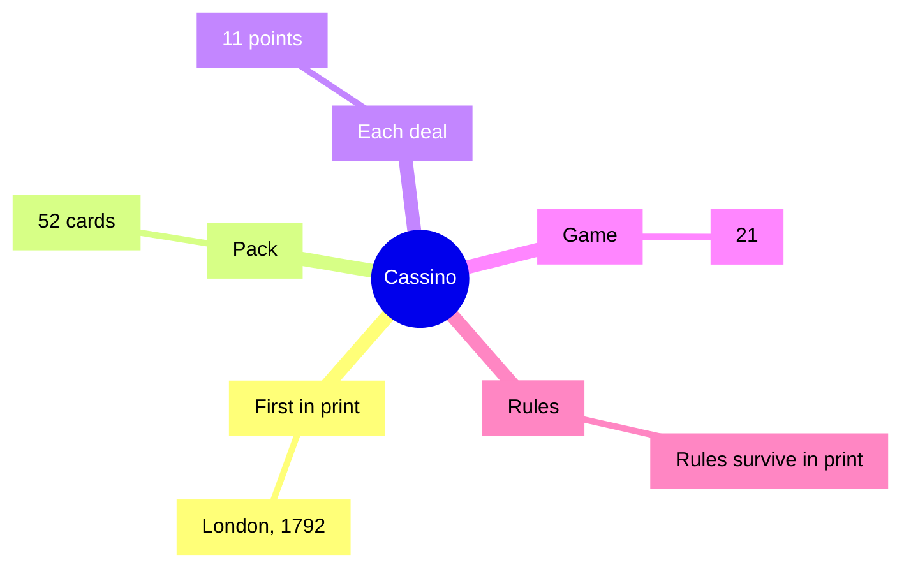
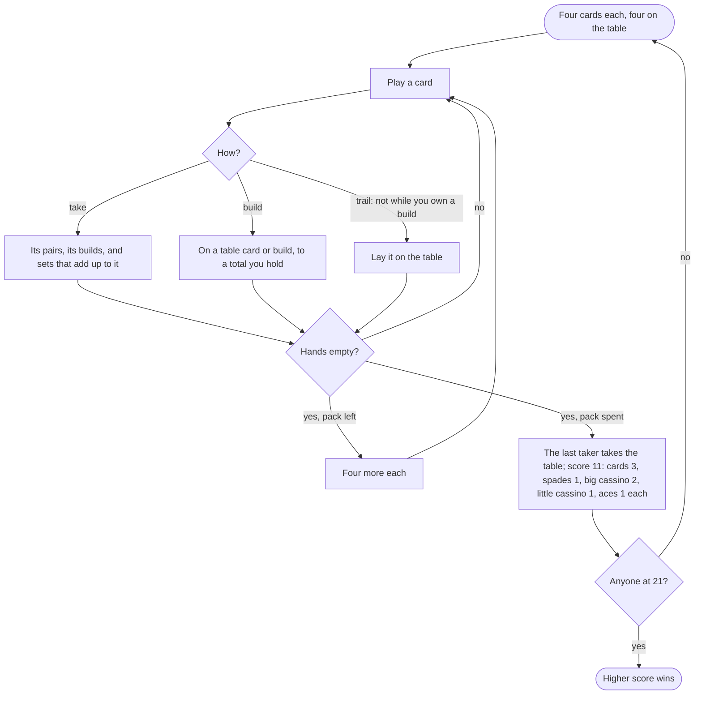

<!-- Written by tools/build-docs.mjs from the sources. Edit those, then run npm run build:docs. -->

# Cassino

**Wing IV · Printed Boards and Parlour Tables** · 1792 CE · England

[← Patience](patience.md) · [All games](README.md) · [Skat →](skat.md)

| | |
| --- | --- |
| In the Archives | Playable against the Scribe |
| Rules | Rules survive in print |
| How we know them | Survive in print |
| Family | [Cards](README.md#cards) |
| Exhibit id | `cassino`: `[librarium_archives start="cassino"]` |
| Sweeps | **No sweeps** · With sweeps |
| Suits drawn | French by default; the Pack switch redraws it in French, German, Swiss or Italian suits |

## At a glance

| | |
| --- | --- |
| First in print | London, 1792 |
| Pack | 52 cards |
| Each deal | 11 points |
| Game | 21 |

## The placard

Cassino is first recorded in England in 1792, in Robert Long's Short Rules for Playing the Game of Casino. It is often called Italian, but no sign has been found of it being played in Italy, and its Italian cousins, scopa and scopone, are first mentioned later.

Rules were printed in Austria in 1795, keeping English words such as sweep and lurch. In America the game was taken up again in the later 1800s, and gin rummy eclipsed it in the 1900s. Americans spell it with two s's; in Britain it is casino.

Like scopa it is a fishing game: a card from your hand takes cards from the table. Cassino adds building, laying a card on another to make a total you mean to take next turn, and the two cards it is named for, big cassino, the ten of diamonds, and little cassino, the two of spades.

> Sweeps, a later addition, can be switched on at the table.

## A turn

## The rules as played here

1. Two players, a full pack. Four cards each and four face up on the table; when both hands are empty, four more each, until the pack is used up. Each turn, play one card from your hand.
2. Take: a card takes every table card of its rank (a court card only one at a time), every build of its value, and any sets of number cards that add up to it: a 9 takes a 4 and a 5. Aces count 1; court cards count nothing and only pair.
3. Build: put a card on a table card or build so the total is the value of another card you hold (a 3 on a 5 to build 8, holding an 8), or on one of the same value to make a multiple build of that value. Either player may take a build with a card of its value; a plain build can be raised by anyone holding the new total, a multiple build cannot. While you own a build you may not trail.
4. Trail: lay your card face up on the table. When the pack is spent, the last player to take anything takes what is left on the table.
5. Each deal scores 11: most cards 3, most spades 1, big cassino (the ten of diamonds) 2, little cassino (the two of spades) 1, and each ace 1; with sweeps, 1 more for clearing the table. The first to 21 at the end of a deal wins.

**Source:** Two-handed Cassino as in the Hoyles that followed Robert Long's rules of 1792, after Wikipedia's Cassino and pagat.com. A player who owns a build may not trail, as Hoyle recommends; combining a build with loose cards is left out.

### Rule choices

- **Cassino:** two-handed, after Wikipedia and pagat.com: four cards each and four to the table, then four each until the pack is spent; pairing (court cards one at a time), combining, single builds that anyone may raise while holding the new total, and multiple builds that cannot be raised. As Hoyle recommends, the owner of a build may not trail. Combining a build with loose cards is left out. Scoring 11 a deal; sweeps are an option. Game to 21.

### Sweeps

Chosen at the table under Options. Changing it restarts the game.

| Choice | |
| --- | --- |
| No sweeps | the default |
| With sweeps |  |

## At the table

| | |
| --- | --- |
| The Scribe | Gentle, Fair or Sharp (see [the Scribe](../scribe.md#levels)) |
| Pass-and-play with a friend | No |
| Undo | No |
| Hint | No |
| Saved and resumed | Yes |
| Pack switch | Yes |

Keys, the move list, replays and the guide are the same at every table: see [Visiting the Archives](../visiting.md#at-a-table).

## How the Scribe plays

**Method:** Hidden information: plays only from what it can see. See [the Scribe](../scribe.md).

**Games with hidden cards and tiles:** Weighs every play: a take for its cards, spades, aces, the two cassinos and a sweep; a build for what it should bring next turn, less the chance the other player holds the card to take it; a trail for what it leaves. Sharp counts every card already taken when it judges those chances

**Measured strength**

| Fair vs Gentle | Sharp vs Fair | Games |
| --- | --- | --- |
| 118–32 | 78–72 | 150 games each, to 21 |

## Sources

Checked in [the placard fact-check](../fact-check.md):

- **Claims:** First recorded in 1792 in Robert Long's *Short Rules for Playing the Game of Casino*; no evidence of play in Italy, and scopa and scopone are mentioned later; Austrian rules of 1795 with English terms; revived in America in the later 1800s and eclipsed by gin rummy; Cassino in the US, casino in Europe; big cassino the ten of diamonds, little cassino the two of spades **Source:** Wikipedia, Cassino (card game)

The sources for every placard are listed in [Historical notes and sources](../sources.md).

## In the code

| | |
| --- | --- |
| Rules and the Scribe | [`src/rules/cassino.js`](../../src/rules/cassino.js) |
| Table presenter | [`src/hall/table-cassino.js`](../../src/hall/table-cassino.js) |
| 3D model | [`src/hall/build-card-room.js`](../../src/hall/build-card-room.js) |
| Placard | [`src/hall/09-exhibit-data.js`](../../src/hall/09-exhibit-data.js) |
