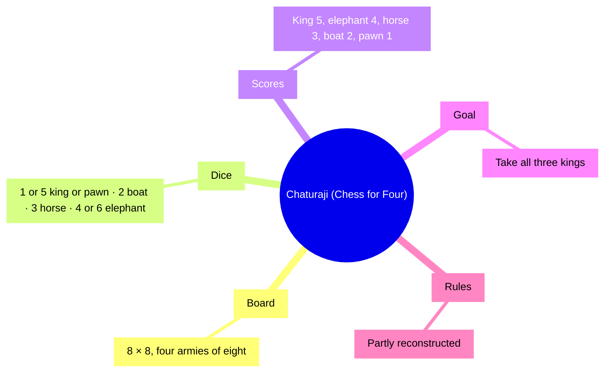
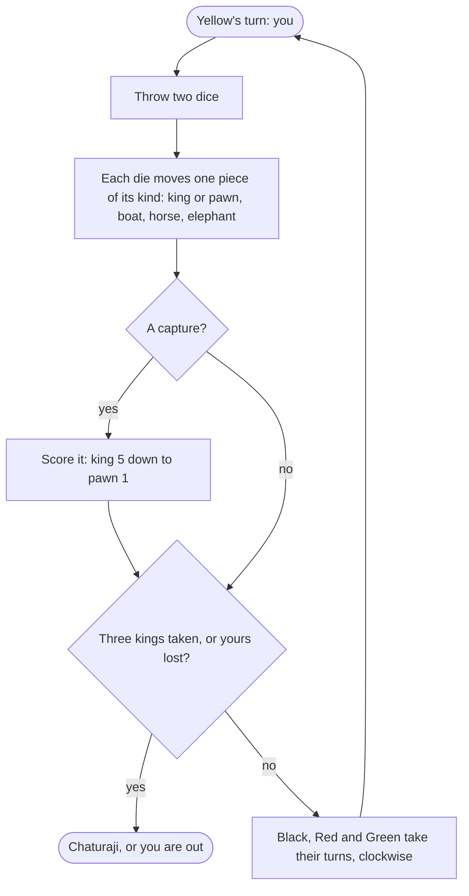

<!-- Written by tools/build-docs.mjs from the sources. Edit those, then run npm run build:docs. -->

# Chaturaji

**Wing III · Kings, Cards and Courts** · described c. 1030 CE · India · recorded by al-Biruni

[← Xiangqi](xiangqi.md) · [All games](README.md) · [Rithmomachia →](rithmo.md)

| | |
| --- | --- |
| In the Archives | Playable against the Scribe, in 4 seats |
| Rules | Partly reconstructed |
| How we know them | Partly reconstructed (al-Biruni, read by Murray) |
| Family | [The chess family](README.md#the-chess-family) |
| Exhibit id | `chaturaji`: `[librarium_archives start="chaturaji"]` |

## At a glance

| | |
| --- | --- |
| Board | 8 × 8, four armies of eight |
| Dice | 1 or 5 king or pawn · 2 boat · 3 horse · 4 or 6 elephant |
| Scores | King 5, elephant 4, horse 3, boat 2, pawn 1 |
| Goal | Take all three kings |

## The placard

Chaturaji, "four kings", was chess for four players, played with dice. The scholar al-Biruni, who came to India with the armies of Mahmud of Ghazni, described it in his book on India of about 1030: four small armies in the corners of one board, a throw of the dice deciding which kind of piece may move, and stakes paid for every piece taken.

The Bengali scholar Raghunandana described it again around 1500, and a version without dice was still played in parts of India in the 19th century. Hiram Cox in 1801 and Duncan Forbes in 1860 argued that it was older than two-handed chaturanga and the true ancestor of chess. Chess historians since H. J. R. Murray have rejected that idea.

We play al-Biruni's game as Murray read it, each army for itself, with ordinary cubic dice. Accounts differ on the dice (Murray thought the first were long four-sided ones), on whether opposite players were partners, and on the rule of the throne, so the table leaves those out.

## A turn

Seats: Yellow, Black, Red, Green.

## The rules as played here

1. Four armies, each for itself. You play yellow, nearest you; Black, Red and Green are three Scribes, and play passes clockwise, to your left.
2. Throw two dice. Each die lets one piece of its kind move once: 1 or 5 the king or a pawn, 2 the boat, 3 the horse, 4 or 6 the elephant. Use the dice in either order, use one, or skip with the Skip button.
3. The king moves one square any way, the elephant like a rook, the horse like a knight, and the boat jumps exactly two squares diagonally. Pawns step one square forward, away from your side, and take one square diagonally forward. There is no check: kings are taken like any other piece.
4. A pawn that reaches the far edge becomes the piece that began on that line (boat, horse, elephant), but only if you have lost one of those. Otherwise it stays a pawn.
5. If a boat's move makes a square of four boats, it takes the other three.
6. Every capture scores: king 5, elephant 4, horse 3, boat 2, pawn 1. A player who loses the king is out, and the rest of that army stays on the board to be taken.
7. Take all three kings and you win: that is chaturaji. Lose yours and you lose. After 30 rounds, the highest score among the kings still standing wins.

**Source:** After al-Biruni's account of about 1030, as read by H. J. R. Murray (A History of Chess, 1913), with cubic dice. The throne rule (sinhasana) and the ransoming of kings are left out, and the 30-round limit is ours.

### Rule choices

- **Chaturaji:** al-Biruni's game as H. J. R. Murray read it, each of the four armies for itself. Two ordinary dice: 1 or 5 moves the king or a pawn, 2 the boat, 3 the horse, 4 or 6 the elephant; each die is one optional move, in either order. The elephant moves like a rook and the boat jumps two squares diagonally; there is no check, and kings are captured. A pawn on the far edge becomes the piece whose line it reached, but only if that piece has been lost. A boat that completes a square of four boats takes the other three. Captures score king 5, elephant 4, horse 3, boat 2, pawn 1. A player without a king is out, and that army stays on the board. You win by being the last king standing (taking all three yourself is chaturaji) and lose with your king; after 30 rounds the highest score among the kings left wins. Left out: partnerships, the throne rule (sinhasana) and ransoming kings, on which accounts differ.

## At the table

| | |
| --- | --- |
| The Scribe | Gentle, Fair or Sharp (see [the Scribe](../scribe.md#levels)) |
| Pass-and-play with a friend | No |
| Undo | No |
| Hint | No |
| Saved and resumed | No |

Keys, the move list, replays and the guide are the same at every table: see [Visiting the Archives](../visiting.md#at-a-table).

## How the Scribe plays

**Measured strength**

| Fair vs Gentle | Sharp vs Fair | Games |
| --- | --- | --- |
| 41% against Gentle | 46% against Fair | 300 each; an even seat wins about 1 in 4 |

**Game by game:** Every way to use both dice, in either order or not at all, scored by points taken, rivals knocked out, and the odds that each piece is taken before its next turn. Sharp also checks its best dozen plans for two-move attacks on its king. Each of the three Scribes plays for itself

## Sources

The sources for every placard are listed in [Historical notes and sources](../sources.md).

## In the code

| | |
| --- | --- |
| Rules and the Scribe | [`src/rules/chaturaji.js`](../../src/rules/chaturaji.js) |
| Table presenter | [`src/hall/table-chaturaji.js`](../../src/hall/table-chaturaji.js) |
| 3D model | [`src/hall/build-chaturaji.js`](../../src/hall/build-chaturaji.js) |
| Placard | [`src/hall/09-exhibit-data.js`](../../src/hall/09-exhibit-data.js) |
