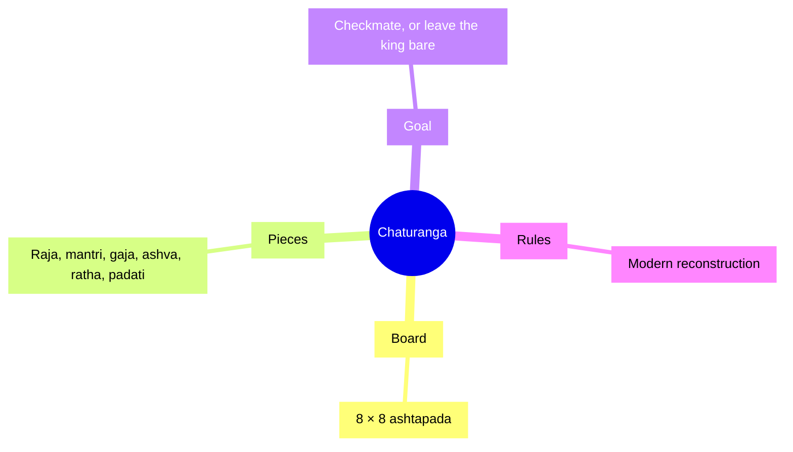
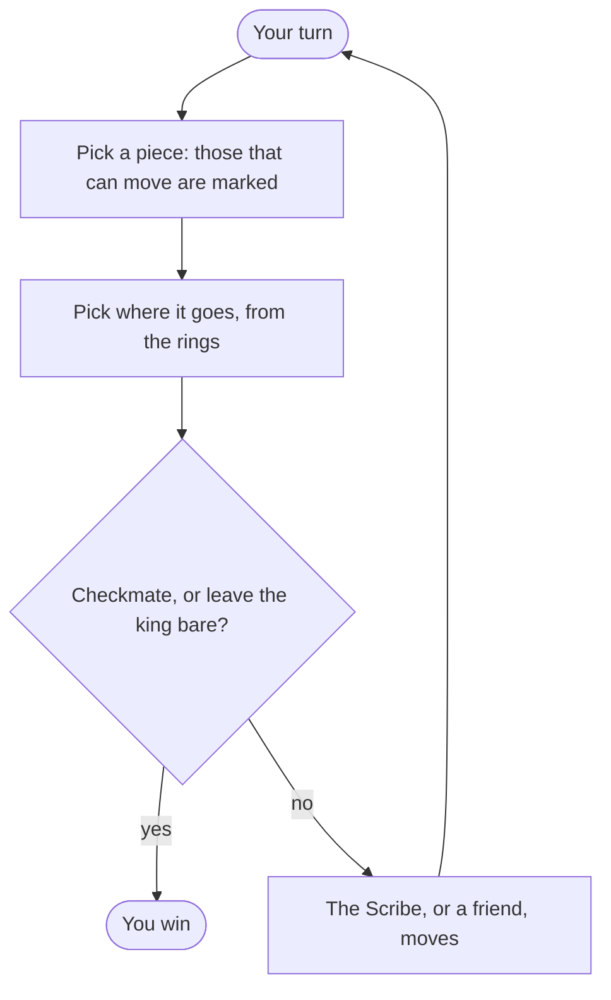

<!-- Written by tools/build-docs.mjs from the sources. Edit those, then run npm run build:docs. -->

# Chaturanga

**Wing III · Kings, Cards and Courts** · by c. 600 CE · India · Gupta period

[← Tables](tables.md) · [All games](README.md) · [Shatranj →](shatranj.md)

| | |
| --- | --- |
| In the Archives | Playable against the Scribe, or a friend on the same screen |
| Rules | Modern reconstruction |
| How we know them | Lost (the elephant's move is unknown) |
| Family | [The chess family](README.md#the-chess-family) |
| Exhibit id | `chaturanga`: `[librarium_archives start="chaturanga"]` |

## At a glance

| | |
| --- | --- |
| Board | 8 × 8 ashtapada |
| Pieces | Raja, mantri, gaja, ashva, ratha, padati |
| Goal | Checkmate, or leave the king bare |

## The placard

Chaturanga means "four limbs", the four arms of an ancient Indian army: elephants, chariots, cavalry and infantry. It is the oldest known ancestor of chess. The earliest clear references come from north India in the 6th century CE, and the name itself appears in Banabhatta's Harsha Charita, written around 625.

It was played on the ashtapada, an uncheckered 8 × 8 board whose marked squares may come from an older race game. The raja, the ratha (chariot) and the ashva (horse) moved like today's king, rook and knight, and the mantri stepped one square diagonally. How the gaja, the elephant, moved is still uncertain.

> No rules survive from chaturanga's own time. This table plays a modern reconstruction, after H. J. R. Murray: shatranj's rules with the Sanskrit pieces, the elephant leaping two squares diagonally.

## A turn

## The rules as played here

1. This is a modern reconstruction. No rules survive from chaturanga's own time, so we play it as H. J. R. Murray did: with the rules of its Persian successor, shatranj.
2. The raja (king) moves one square in any direction. The ratha (chariot) moves like a rook and the ashva (horse) like a knight.
3. The mantri (counsellor) steps one square diagonally. The gaja (elephant) jumps exactly two squares diagonally, over anything in between. Its true move is unknown; this is the shatranj alfil's.
4. The padati (foot soldier) steps one square forward and takes one square diagonally forward, never two at once. On the far rank it becomes a mantri.
5. You win by checkmate, by stalemating the Scribe, or by capturing everything but its raja, unless it can strip yours bare on the very next move. There is no castling, and a long stretch with no capture or padati move is a draw.

**Source:** A modern reconstruction after H. J. R. Murray, A History of Chess (1913), which takes chaturanga's moves from shatranj. Other reconstructions move the gaja differently.

### Rule choices

- **Chaturanga:** no rules survive from its own time, so the table plays H. J. R. Murray's reconstruction: shatranj's rules under the Sanskrit names. The gaja (elephant) leaps two squares diagonally like the alfil, the mantri steps one diagonally, the padati promotes to a mantri, and you win by checkmate, stalemate or baring the raja. Other reconstructions move the gaja differently; the placard says so.

## At the table

| | |
| --- | --- |
| The Scribe | Gentle, Fair or Sharp (see [the Scribe](../scribe.md#levels)) |
| Pass-and-play with a friend | Yes |
| Undo | Yes |
| Hint | Yes |
| Saved and resumed | Yes |

Keys, the move list, replays and the guide are the same at every table: see [Visiting the Archives](../visiting.md#at-a-table).

## How the Scribe plays

**Measured strength**

| Fair vs Gentle | Sharp vs Fair | Games |
| --- | --- | --- |
| 6–0 | as Shatranj | 6; the same engine as Shatranj |

## Sources

The sources for every placard are listed in [Historical notes and sources](../sources.md).

## In the code

| | |
| --- | --- |
| Rules and the Scribe | [`src/rules/chaturanga.js`](../../src/rules/chaturanga.js) |
| Table presenter | [`src/hall/table-chaturanga.js`](../../src/hall/table-chaturanga.js) |
| 3D model | [`src/hall/build-chaturanga-on-an-ashtapada.js`](../../src/hall/build-chaturanga-on-an-ashtapada.js) |
| Placard | [`src/hall/09-exhibit-data.js`](../../src/hall/09-exhibit-data.js) |
