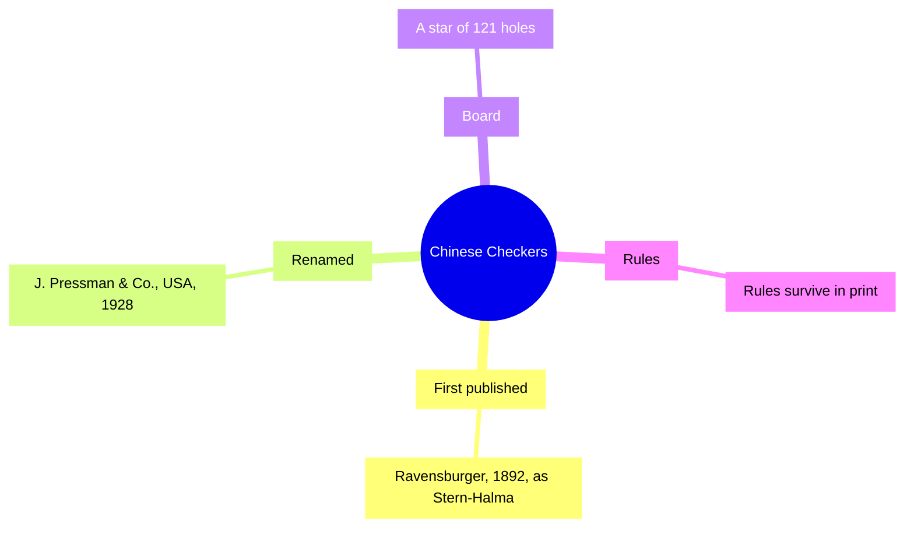
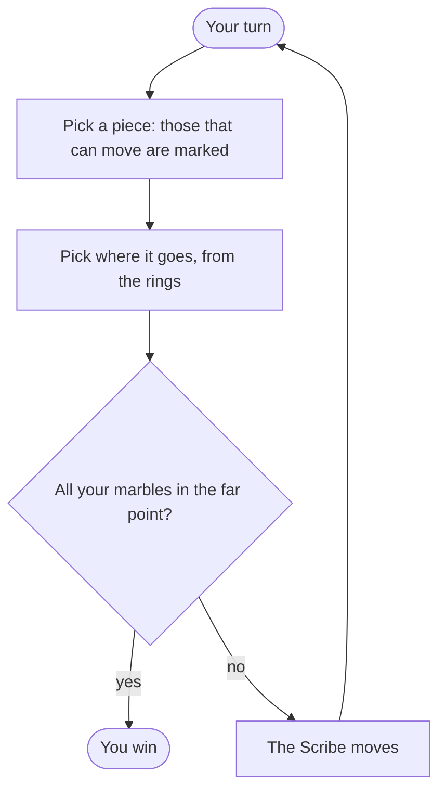

<!-- Written by tools/build-docs.mjs from the sources. Edit those, then run npm run build:docs. -->

# Chinese Checkers

**Wing V · The Modern Board Game** · 1892 CE · Germany and the United States

[← Dots and Boxes](dotsboxes.md) · [All games](README.md) · [The Landlord's Game →](landlord.md)

| | |
| --- | --- |
| In the Archives | Playable against the Scribe |
| Rules | Rules survive in print |
| How we know them | Still played |
| Family | [Running and jumping races](README.md#running-and-jumping-races) |
| Exhibit id | `chinese`: `[librarium_archives start="chinese"]` |

## At a glance

| | |
| --- | --- |
| First published | Ravensburger, 1892, as Stern-Halma |
| Renamed | J. Pressman & Co., USA, 1928 |
| Board | A star of 121 holes |

## The placard

Chinese checkers is neither Chinese nor checkers. It began as Stern-Halma, "star Halma", which the German publisher Ravensburger brought out in 1892: Halma's race moved onto a six-pointed star, so that two, three, four or six players could each race their marbles into the opposite point.

In 1928 the American firm J. Pressman & Co. sold the game as Hop Ching Checkers, and the brothers Bill and Jack Pressman soon renamed it Chinese checkers, to suit the fashion of the time for anything from the East. The name stuck, though the game has no Chinese origin.

## A turn

## The rules as played here

1. You play red, from the point of the star nearest you, and move first. Move all ten of your marbles into the far point before the Scribe fills yours.
2. A marble steps to an empty hole next to it, in any of six directions.
3. Or it hops: over one marble next to it, of either colour, into the empty hole just beyond. Nothing is captured, and it may keep hopping in the same turn, as far as the chain goes. A move is a step or a chain of hops, never both.
4. You win when all your marbles are in the far point. If the far point is full and at least one marble in it is yours, you win too, so no one can block by staying home.
5. House rule: after a hundred and fifty moves each, whoever has more marbles home wins, then whoever is closer overall.

**Source:** Stern-Halma, the star Halma Ravensburger published in 1892, for two players with ten marbles each. The rule against blocking a point by staying home is a common modern addition.

### Rule choices

- **Chinese checkers:** ten marbles each in opposite points of the star. A move is a step or a chain of hops over single marbles of either colour; nothing is captured. A full far point with at least one of your marbles in it wins. House rule: after a hundred and fifty moves each, more marbles home wins.

## At the table

| | |
| --- | --- |
| The Scribe | Gentle, Fair or Sharp (see [the Scribe](../scribe.md#levels)) |
| Pass-and-play with a friend | No |
| Undo | Yes |
| Hint | Yes |
| Saved and resumed | Yes |

Keys, the move list, replays and the guide are the same at every table: see [Visiting the Archives](../visiting.md#at-a-table).

## How the Scribe plays

**Method:** Shared search: negamax with alpha-beta; captures played out at the leaves; iterative deepening; time budget per level. See [the Scribe](../scribe.md).

**Measured strength**

| Fair vs Gentle | Sharp vs Fair | Games |
| --- | --- | --- |
| 6–0 | 4–2 | 6 each |

## Sources

The sources for every placard are listed in [Historical notes and sources](../sources.md).

## In the code

| | |
| --- | --- |
| Rules and the Scribe | [`src/rules/chinese-checkers.js`](../../src/rules/chinese-checkers.js) |
| Table presenter | [`src/hall/table-chinese.js`](../../src/hall/table-chinese.js) |
| 3D model | [`src/hall/build-new-tables.js`](../../src/hall/build-new-tables.js) |
| Placard | [`src/hall/09-exhibit-data.js`](../../src/hall/09-exhibit-data.js) |
