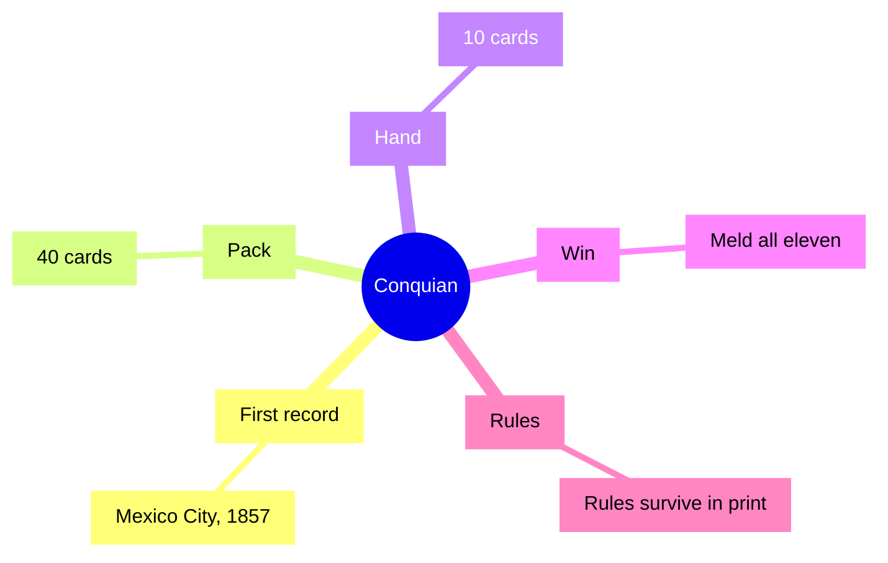
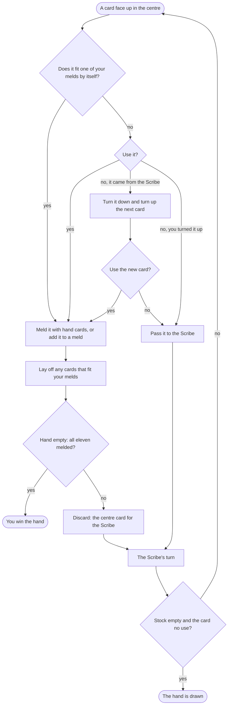

<!-- Written by tools/build-docs.mjs from the sources. Edit those, then run npm run build:docs. -->

# Conquian

**Wing V · The Modern Board Game** · 1857 CE · Mexico, and the first rummy

[← Euchre](euchre.md) · [All games](README.md) · [The Checkered Game of Life →](lifegame.md)

| | |
| --- | --- |
| In the Archives | Playable against the Scribe |
| Rules | Rules survive in print |
| How we know them | Survive in print (Foster, 1897) |
| Family | [Cards](README.md#cards) |
| Exhibit id | `conquian`: `[librarium_archives start="conquian"]` |
| Game | One hand · **First to 3** |
| Suits drawn | French by default; the Pack switch redraws it in French, German, Swiss or Italian suits |

## At a glance

| | |
| --- | --- |
| First record | Mexico City, 1857 |
| Pack | 40 cards |
| Hand | 10 cards |
| Win | Meld all eleven |

## The placard

Conquian is the oldest game of the rummy family, in which players collect sets of a rank and runs in a suit. Its first known mention comes from Mexico City in 1857, where it was played with a 40-card Spanish pack.

It reached Texas by the 1860s and was popular across the neighbouring states by the end of the century. English speakers made the name coon-can. R. F. Foster gave the first full description in English in his Complete Hoyle of 1897, and his 1913 book on the game is subtitled "also called Rum".

The western rummies, gin rummy among them, grew from it. Conquian is stricter than they are: you can meld only with the single card face up in the centre, and must use it or turn it down, and you go out by melding eleven cards, all ten of yours and the last centre card.

> The cards are French-suited here. The Pack switch at the table can redraw them in Latin suits, like the Spanish packs played in Mexico.

## A turn

## The rules as played here

1. Two players, a 40-card pack: ace to seven and the jack, queen and king. Ten cards each; the rest are the stock. A set is three or four cards of a rank; a run is three to eight in a row in one suit, with the ace low and the seven next to the jack (6-7-J is a run, Q-K-A is not).
2. One card at a time lies face up in the centre. On your turn you may use it: meld it with cards from your hand (a new set or run, or added to one of yours), lay off any other cards that fit your melds, then discard a card face up, which becomes the centre card for the other player.
3. Or turn it down: it goes face down out of play, and you turn up the top card of the stock. You may use that card the same way, or pass it, and it becomes the centre card for the other player.
4. A card that fits one of your melds by itself, with no help from your hand, cannot be turned down: the other player forces it on you. You can only meld when you take the centre card.
5. Go out by melding all eleven cards, your ten and the centre card, leaving nothing to discard: you win the hand. If the stock runs out first, the hand is drawn. The first to win three hands (or a single hand) wins the game.

**Source:** Anglo-American two-handed Conquian after pagat.com, which follows R. F. Foster's Complete Hoyle (1897). Forcing, an option for the other player in the old game, always happens here.

### Rule choices

- **Conquian:** the Anglo-American two-handed game after pagat.com and Foster (1897): 40 cards, ten each; the centre card must be used or turned down (or, if you turned it up yourself, passed); melds only with the centre card; lay off on your own melds; runs from the ace up with the seven next to the jack, up to eight long. A card that fits one of your melds by itself is forced on you (in the old game the opponent chooses whether to force it). Go out by melding all eleven. A hand is drawn if the stock runs out. One hand, or first to three.

### Game

Chosen at the table under Options. Changing it restarts the game.

| Choice | |
| --- | --- |
| One hand |  |
| First to 3 | the default |

## At the table

| | |
| --- | --- |
| The Scribe | Gentle, Fair or Sharp (see [the Scribe](../scribe.md#levels)) |
| Pass-and-play with a friend | No |
| Undo | No |
| Hint | No |
| Saved and resumed | Yes |
| Pack switch | Yes |

Keys, the move list, replays and the guide are the same at every table: see [Visiting the Archives](../visiting.md#at-a-table).

## How the Scribe plays

**Method:** Hidden information: plays only from what it can see. See [the Scribe](../scribe.md).

**Games with hidden cards and tiles:** Values each hand card by the sets and runs it could still make. Takes the centre card when that brings the most cards down while leaving the rest of the hand useful, lays off whatever fits, and discards the card it can least use; Fair and Sharp avoid discarding a card that fits the other player's melds

**Measured strength**

| Fair vs Gentle | Sharp vs Fair | Games |
| --- | --- | --- |
| 127–23 | 85–65 | 150 games each, first to 3 |

## Sources

Checked in [the placard fact-check](../fact-check.md):

- **Claims:** First known mention in Mexico City, 1857, with a 40-card Spanish pack; in Texas by the 1860s, popular in neighbouring states by 1900; the first full English description in Foster's *Complete Hoyle* (1897); Foster's 1913 book subtitled "also called Rum"; the ancestor of the western rummies **Source:** pagat.com, Conquian

The sources for every placard are listed in [Historical notes and sources](../sources.md).

## In the code

| | |
| --- | --- |
| Rules and the Scribe | [`src/rules/conquian.js`](../../src/rules/conquian.js) |
| Table presenter | [`src/hall/table-conquian.js`](../../src/hall/table-conquian.js) |
| 3D model | [`src/hall/build-card-room.js`](../../src/hall/build-card-room.js) |
| Placard | [`src/hall/09-exhibit-data.js`](../../src/hall/09-exhibit-data.js) |
