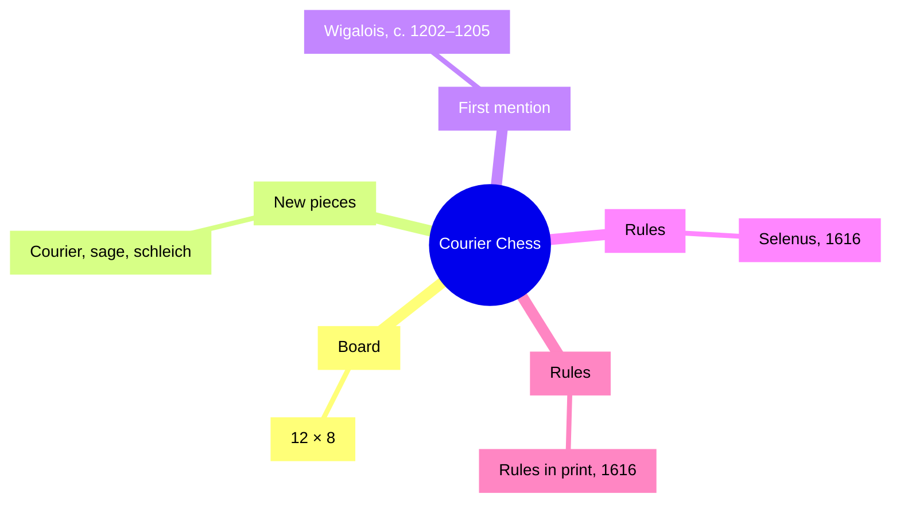
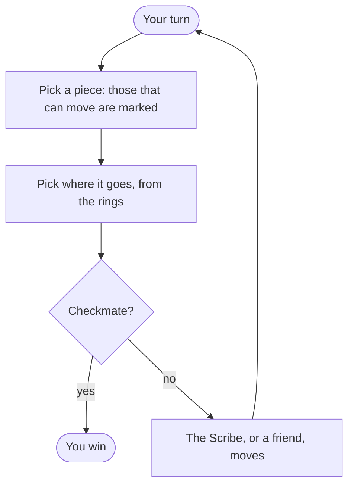

<!-- Written by tools/build-docs.mjs from the sources. Edit those, then run npm run build:docs. -->

# Courier Chess

**Wing III · Kings, Cards and Courts** · by 1202 CE · Germany · from Wigalois to Ströbeck

[← The Lewis Chessmen](lewis.md) · [All games](README.md) · [Four Seasons Chess →](fourseasons.md)

| | |
| --- | --- |
| In the Archives | Playable against the Scribe, or a friend on the same screen |
| Rules | Rules in print, 1616 |
| How we know them | Survive in print (Selenus, 1616) |
| Family | [The chess family](README.md#the-chess-family) |
| Exhibit id | `courier`: `[librarium_archives start="courier"]` |

## At a glance

| | |
| --- | --- |
| Board | 12 × 8 |
| New pieces | Courier, sage, schleich |
| First mention | Wigalois, c. 1202–1205 |
| Rules | Selenus, 1616 |

## The placard

Courier chess is a German chess on a board of twelve files. The poet Wirnt von Gravenberg mentioned it in his romance Wigalois, written around 1202–1205, and expected his readers to know it. Its namesake, the courier, ran any distance diagonally, centuries before the bishop could; after about 1475 that power passed to the bishop of ordinary chess.

Beside the king stand a sage who moves like a king without being one, and a schleich, a fool or jester, who steps one square straight. The old queen and bishop keep their short medieval moves. In the early 1500s Lucas van Leyden painted a woman who seems to be beating a man at courier chess.

In 1616 Gustavus Selenus described the game in detail as one of three forms of chess played in the village of Ströbeck, where it lasted into the 1800s.

## A turn

## The rules as played here

1. You play white and move first, on a board of twelve files. The old opening leaps are already made: your rook pawns and queen's pawn have jumped two squares, and so has your queen.
2. The king moves one square any way, the rook and knight as in modern chess. The courier, the piece the game is named for, runs any distance diagonally like a modern bishop.
3. The queen (fers) steps one square diagonally, and the bishop (alfil) jumps exactly two squares diagonally. The sage (Mann) moves like a king but is not royal. The schleich (fool) steps one square straight.
4. Pawns step one square forward and take one square diagonally forward, never two at once. On the far rank a pawn becomes a queen.
5. Checkmate wins. There is no castling. A stalemate, two bare kings, or a long stretch with no capture or pawn move is a draw.

**Source:** Courier chess as Gustavus Selenus described it in 1616, as played at Ströbeck. Stalemate is not recorded, so it is a draw here, and a pawn becomes a queen at once rather than by the slower old procedures.

### Rule choices

- **Courier chess:** Selenus's game of 1616: rook, knight, bishop (alfil), courier, sage, king, queen (fers), schleich, courier, bishop, knight, rook, with pawns in front. The opening leaps (rook pawns, queen's pawn and queen, two squares each) are made before you start. A pawn becomes a queen on the last rank at once. Stalemate is not recorded, so it is a draw.

## At the table

| | |
| --- | --- |
| The Scribe | Gentle, Fair or Sharp (see [the Scribe](../scribe.md#levels)) |
| Pass-and-play with a friend | Yes |
| Undo | Yes |
| Hint | Yes |
| Saved and resumed | Yes |

Keys, the move list, replays and the guide are the same at every table: see [Visiting the Archives](../visiting.md#at-a-table).

## How the Scribe plays

**Measured strength**

| Fair vs Gentle | Sharp vs Fair | Games |
| --- | --- | --- |
| 5–0, 1 draw | 5–0, 1 draw | 6 each |

**Game by game:** Material (the courier and rook strongest), centralised pieces and advanced pawns, with captures tried first

## Sources

The sources for every placard are listed in [Historical notes and sources](../sources.md).

## In the code

| | |
| --- | --- |
| Rules and the Scribe | [`src/rules/courier-chess.js`](../../src/rules/courier-chess.js) |
| Table presenter | [`src/hall/table-courier.js`](../../src/hall/table-courier.js) |
| 3D model | [`src/hall/build-courier-chess.js`](../../src/hall/build-courier-chess.js) |
| Placard | [`src/hall/09-exhibit-data.js`](../../src/hall/09-exhibit-data.js) |
