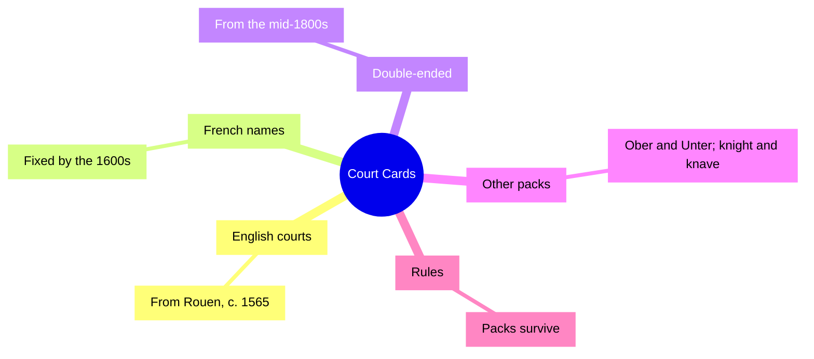

<!-- Written by tools/build-docs.mjs from the sources. Edit those, then run npm run build:docs. -->

# Court Cards

**Wing IV · Printed Boards and Parlour Tables** · c. 1565 CE · Rouen, Paris and London

[← Pachisi (Chaupar)](pachisi.md) · [All games](README.md) · [The Game of the Goose →](goose.md)

| | |
| --- | --- |
| In the Archives | On display |
| Rules | Packs survive |
| How we know them | Packs survive |
| Family | [Cards](README.md#cards) |
| Exhibit id | `courtcards`: `[librarium_archives start="courtcards"]` |

## At a glance

| | |
| --- | --- |
| English courts | From Rouen, c. 1565 |
| French names | Fixed by the 1600s |
| Double-ended | From the mid-1800s |
| Other packs | Ober and Unter; knight and knave |

## The placard

The kings, queens and knaves of the English pack descend from a Rouen pack of about 1565 by Pierre Marechal, which survives in the museum at Rouen. Its kings wear a crown over a flat cap and long fur-lined cloaks, and its queens Tudor headdresses. Copyists and woodcutters repeated the figures for centuries, and hands, sceptres and symbols drifted or lost their meaning on the way: the king of hearts, nicknamed the suicide king, seems to hold his sword behind his head.

From the late 1500s French makers named their court cards after heroes of epic, chronicle and legend, and by the 1600s the names were fixed: the kings became David, Charles, Caesar and Alexander. English makers never took the names up.

Not every pack has a queen. German and Swiss packs have a king, an Ober and an Unter; Italian and Spanish packs a king, a mounted knight and a knave. Double-ended courts, which read the same either way up, came in the mid-1800s, at the cost of cutting each figure off at the waist.

> The figures on the easel are our own drawings after the old patterns, not copies of any pack.

## Sources

Checked in [the placard fact-check](../fact-check.md):

- **Claims:** The English courts descend from Pierre Marechal's Rouen pack of c. 1565, which survives at Rouen; Tudor headdresses; the "suicide king"; French court names fixed by the 1600s (David, Charles, Caesar, Alexander), never adopted in England; double-ended courts from the mid-1800s **Source:** WOPC, History of Court Cards

The sources for every placard are listed in [Historical notes and sources](../sources.md).

## In the code

| | |
| --- | --- |
| 3D model | [`src/hall/build-card-room.js`](../../src/hall/build-card-room.js) |
| Placard | [`src/hall/09-exhibit-data.js`](../../src/hall/09-exhibit-data.js) |
