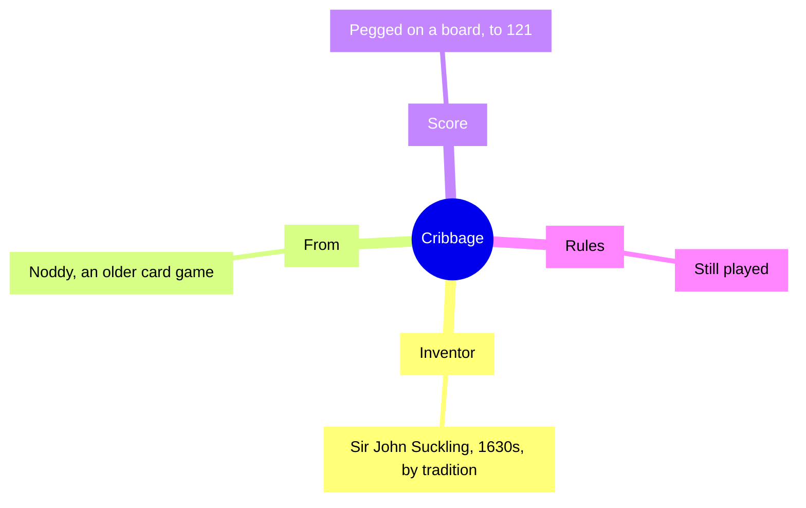
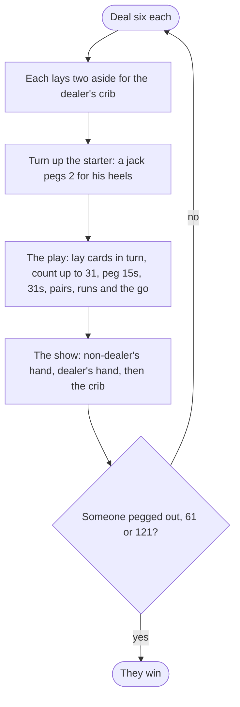

<!-- Written by tools/build-docs.mjs from the sources. Edit those, then run npm run build:docs. -->

# Cribbage

**Wing IV · Printed Boards and Parlour Tables** · 1630s CE · England · the Stuart court

[← The Game of the Goose](goose.md) · [All games](README.md) · [Cards Not for Playing →](notforplay.md)

| | |
| --- | --- |
| In the Archives | Playable against the Scribe |
| Rules | Still played |
| How we know them | Still played |
| Family | [Cards](README.md#cards) |
| Exhibit id | `cribbage`: `[librarium_archives start="cribbage"]` |
| Game | **To 61** · To 121 |
| Suits drawn | French by default; the Pack switch redraws it in French, German, Swiss or Italian suits |

## At a glance

| | |
| --- | --- |
| Inventor | Sir John Suckling, 1630s, by tradition |
| From | Noddy, an older card game |
| Score | Pegged on a board, to 121 |

## The placard

Cribbage is said to have been devised in the 1630s by the poet and courtier Sir John Suckling, who added new rules to an older card game called noddy. John Aubrey, writing later in the century, credited Suckling with it; Suckling was also famous as a gambler.

It is one of very few card games scored on a board. Each player moves two pegs, the back one leapfrogging the front, so a miscount is easy to see. Fifteens, pairs and runs are scored twice over: once as the cards are played, and again when the hands are shown.

## A turn

## The rules as played here

1. Each deal, you each get six cards and lay two aside, face down, for the crib, which scores for the dealer. The deal alternates; the Scribe deals first. Then a starter card is turned up, and if it is a jack the dealer pegs 2 for his heels.
2. The play: starting with the player who did not deal, you take turns laying a card and calling the running total, which may not pass 31. Score 2 for making 15 or 31, 2 for a pair with the card before (6 for three of a kind, 12 for four), and 1 a card for a run of three or more. When neither of you can play without passing 31, the last to play pegs 1 for the go and the count starts again from nothing. The last card of all pegs 1.
3. The show: each hand of four, with the starter, counts 2 for every combination making 15, 2 for every pair, 1 a card for runs, 4 for a flush (5 if the starter matches; the crib needs all five) and 1 for his nobs, a jack of the starter's suit. The non-dealer counts first, then the dealer's hand, then the crib.
4. The first to peg out wins: 61 points here by default, or the full 121.

**Source:** Cribbage as Sir John Suckling is said to have devised it in the 1630s from the older game of noddy, in its modern two-player six-card form.

### Rule choices

- **Cribbage:** the standard two-player six-card game. The Scribe deals first and the deal alternates; the play, the go and the show are scored for you, and pegs leapfrog along the board. One game to 61 by default, or 121 (a lurch is noted but not doubled).

### Game

Chosen at the table under Options. Changing it restarts the game.

| Choice | |
| --- | --- |
| To 61 | the default |
| To 121 |  |

## At the table

| | |
| --- | --- |
| The Scribe | Gentle, Fair or Sharp (see [the Scribe](../scribe.md#levels)) |
| Pass-and-play with a friend | No |
| Undo | No |
| Hint | No |
| Saved and resumed | No |
| Pack switch | Yes |

Keys, the move list, replays and the guide are the same at every table: see [Visiting the Archives](../visiting.md#at-a-table).

## How the Scribe plays

**Method:** Hidden information: plays only from what it can see. See [the Scribe](../scribe.md).

**Games with hidden cards and tiles:** Sharp averages every possible four-card keep over all 46 possible starters, weighs what it gives the crib, and in the play avoids leaving counts of 5 or 21

**Measured strength**

| Fair vs Gentle | Sharp vs Fair | Games |
| --- | --- | --- |
| 60% | 57% | 300 each |

## Sources

The sources for every placard are listed in [Historical notes and sources](../sources.md).

## In the code

| | |
| --- | --- |
| Rules and the Scribe | [`src/rules/cribbage.js`](../../src/rules/cribbage.js) |
| Table presenter | [`src/hall/table-cribbage.js`](../../src/hall/table-cribbage.js) |
| 3D model | [`src/hall/build-hnefatafl.js`](../../src/hall/build-hnefatafl.js) |
| Placard | [`src/hall/09-exhibit-data.js`](../../src/hall/09-exhibit-data.js) |
