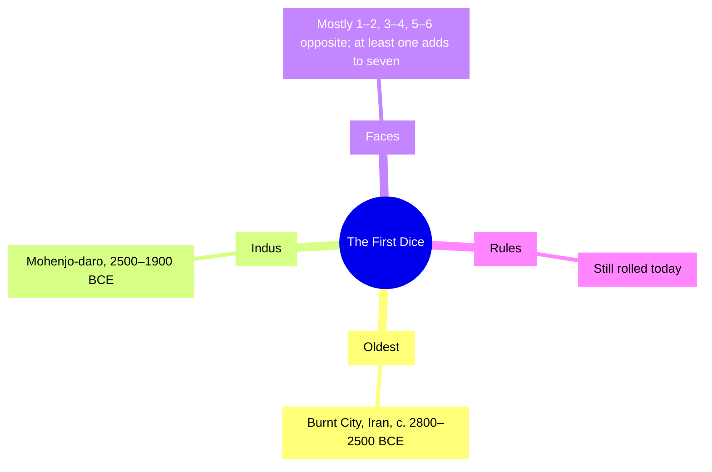
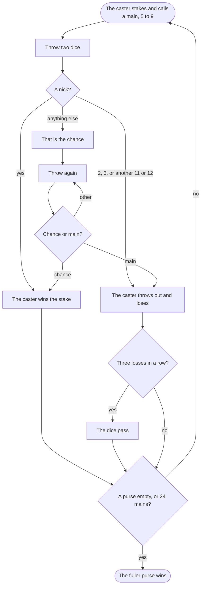

<!-- Written by tools/build-docs.mjs from the sources. Edit those, then run npm run build:docs. -->

# The First Dice

**Wing I · The Dawn of Play** · c. 2800–1900 BCE · Iran and the Indus Valley

[← The Royal Game of Ur](ur.md) · [All games](README.md) · [Hounds and Jackals →](hounds.md)

| | |
| --- | --- |
| In the Archives | Playable against the Scribe, or a friend on the same screen |
| Rules | Still rolled today |
| How we know them | Still rolled; the oldest games are lost |
| Family | [Dice games](README.md#dice-games) |
| Exhibit id | `dice`: `[librarium_archives start="dice"]` |
| Rule engine | `hazard` |

## At a glance

| | |
| --- | --- |
| Oldest | Burnt City, Iran, c. 2800–2500 BCE |
| Indus | Mohenjo-daro, 2500–1900 BCE |
| Faces | Mostly 1–2, 3–4, 5–6 opposite; at least one adds to seven |

## The placard

Cubic dice are nearly as old as board games. Possibly the oldest yet found come from the Burnt City, Shahr-e Sukhteh in eastern Iran, buried with a set for a race game that has been dated to between 2800 and 2500 BCE.

Graves at Mohenjo-daro in the Indus Valley held terracotta dice from 2500 to 1900 BCE. Most were numbered one opposite two, three opposite four and five opposite six, but on at least one the opposite faces add up to seven, as they do on dice today. Players elsewhere threw other things: Senet's sticks and Ur's four-sided pyramids are on the tables in this wing.

The table here plays Hazard, a two-dice game named in Chaucer's Canterbury Tales in the 14th century. Its rules were set down in Hoyle's Games by 1790, and a simplified form of it became American craps.

> The dice are new, made in the old manner. No rules survive for the Bronze Age games, so this table plays Hazard, the medieval dice game Chaucer knew, as it was written down in the 1700s.

## A turn

## The rules as played here

1. You each begin with ten shillings. Whoever casts stakes 1, 2 or 5 shillings, which the other covers, then calls a main: any number from 5 to 9.
2. On the first throw of two dice, the main wins (a nick). So does 11 with a main of 7, and 12 with a main of 6 or 8. A 2 or 3 always loses (throwing out), and so does any other 11 or 12.
3. Any other total becomes your chance. Keep throwing: the chance wins, the main loses, and anything else is thrown again.
4. The caster keeps the dice until losing three times in a row; then they pass. The game ends when a purse is empty, or after 24 mains, when the fuller purse wins.

**Source:** English hazard as Hoyle's Games set it down by 1790. The bank's side bets and odds on the chance are left out: every cast is an even-money stake.

### Rule choices

- **Hazard** (at the first dice): English hazard as Hoyle's Games give it by 1790. Each player starts with 10 shillings; the caster stakes 1, 2 or 5 and calls a main of 5 to 9. On the first throw the main nicks, as does 11 with a main of 7 and 12 with 6 or 8; 2 and 3 always throw out, as do other 11s and 12s. Any other total is the chance, thrown for until it or the main comes up. The caster keeps the dice until three losses in a row. The game ends with an empty purse or after 24 mains. Side bets at odds are left out.

## At the table

| | |
| --- | --- |
| The Scribe | Gentle, Fair or Sharp (see [the Scribe](../scribe.md#levels)) |
| Pass-and-play with a friend | Yes |
| Undo | No |
| Hint | No |
| Saved and resumed | No |

Keys, the move list, replays and the guide are the same at every table: see [Visiting the Archives](../visiting.md#at-a-table).

## How the Scribe plays

**Games with hidden cards and tiles:** Always calls a main of 7, the caster's best. Fair stakes 2; Sharp stakes 1, since the caster has the worse of every bet, unless it is behind near the end

**Measured strength**

| Fair vs Gentle | Sharp vs Fair | Games |
| --- | --- | --- |
| about 50% | 56% | 4,000 each; the dice decide almost everything |

## Sources

The sources for every placard are listed in [Historical notes and sources](../sources.md).

## In the code

| | |
| --- | --- |
| Rules and the Scribe | [`src/rules/hazard.js`](../../src/rules/hazard.js) |
| Table presenter | [`src/hall/table-hazard.js`](../../src/hall/table-hazard.js) |
| 3D model | [`src/hall/build-backfill-displays.js`](../../src/hall/build-backfill-displays.js) |
| Placard | [`src/hall/09-exhibit-data.js`](../../src/hall/09-exhibit-data.js) |
