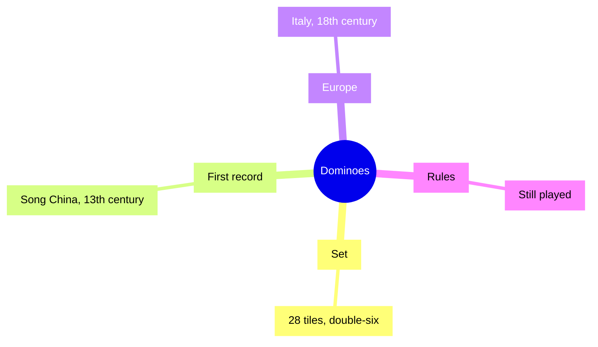
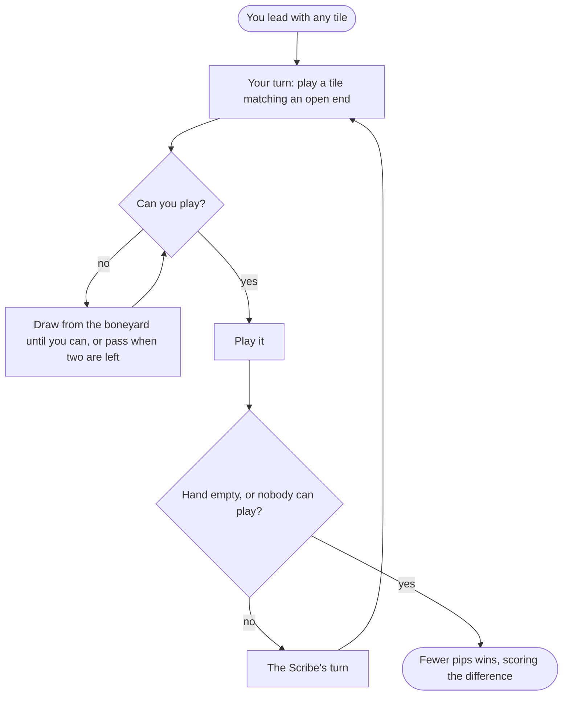

<!-- Written by tools/build-docs.mjs from the sources. Edit those, then run npm run build:docs. -->

# Dominoes

**Wing IV · Printed Boards and Parlour Tables** · 18th century CE · China, then Italy and France

[← Cards Not for Playing](notforplay.md) · [All games](README.md) · [Scopa →](scopa.md)

| | |
| --- | --- |
| In the Archives | Playable against the Scribe |
| Rules | Still played |
| How we know them | Still played |
| Family | [Tiles](README.md#tiles) |
| Exhibit id | `dominoes`: `[librarium_archives start="dominoes"]` |

## At a glance

| | |
| --- | --- |
| Set | 28 tiles, double-six |
| First record | Song China, 13th century |
| Europe | Italy, 18th century |

## The placard

A domino is a pair of dice in one tile. A double-six set holds one tile for each throw of two dice, with a blank suit added, 28 in all. The earliest written mention of dominoes comes from Song-dynasty China, in Zhou Mi's Former Events in Wulin, written in the 13th century, and Chinese sets are still made without the blanks.

The European game appeared in Italy in the 18th century, perhaps first in Venice and Naples, became a fashion in France, and reached Britain late in the century, possibly with French prisoners of war. The name probably comes from a hooded carnival costume. The oldest European games block the line or draw from the boneyard, like the one at this table.

## A turn

## The rules as played here

1. Each of you has seven tiles; the other fourteen lie face down in the boneyard. You lead first, with any tile.
2. On your turn, play one tile that matches either open end of the line: click it, and if it fits both ends, then the ring at the end you want.
3. If you cannot play, you must draw from the boneyard until you can. The last two tiles are never drawn: once only two remain, a player who cannot play passes.
4. The hand ends when someone plays their last tile, or when neither of you can play. The player with fewer pips left in hand wins, and scores the difference (a player who goes out scores all the other's pips). Equal pips is a draw.

**Source:** The Draw game, the oldest kind of European domino game, as pagat.com gives it for two players. One hand is played here rather than a game to 100.

### Rule choices

- **Dominoes:** the Draw game for two from pagat.com: seven tiles each, draw from the boneyard until you can play but never the last two, and the lower pip count wins when the hand ends. One hand is played rather than a game to 100.

## At the table

| | |
| --- | --- |
| The Scribe | Gentle, Fair or Sharp (see [the Scribe](../scribe.md#levels)) |
| Pass-and-play with a friend | No |
| Undo | No |
| Hint | No |
| Saved and resumed | No |

Keys, the move list, replays and the guide are the same at every table: see [Visiting the Archives](../visiting.md#at-a-table).

## How the Scribe plays

**Method:** Hidden information: plays only from what it can see. See [the Scribe](../scribe.md).

**Games with hidden cards and tiles:** Sheds heavy tiles and doubles. Sharp also keeps tiles that match the ends it leaves, and leaves ends you have shown you cannot match (you drew or passed on them)

**Measured strength**

| Fair vs Gentle | Sharp vs Fair | Games |
| --- | --- | --- |
| 61% | 62% | 400 and 600 hands |

## Sources

The sources for every placard are listed in [Historical notes and sources](../sources.md).

## In the code

| | |
| --- | --- |
| Rules and the Scribe | [`src/rules/dominoes.js`](../../src/rules/dominoes.js) |
| Table presenter | [`src/hall/table-dominoes.js`](../../src/hall/table-dominoes.js) |
| 3D model | [`src/hall/build-new-tables.js`](../../src/hall/build-new-tables.js) |
| Placard | [`src/hall/09-exhibit-data.js`](../../src/hall/09-exhibit-data.js) |
