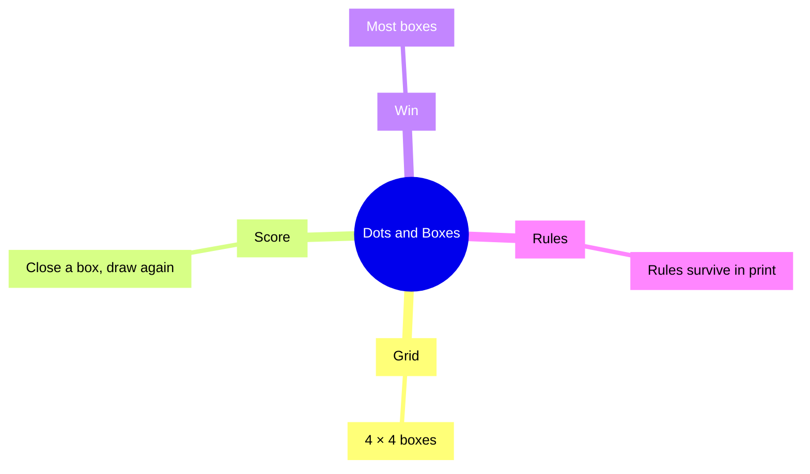
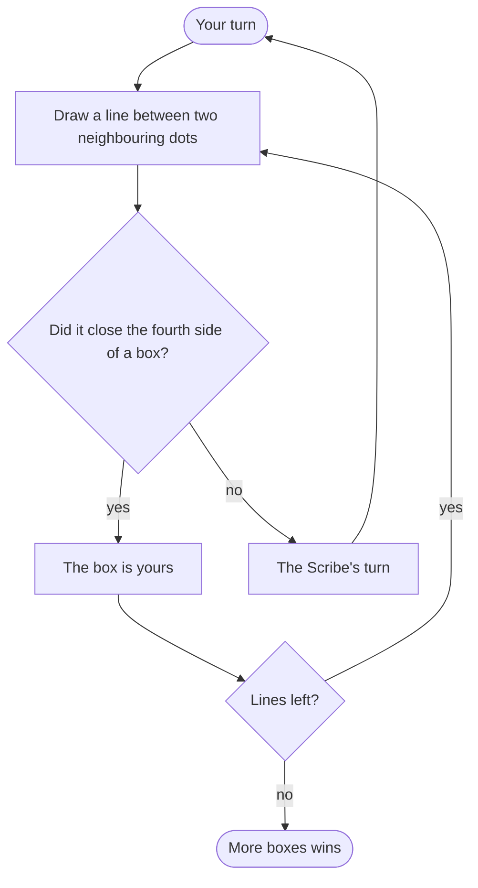

<!-- Written by tools/build-docs.mjs from the sources. Edit those, then run npm run build:docs. -->

# Dots and Boxes

**Wing V · The Modern Board Game** · late 19th century CE · France

[← Hearts](hearts.md) · [All games](README.md) · [Chinese Checkers →](chinese.md)

| | |
| --- | --- |
| In the Archives | Playable against the Scribe, or a friend on the same screen |
| Rules | Rules survive in print |
| How we know them | Survive in print (Lucas's *pipopipette*) |
| Family | [Territory and enclosure](README.md#territory-and-enclosure) |
| Exhibit id | `dotsboxes`: `[librarium_archives start="dotsboxes"]` |
| Options | **4 × 4** · 5 × 5 |

## At a glance

| | |
| --- | --- |
| Grid | 4 × 4 boxes |
| Score | Close a box, draw again |
| Win | Most boxes |

## The placard

Dots and Boxes needs only a pencil and paper. The French mathematician Édouard Lucas, best known for the Tower of Hanoi puzzle, published it in the late 19th century as la pipopipette, and it has gone by many names since, from boxes to pigs in a pen.

It looks simple, but it hides deep strategy. Strong players count the chains of boxes forming on the board and give a few boxes away on purpose, to force their opponent to open the long chains. The mathematician Elwyn Berlekamp wrote a whole book about it in 2000.

## A turn

## The rules as played here

1. Take turns drawing a line between two neighbouring dots, across or up and down.
2. Close the fourth side of a box and it is yours: you score it and draw again.
3. When every line is drawn, the player with more boxes wins.
4. A tip: try not to draw the third side of a box, unless you have to.

**Source:** The rules Édouard Lucas published as "la pipopipette", here on a grid of sixteen boxes.

### Options

Chosen at the table under Options. Changing it restarts the game.

| Choice | |
| --- | --- |
| 4 × 4 | the default |
| 5 × 5 |  |

## At the table

| | |
| --- | --- |
| The Scribe | Gentle, Fair or Sharp (see [the Scribe](../scribe.md#levels)) |
| Pass-and-play with a friend | Yes |
| Undo | Yes |
| Hint | Yes |
| Saved and resumed | Yes |

Keys, the move list, replays and the guide are the same at every table: see [Visiting the Archives](../visiting.md#at-a-table).

## How the Scribe plays

**Game by game:** Never hands over boxes while it can help it, then solves the endgame exactly (Sharp from 22 open lines, Fair from 15)

## Sources

The sources for every placard are listed in [Historical notes and sources](../sources.md).

## In the code

| | |
| --- | --- |
| Rules and the Scribe | [`src/rules/dots-and-boxes.js`](../../src/rules/dots-and-boxes.js) |
| Table presenter | [`src/hall/table-dots.js`](../../src/hall/table-dots.js) |
| 3D model | [`src/hall/build-dots-and-boxes.js`](../../src/hall/build-dots-and-boxes.js) |
| Placard | [`src/hall/09-exhibit-data.js`](../../src/hall/09-exhibit-data.js) |
