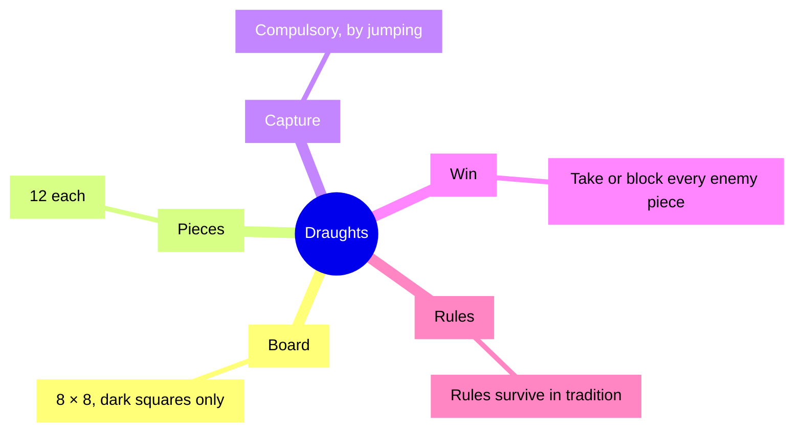
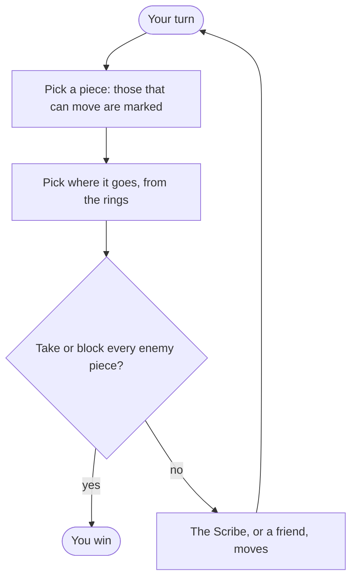

<!-- Written by tools/build-docs.mjs from the sources. Edit those, then run npm run build:docs. -->

# Draughts

**Wing IV · Printed Boards and Parlour Tables** · c. 1100s – 1500s CE · France, Spain and England

[← The New Queen](newqueen.md) · [All games](README.md) · [Primero →](primero.md)

| | |
| --- | --- |
| In the Archives | Playable against the Scribe, or a friend on the same screen |
| Rules | Rules survive in tradition |
| How we know them | English draughts (checkers) |
| Family | [Capture games](README.md#capture-games) |
| Exhibit id | `draughts`: `[librarium_archives start="draughts"]` |

## At a glance

| | |
| --- | --- |
| Board | 8 × 8, dark squares only |
| Pieces | 12 each |
| Capture | Compulsory, by jumping |
| Win | Take or block every enemy piece |

## The placard

Draughts was born when someone moved the pieces of alquerque, an Arabic game played on a grid of lines, onto a chessboard. When is disputed: the historian H. J. R. Murray thought the 12th century, while David Parlett finds the first possible reference in England in 1380. Early players called it fierges or ferses, after the medieval chess queen, and later dames.

Around 1535 the French made capturing compulsory, which turned a pleasant pastime into a sharp game of forced sacrifices. The first book on it was printed in Valencia in 1547, and in 1756 the London mathematician William Payne wrote the first in English. In America it is called checkers.

## A turn

## The rules as played here

1. You play the dark pieces and move first. Pieces move one square diagonally forward, on the dark squares only.
2. Capture by jumping an enemy piece diagonally into the empty square beyond. If you can capture, you must, and you keep jumping while you can.
3. A piece that reaches the far row is crowned a king. Kings move and capture diagonally backwards as well as forwards.
4. You win when the Scribe has no pieces left or no legal move. A long stretch with no capture or uncrowned move is a draw.

**Source:** English draughts (checkers). Forced capture is first recorded in France around 1535.

## At the table

| | |
| --- | --- |
| The Scribe | Gentle, Fair or Sharp (see [the Scribe](../scribe.md#levels)) |
| Pass-and-play with a friend | Yes |
| Undo | Yes |
| Hint | Yes |
| Saved and resumed | Yes |

Keys, the move list, replays and the guide are the same at every table: see [Visiting the Archives](../visiting.md#at-a-table).

## How the Scribe plays

**Method:** Shared search: negamax with alpha-beta; captures played out at the leaves; iterative deepening; time budget per level. See [the Scribe](../scribe.md).

## Sources

The sources for every placard are listed in [Historical notes and sources](../sources.md).

## In the code

| | |
| --- | --- |
| Rules and the Scribe | [`src/rules/draughts.js`](../../src/rules/draughts.js) |
| Table presenter | [`src/hall/table-draughts.js`](../../src/hall/table-draughts.js) |
| 3D model | [`src/hall/build-draughts.js`](../../src/hall/build-draughts.js) |
| Placard | [`src/hall/09-exhibit-data.js`](../../src/hall/09-exhibit-data.js) |
