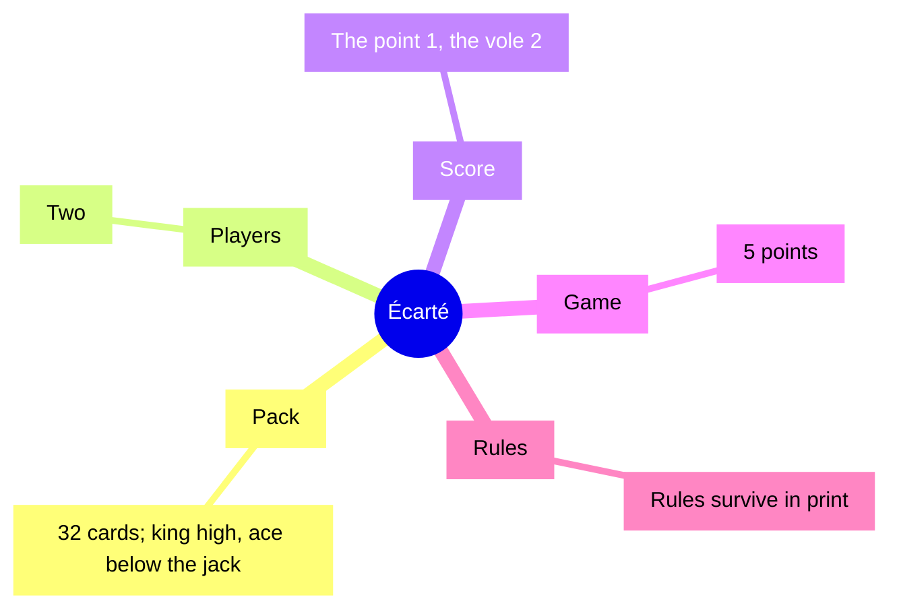
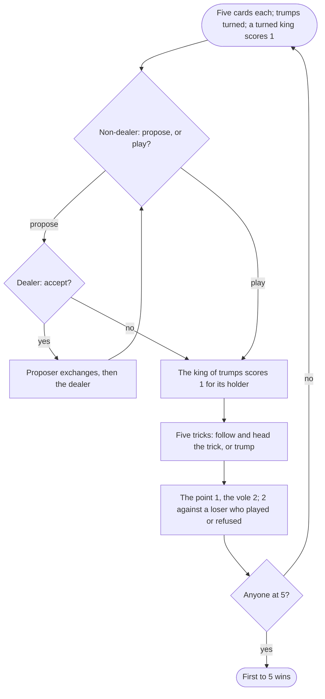

<!-- Written by tools/build-docs.mjs from the sources. Edit those, then run npm run build:docs. -->

# Écarté

**Wing IV · Printed Boards and Parlour Tables** · 19th century CE · France, the salons and the clubs

[← Skat](skat.md) · [All games](README.md) · [Snakes and Ladders →](snakes.md)

| | |
| --- | --- |
| In the Archives | Playable against the Scribe |
| Rules | Rules survive in print |
| How we know them | Survive in print |
| Family | [Cards](README.md#cards) |
| Exhibit id | `ecarte`: `[librarium_archives start="ecarte"]` |
| Suits drawn | French by default; the Pack switch redraws it in French, German, Swiss or Italian suits |

## At a glance

| | |
| --- | --- |
| Pack | 32 cards; king high, ace below the jack |
| Players | Two |
| Score | The point 1, the vole 2 |
| Game | 5 points |

## The placard

Écarté is a French game for two, a sharp, quick descendant of the old trick-taking game of triomphe. Its name means discarded: before play, either player may ask to throw away cards and draw new ones, and the other may agree or refuse, and refusing is a risk. In every suit the king ranks highest and the ace sits between the ten and the jack.

It was a great gambling game of 19th-century Paris, where onlookers might advise the players, and it crossed to the London clubs, which forbade that: Cavendish described the rules played there in 1886. It turns up in fiction from Poe's "William Wilson" (1839), whose hero cheats at it, to Dumas's The Count of Monte Cristo and Conan Doyle's Brigadier Gerard.

It survived in Germany into the 1960s, and in a few French cercles de jeu into this century.

> Holding the king of trumps is announced for you.

## A turn

## The rules as played here

1. Five cards each from a pack of 32 (sevens to kings and the aces), and the next card turned up for trumps. In every suit the king is highest, then the queen, jack, ace, ten, nine, eight and seven. A turned-up king scores 1 for the dealer.
2. Before play, the player who did not deal may propose an exchange, or play at once. If the dealer accepts, the proposer discards any number of cards and draws as many, then the dealer must exchange at least one; the proposer may then propose again. If the dealer refuses, play begins.
3. Holding the king of trumps scores 1; it is announced for you before the first card.
4. The non-dealer leads. You must follow suit if you can, and win the trick if you can; if you cannot follow, you must trump if you can. The winner leads the next trick.
5. Three or four tricks score 1 point, all five (the vole) 2. If you played without proposing, or refused the first proposal, and then lose, the other player scores 2. The first to 5 points wins.

**Source:** Écarté as Wikipedia gives the French game: the pack and its order, the turned king, the proposal and exchange, the duty to head the trick, the vole and the penalties for playing or refusing and losing.

### Rule choices

- **Écarté:** after Wikipedia: 32 cards ranking king, queen, jack, ace, ten down to seven; five each, a turned king scoring 1 for the dealer; the non-dealer proposes or plays, the dealer accepts or refuses, and after an accepted proposal the proposer exchanges first and the dealer must take at least one card; the king of trumps is announced for its holder. Follow suit and head the trick if you can, trump if you cannot follow. The point 1, the vole 2, and 2 against a player who played without proposing, or refused the first proposal, and lost. Game to 5.

## At the table

| | |
| --- | --- |
| The Scribe | Gentle, Fair or Sharp (see [the Scribe](../scribe.md#levels)) |
| Pass-and-play with a friend | No |
| Undo | No |
| Hint | No |
| Saved and resumed | Yes |
| Pack switch | Yes |

Keys, the move list, replays and the guide are the same at every table: see [Visiting the Archives](../visiting.md#at-a-table).

## How the Scribe plays

**Method:** Sampling the unseen cards: deals what it cannot see at random and plays each deal out, as Tarocchi's Sharp does. See [the Scribe](../scribe.md).

**Games with hidden cards and tiles:** Counts its hand (trumps by rank, side kings, guarded queens) and plays without proposing, or refuses, when that promises three tricks; in an exchange it keeps trumps and kings. The rules leave few choices in play: it leads its best trump when long in them, otherwise its strongest side card, and follows as cheaply as allowed. Sharp deals your hand at random many times, solves each deal exactly from both sides, and plays (or proposes, or refuses) by how often it wins the point

**Measured strength**

| Fair vs Gentle | Sharp vs Fair | Games |
| --- | --- | --- |
| 165–135 | 170–130 | 300 games each, to 5; the deal decides much |

## Sources

Checked in [the placard fact-check](../fact-check.md):

- **Claims:** A French game for two, a derivative of triomphe; the name means discarded; king high, the ace between ten and jack; a gambling game of 19th-century Paris; French onlookers might advise, English clubs forbade it; Cavendish's account of the London clubs, 1886; Poe's "William Wilson" (1839), Dumas, Conan Doyle's Brigadier Gerard; played in Germany into the 1960s and in some French cercles de jeu this century **Source:** Wikipedia, Écarté; pagat.com, Écarté

The sources for every placard are listed in [Historical notes and sources](../sources.md).

## In the code

| | |
| --- | --- |
| Rules and the Scribe | [`src/rules/ecarte.js`](../../src/rules/ecarte.js) |
| Table presenter | [`src/hall/table-card-room-6.js`](../../src/hall/table-card-room-6.js) |
| 3D model | [`src/hall/build-card-room-6.js`](../../src/hall/build-card-room-6.js) |
| Placard | [`src/hall/09-exhibit-data.js`](../../src/hall/09-exhibit-data.js) |
