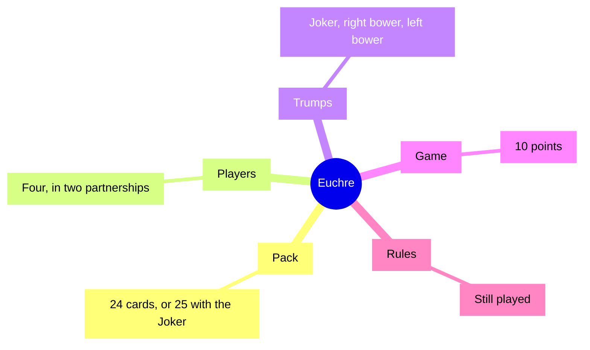
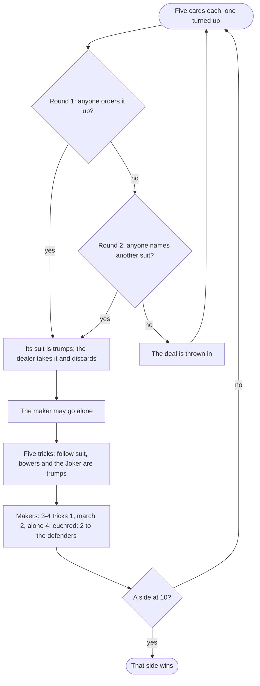

<!-- Written by tools/build-docs.mjs from the sources. Edit those, then run npm run build:docs. -->

# Euchre

**Wing V · The Modern Board Game** · 1850s–60s CE · America, and the Joker

[← The Mansion of Happiness](mansion.md) · [All games](README.md) · [Conquian →](conquian.md)

| | |
| --- | --- |
| In the Archives | Playable against the Scribe, in 4 seats |
| Rules | Still played |
| How we know them | Still played |
| Family | [Cards](README.md#cards) |
| Exhibit id | `euchre`: `[librarium_archives start="euchre"]` |
| Pack | **With the Joker** · 24 cards |
| Suits drawn | French by default; the Pack switch redraws it in French, German, Swiss or Italian suits |

## At a glance

| | |
| --- | --- |
| Pack | 24 cards, or 25 with the Joker |
| Players | Four, in two partnerships |
| Trumps | Joker, right bower, left bower |
| Game | 10 points |

## The placard

Euchre most likely came from Jucker, an old game of Alsace. Its name turns up in America in 1810, it was played with bowers on a Midwest steamboat in 1829, and its first surviving rules were printed in 1844. By the late 1800s it was called the national card game of the United States. The bowers, the two top jacks, are the German Bauer: the farmer, and the jack.

Euchre gave the pack its fifty-third card. In the 1850s or 1860s American players added an extra top trump, first called the Best Bower; jokers were printed in American packs by about 1863 and reached English packs around 1880. Many early jokers are jesters, some of them sinister, and makers used them to show off their names. From euchre the joker went on to poker, and to every wild card since.

Bridge and spades drew players away in the 20th century, but euchre is still played in the American Midwest and upstate New York, in Canada, Australia and New Zealand, and in Cornwall and Devon.

> The cards are our own. The Pack switch at the table redraws them in other suits; the Joker stays a joker.

## A turn

Seats: You, West, North, East.

## The rules as played here

1. You sit South; North, your partner, and West and East against you, are played by the Scribe. Each of you holds five cards from a pack of nines to aces, with the Joker as an extra card (or without it, at 24 cards). One card is turned up.
2. Making trumps: in turn from the dealer's left, each player may order the turned card's suit as trumps or pass; if they order it, the dealer takes the card and discards one. If all four pass, each in turn may name another suit, or pass again; if everyone passes twice, the deal is thrown in. If the Joker is turned up, the dealer names trumps.
3. Trumps rank: the Joker (the Best Bower), the jack of trumps (the right bower), the other jack of the same colour (the left bower, which counts as a trump), then ace, king, queen, ten and nine. Other suits rank ace, king, queen, jack, ten, nine.
4. The side that made trumps must take three of the five tricks. The maker may play alone, without a partner. Follow suit if you can, otherwise play anything; the highest trump wins, or the highest card of the suit led.
5. Makers take three or four tricks: 1 point; all five, a march: 2, or 4 played alone. Makers who take fewer than three are euchred: the other side scores 2. The first side to 10 wins.

**Source:** Four-handed Euchre, after the rules at pagat.com, with American scoring to 10. Going alone is declared once trumps are made; the Joker, when turned up, makes the dealer's side the makers.

### Rule choices

- **Euchre:** four-handed, after pagat.com, with American scoring to 10: one round of ordering up the turned card, then a round of naming another suit; everyone passing twice throws the deal in (no "stick the dealer"). Going alone is declared once trumps are made rather than with the bid. With the Joker (the Best Bower, top trump), a Joker turned up makes the dealer's side the makers and the dealer names trumps.

### Pack

Chosen at the table under Options. Changing it restarts the game.

| Choice | |
| --- | --- |
| With the Joker | the default |
| 24 cards |  |

## At the table

| | |
| --- | --- |
| The Scribe | Gentle, Fair or Sharp (see [the Scribe](../scribe.md#levels)) |
| Pass-and-play with a friend | No |
| Undo | No |
| Hint | No |
| Saved and resumed | Yes |
| Pack switch | Yes |

Keys, the move list, replays and the guide are the same at every table: see [Visiting the Archives](../visiting.md#at-a-table).

## How the Scribe plays

**Method:** Hidden information: plays only from what it can see. See [the Scribe](../scribe.md).

**Games with hidden cards and tiles:** Bids by the worth of its hand in each suit (bowers, the Joker, aces, length) against a bar that Gentle sets high and Sharp low, and is a little bolder without the Joker. Goes alone only with a strong hand holding two sure tricks (never at Gentle). In play it draws trumps when it holds the best one, cashes sure winners, throws its least card when its partner has the trick, and otherwise wins as cheaply as it can. Gentle plays some cards at random

**Measured strength**

| Fair vs Gentle | Sharp vs Fair | Games |
| --- | --- | --- |
| 109–41 | 80–70 | 150 games each |

## Sources

Checked in [the placard fact-check](../fact-check.md):

- **Claims:** Probably from Jucker of Alsace; "Eucre" in America in 1810; bowers on a Midwest steamboat in 1829; first surviving rules 1844; the national card game in the late 1800s; bower from German *Bauer*; still played in the Midwest, upstate New York, Canada, Australia, New Zealand, Cornwall and Devon **Source:** Wikipedia, Euchre

The sources for every placard are listed in [Historical notes and sources](../sources.md).

## In the code

| | |
| --- | --- |
| Rules and the Scribe | [`src/rules/euchre.js`](../../src/rules/euchre.js) |
| Table presenter | [`src/hall/table-euchre.js`](../../src/hall/table-euchre.js) |
| 3D model | [`src/hall/build-card-room.js`](../../src/hall/build-card-room.js) |
| Placard | [`src/hall/09-exhibit-data.js`](../../src/hall/09-exhibit-data.js) |
