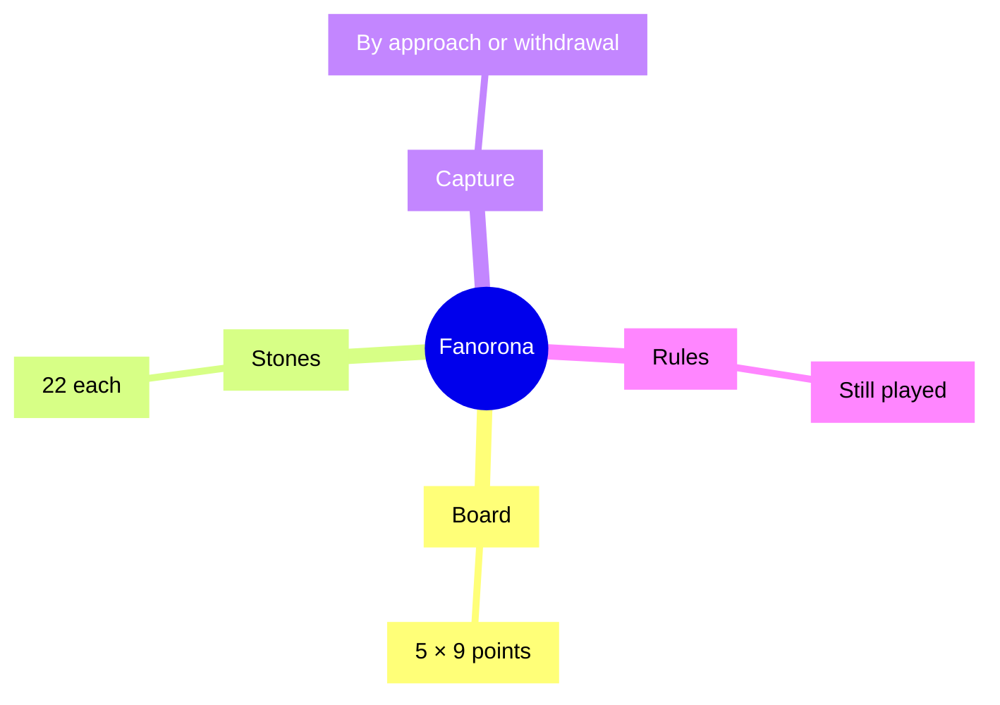
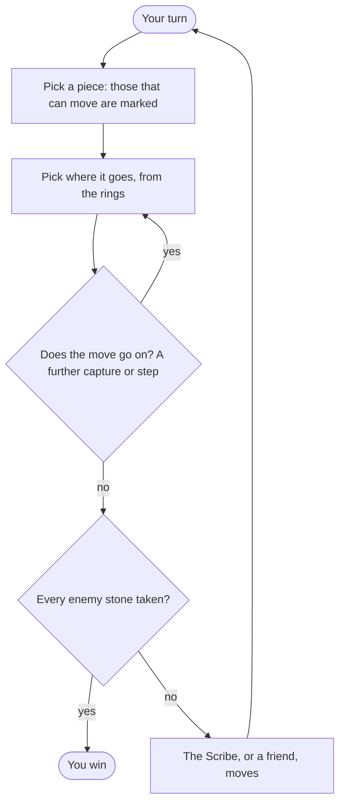

<!-- Written by tools/build-docs.mjs from the sources. Edit those, then run npm run build:docs. -->

# Fanorona

**Wing VI · Games of the World** · traditional · Madagascar

[← Janggi](janggi.md) · [All games](README.md) · [Bao →](bao.md)

| | |
| --- | --- |
| In the Archives | Playable against the Scribe, or a friend on the same screen |
| Rules | Still played |
| How we know them | Still played |
| Family | [Capture games](README.md#capture-games) |
| Exhibit id | `fanorona`: `[librarium_archives start="fanorona"]` |

## At a glance

| | |
| --- | --- |
| Board | 5 × 9 points |
| Stones | 22 each |
| Capture | By approach or withdrawal |

## The placard

Fanorona is a game of Madagascar, widely played there, and the full game, fanoron-tsivy, is played on five rows of nine points joined by lines and diagonals. It looks like alquerque, but its captures are its own: a stone takes by moving up to an enemy line or by moving away from one, and the whole unbroken line falls at once.

A Malagasy legend tells how King Ralambo chose his heir by summoning his sons while pretending to be ill. The elder was so absorbed in a fanorona problem that the younger, Andrianjaka, arrived first and became king. In 2007 computer scientists showed that, played perfectly, the game is a draw.

## A turn

## The rules as played here

1. You play white and move first. A stone moves one step along a line to an empty point.
2. Capture by approach: step up to an enemy stone in the direction you are moving. Or by withdrawal: step directly away from an enemy stone next to you. Either way, the whole unbroken line of enemy stones beyond is taken.
3. Pick a stone, then pick the enemy stone you want to capture: the rings show your choices. When one step could approach or withdraw, you choose which line to take.
4. Capturing is compulsory. After a capture, the same stone may capture again, but never back onto a point it visited this turn, and never twice in the same direction. Or choose Stop.
5. Take every enemy stone to win. House rule: twenty moves each with no capture is a draw.

**Source:** Fanoron-tsivy, the full 5 × 9 game, with the rules as they are usually given today.

### Rule choices

- **Fanorona:** captures by approach or withdrawal take the whole unbroken line. You choose a capture by clicking the first enemy stone it would take, which also settles approach against withdrawal. A capture chain may not revisit a point or repeat a direction, and the **Stop** button ends it early. House rule: twenty moves each without a capture is a draw.

## At the table

| | |
| --- | --- |
| The Scribe | Gentle, Fair or Sharp (see [the Scribe](../scribe.md#levels)) |
| Pass-and-play with a friend | Yes |
| Undo | Yes |
| Hint | Yes |
| Saved and resumed | Yes |

Keys, the move list, replays and the guide are the same at every table: see [Visiting the Archives](../visiting.md#at-a-table).

## How the Scribe plays

**Method:** Shared search: negamax with alpha-beta; captures played out at the leaves; iterative deepening; time budget per level. See [the Scribe](../scribe.md).

## Sources

The sources for every placard are listed in [Historical notes and sources](../sources.md).

## In the code

| | |
| --- | --- |
| Rules and the Scribe | [`src/rules/fanorona.js`](../../src/rules/fanorona.js) |
| Table presenter | [`src/hall/table-fanorona.js`](../../src/hall/table-fanorona.js) |
| 3D model | [`src/hall/build-games-of-the-world.js`](../../src/hall/build-games-of-the-world.js) |
| Placard | [`src/hall/09-exhibit-data.js`](../../src/hall/09-exhibit-data.js) |
