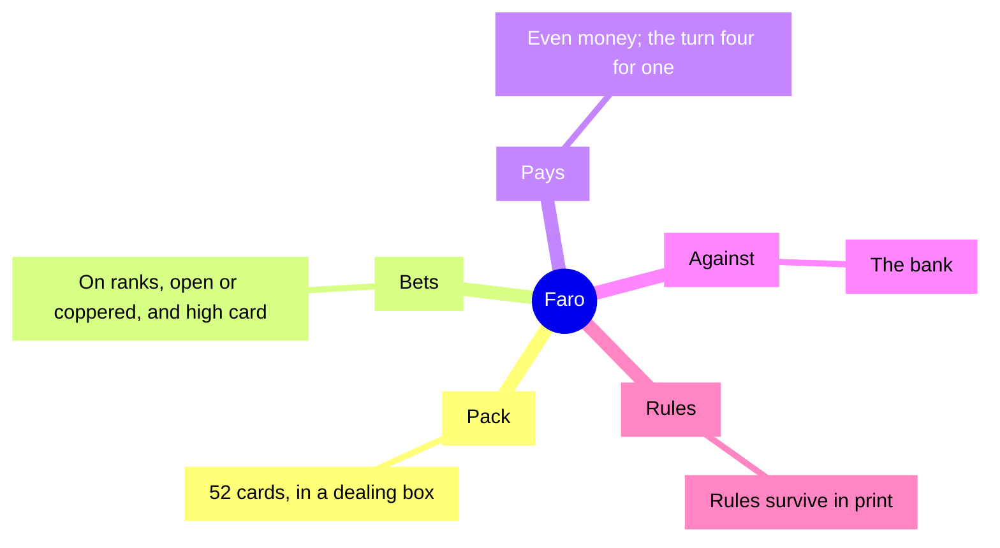
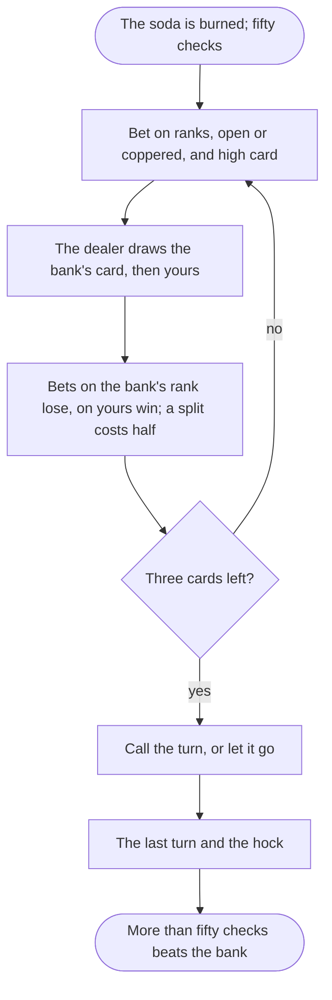

<!-- Written by tools/build-docs.mjs from the sources. Edit those, then run npm run build:docs. -->

# Faro

**Wing IV · Printed Boards and Parlour Tables** · 1688 CE · France, then the American West

[← Cards Not for Playing](notforplay.md) · [All games](README.md) · [Dominoes →](dominoes.md)

| | |
| --- | --- |
| In the Archives | Playable, alone: there is no Scribe at this table |
| Rules | Rules survive in print |
| How we know them | Survive in print |
| Family | [Cards](README.md#cards) |
| Exhibit id | `faro`: `[librarium_archives start="faro"]` |

## At a glance

| | |
| --- | --- |
| Pack | 52 cards, in a dealing box |
| Bets | On ranks, open or coppered, and high card |
| Pays | Even money; the turn four for one |
| Against | The bank |

## The placard

Faro grew out of basset, a Venetian game brought to Paris in the 1670s. As pharaon it was first recorded in 1688; both games were soon banned in France and played anyway. In 18th-century England, where it was pharo, it was thought to give the punter the best odds of any banking game, so long as the bank was honest.

In America it became the gambling game of the 19th century, dealt in nearly every saloon of the West, where playing it was called bucking the tiger, after the tiger on the backs of early faro cards. A study of 1882 found more money bet on faro than on every other kind of gambling together.

The dealing box was meant to keep the dealer honest, and the case keeper let everyone see which ranks were still to come. Poker took its place in the early 20th century, and a few Nevada casinos kept a faro bank until 1985.

> The bank only deals, so there is no Scribe to set here. Bets split between two ranks are left out.

## A turn

## The rules as played here

1. You punt against the bank, which deals from a box. You have 50 checks. The layout shows one suit, ace to king: click a card to put a check on that rank (up to ten). The case keeper beside the box shows how many of each rank are still to come.
2. Deal a turn and the dealer draws two cards. The first is the bank's card: bets on its rank lose. The second is yours: bets on its rank win, paid even money. If both are the same rank, a split, the bank takes half the bets on it (at least one check).
3. A coppered bet is reversed: it wins on the bank's card and loses on yours. Switch Copper on, then click a card, to copper the bet there. The high card bet wins if your card outranks the bank's.
4. The first card out of the box, the soda, counts for nothing. Bets stay on the layout until they win or lose, and you may add to them or take them back between turns.
5. When three cards are left, you may call the turn: guess the order of the bank's card, yours, and the last card (the hock). It pays four for one, or one for one when two of the three are a pair.
6. The game ends when the box is empty. Finish with more than 50 checks and you have beaten the bank.

**Source:** Faro as Wikipedia and pagat.com describe the American banking game: the layout, flat and coppered bets, splits, the high card bet and calling the turn. Splits between two ranks are left out.

### Rule choices

- **Faro:** after Wikipedia and pagat.com: the soda burned, then twenty-four turns of the bank's card and yours, and the last turn with the hock. Bets on a rank, open or coppered (a copper reverses the bet), at most ten checks a rank, and the high card bar; a split takes half the bet on that rank (at least one). Calling the turn pays four for one, or one for one with a pair among the three. Bets split between two ranks are left out, and the bank is never short of money. The game is one deal from the box with 50 checks.

## At the table

| | |
| --- | --- |
| The Scribe | None: the bank only deals |
| Pass-and-play with a friend | No |
| Undo | No |
| Hint | No |
| Saved and resumed | Yes |

Keys, the move list, replays and the guide are the same at every table: see [Visiting the Archives](../visiting.md#at-a-table).

## The odds

There is no Scribe at this table: the bank only deals, and the cards decide. The odds are the game's own: a split costs half the bet, and calling the turn pays four for one against odds of five to one.

## Sources

Checked in [the placard fact-check](../fact-check.md):

- **Claims:** From basset, brought to Paris by the Venetian ambassador in 1672; pharaon first recorded 1688; both banned in France; "pharo" in England, thought to give the best odds of any banking game when honest (Gilly Williams, 1752); nearly every gambling hall of the West; "bucking the tiger" after early card backs; the 1882 study; poker took over in the early 20th century; Nevada casinos until 1985 **Source:** Wikipedia, Faro (card game); pagat.com, Faro

The sources for every placard are listed in [Historical notes and sources](../sources.md).

## In the code

| | |
| --- | --- |
| Rules and the Scribe | [`src/rules/faro.js`](../../src/rules/faro.js) |
| Table presenter | [`src/hall/table-card-room-5.js`](../../src/hall/table-card-room-5.js) |
| 3D model | [`src/hall/build-card-room-5.js`](../../src/hall/build-card-room-5.js) |
| Placard | [`src/hall/09-exhibit-data.js`](../../src/hall/09-exhibit-data.js) |
