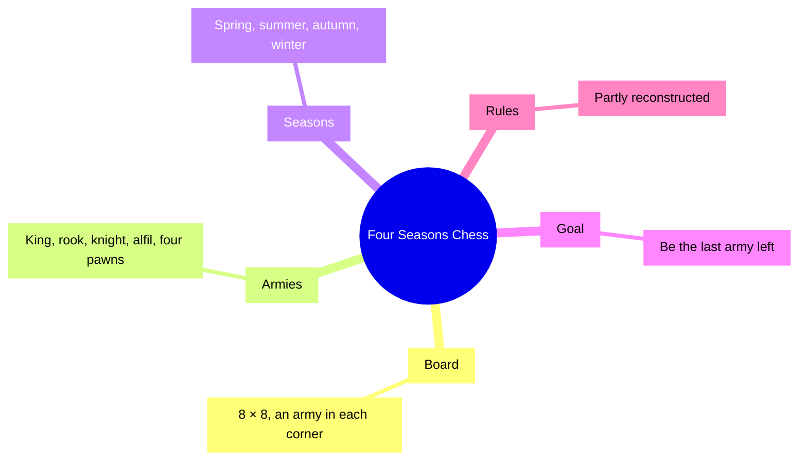
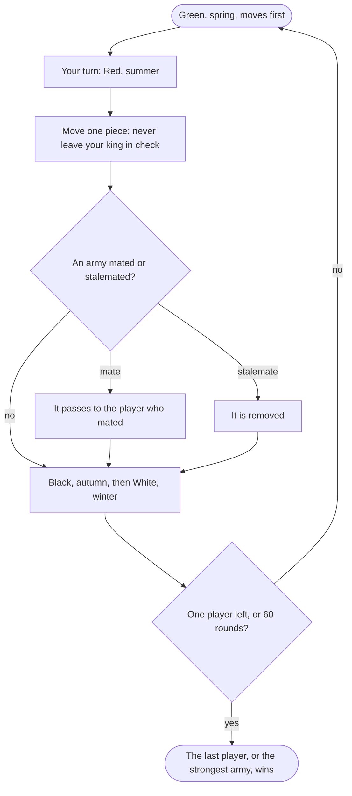

<!-- Written by tools/build-docs.mjs from the sources. Edit those, then run npm run build:docs. -->

# Four Seasons Chess

**Wing III · Kings, Cards and Courts** · 1283 CE · Castile · Alfonso X's Book of Games

[← Courier Chess](courier.md) · [All games](README.md) · [Playing Cards →](cards.md)

| | |
| --- | --- |
| In the Archives | Playable against the Scribe, in 4 seats |
| Rules | Partly reconstructed |
| How we know them | Partly reconstructed (Alfonso X's Book of Games) |
| Family | [The chess family](README.md#the-chess-family) |
| Exhibit id | `fourseasons`: `[librarium_archives start="fourseasons"]` |

## At a glance

| | |
| --- | --- |
| Board | 8 × 8, an army in each corner |
| Armies | King, rook, knight, alfil, four pawns |
| Seasons | Spring, summer, autumn, winter |
| Goal | Be the last army left |

## The placard

In 1283 King Alfonso X of Castile finished his Libro de los juegos, the Book of Games: an illustrated manuscript of chess problems, dice games and table games. Among them is a chess for four players, the acedrex de los quatro tiempos, the chess of the four seasons.

Each army is a season, a colour, an element and one of the four humours of the body: green for spring, air and blood; red for summer, fire and choler; black for autumn, earth and melancholy; white for winter, water and phlegm. The armies start in the four corners, and play goes round the board as the seasons turn, beginning with spring.

Alfonso's text leaves gaps, so the table follows the reading of H. J. R. Murray and Hans Bodlaender: an alfil that leaps two squares, and a mated army that passes to the player who mated it. The book allows dice; we play without, and the diagonals drawn across the centre are only decoration.

## A turn

Seats: Red, Black, White, Green.

## The rules as played here

1. Four armies, one in each corner, each for itself. You are Red, summer, in the corner nearest your left hand. Green (spring) moves first, then play goes round: you, Black (autumn), White (winter).
2. The king, rook and knight move as in chess. The alfil jumps exactly two squares diagonally, over anything between. Pawns step one square straight ahead, never two, and take one square diagonally ahead; two of your pawns march up the board and two across it.
3. A pawn that reaches the edge of the board becomes a general, which moves one square diagonally.
4. You may not leave your king in check from any army.
5. A player who is checkmated is out: the king is removed and the whole army passes to the player who gave the mate. A player left with no move but not in check is stalemated: the whole army is removed. Taking a king counts as a mate.
6. The last player left wins. If you are mated or stalemated you lose. After 60 rounds, the strongest army still in play wins (rook 5, knight 3, general 2, alfil 1½, pawn 1).

**Source:** After the Libro de los juegos of Alfonso X (1283), as described by H. J. R. Murray and Hans Bodlaender. The game is played without dice, the diagonals in the centre of the board are decoration, and the 60-round limit is ours.

### Rule choices

- **Four Seasons chess:** Alfonso X's acedrex de los quatro tiempos as Murray and Bodlaender read it, each army for itself and without dice. Armies of king, rook, knight, alfil and four pawns start in the corners (you are Red, in a1); Green moves first and play goes Green, Red, Black, White. The alfil leaps exactly two squares diagonally; pawns step one square without a double step, two of each army's pawns going along the files and two along the ranks, and become generals (one square diagonally) at the edge. You may not leave your king in check. A player checkmated is out and the whole army passes to the mater; taking a king counts the same; a player stalemated is out and the army leaves the board. Mates and stalemates are judged as soon as a move is made. The last army left wins; after 60 rounds the strongest army still in play wins (rook 5, knight 3, general 2, alfil 1½, pawn 1). The centre diagonals are decoration.

## At the table

| | |
| --- | --- |
| The Scribe | Gentle, Fair or Sharp (see [the Scribe](../scribe.md#levels)) |
| Pass-and-play with a friend | No |
| Undo | No |
| Hint | No |
| Saved and resumed | No |

Keys, the move list, replays and the guide are the same at every table: see [Visiting the Archives](../visiting.md#at-a-table).

## How the Scribe plays

**Measured strength**

| Fair vs Gentle | Sharp vs Fair | Games |
| --- | --- | --- |
| 67% against Gentle | 47% against Fair | 60 each; an even seat wins about 1 in 4 |

**Game by game:** Its own strength against the others', pieces left hanging (with what defends them) and the squares round its king. Sharp also lets the next player answer each of its best eight moves

## Sources

The sources for every placard are listed in [Historical notes and sources](../sources.md).

## In the code

| | |
| --- | --- |
| Rules and the Scribe | [`src/rules/four-seasons-chess.js`](../../src/rules/four-seasons-chess.js) |
| Table presenter | [`src/hall/table-fourseasons.js`](../../src/hall/table-fourseasons.js) |
| 3D model | [`src/hall/build-four-seasons-chess.js`](../../src/hall/build-four-seasons-chess.js) |
| Placard | [`src/hall/09-exhibit-data.js`](../../src/hall/09-exhibit-data.js) |
