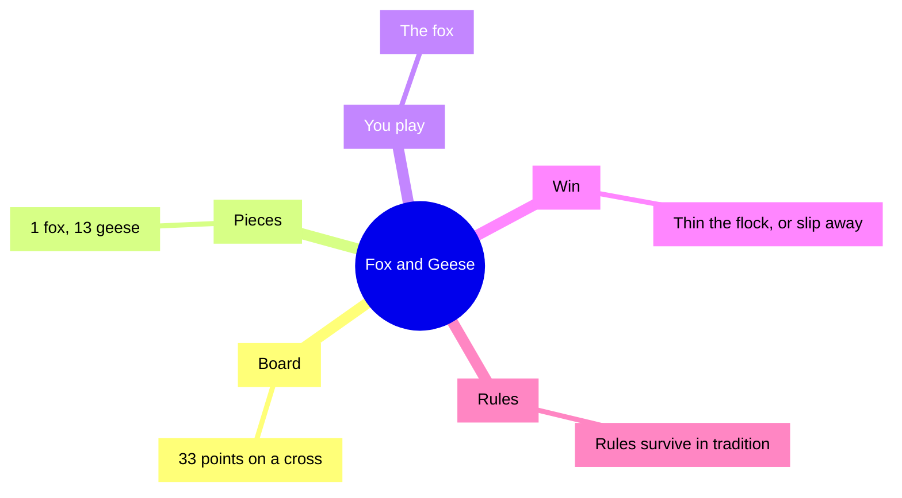
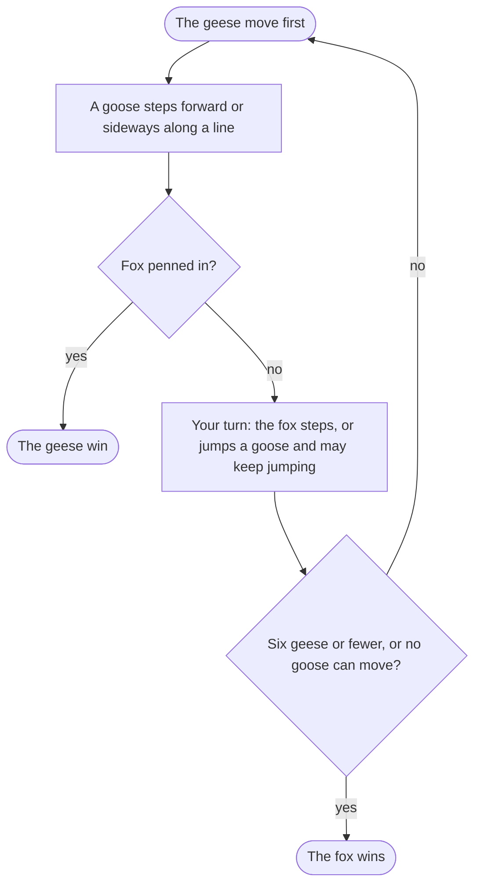

<!-- Written by tools/build-docs.mjs from the sources. Edit those, then run npm run build:docs. -->

# Fox and Geese

**Wing IV · Printed Boards and Parlour Tables** · by c. 1300 CE · Northern Europe · Middle Ages

[← Tarot (Tarocchi)](tarot.md) · [All games](README.md) · [The New Queen →](newqueen.md)

| | |
| --- | --- |
| In the Archives | Playable against the Scribe |
| Rules | Rules survive in tradition |
| How we know them | Survive in tradition; many local variants |
| Family | [Hunt and tafl games](README.md#hunt-and-tafl-games) |
| Exhibit id | `foxgeese`: `[librarium_archives start="foxgeese"]` |

## At a glance

| | |
| --- | --- |
| Board | 33 points on a cross |
| Pieces | 1 fox, 13 geese |
| You play | The fox |
| Win | Thin the flock, or slip away |

## The placard

Fox and Geese is a hunt: one fox against a whole flock. Its likely ancestor is halatafl, the "tail board" game named in the Icelandic Grettis saga, which was written down in the 14th century. It is a cousin of the tafl games in Wing II.

The household accounts of Edward IV of England, who reigned from 1461 to 1483, record silver-gilt pieces for the game: two foxes and 26 hounds, enough for two sets. Boards scratched into cloister benches show that monks played it too, and Queen Victoria is said to have enjoyed it.

Rules varied from place to place. We play a common English form, with one house rule added so that every game ends.

## A turn

## The rules as played here

1. You are the fox. The Scribe has thirteen geese and moves first.
2. Each turn, move one piece along a line, across or up and down the board, to the next empty point. The fox may go any way; geese may go forward or sideways, never back.
3. The fox captures by jumping a goose to the empty point just beyond it, and may keep jumping in one turn. Geese cannot capture.
4. The geese win by penning the fox in so it cannot move.
5. The fox wins by thinning the flock to six geese or fewer, or by leaving the geese with no move.
6. House rule: if the geese go twenty moves without moving forward or losing a goose, the fox slips away and wins.

**Source:** A common English form of the game, on the plain cross board. Medieval versions varied in the number of geese, in the lines on the board and in whether geese could move backwards. The twenty-move rule is ours, so games end.

## At the table

| | |
| --- | --- |
| The Scribe | Gentle, Fair or Sharp (see [the Scribe](../scribe.md#levels)) |
| Pass-and-play with a friend | No |
| Undo | Yes |
| Hint | Yes |
| Saved and resumed | Yes |

Keys, the move list, replays and the guide are the same at every table: see [Visiting the Archives](../visiting.md#at-a-table).

## How the Scribe plays

**Method:** Shared search: negamax with alpha-beta; captures played out at the leaves; iterative deepening; time budget per level. See [the Scribe](../scribe.md).

**Game by game:** Plays the geese, steering by how much room the fox has left

## Sources

The sources for every placard are listed in [Historical notes and sources](../sources.md).

## In the code

| | |
| --- | --- |
| Rules and the Scribe | [`src/rules/fox-and-geese.js`](../../src/rules/fox-and-geese.js) |
| Table presenter | [`src/hall/table-foxgeese.js`](../../src/hall/table-foxgeese.js) |
| 3D model | [`src/hall/build-fox-and-geese.js`](../../src/hall/build-fox-and-geese.js) |
| Placard | [`src/hall/09-exhibit-data.js`](../../src/hall/09-exhibit-data.js) |
