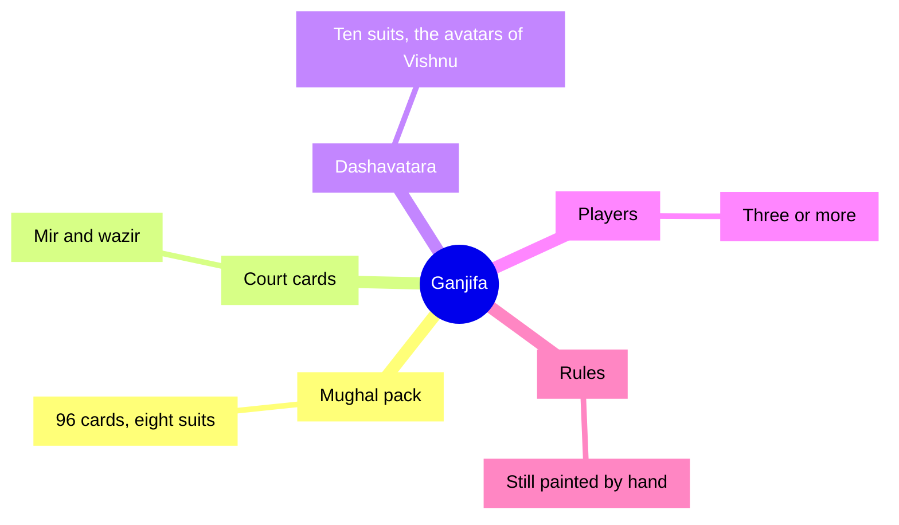

<!-- Written by tools/build-docs.mjs from the sources. Edit those, then run npm run build:docs. -->

# Ganjifa

**Wing VI · Games of the World** · 16th century CE · Persia and Mughal India

[← Hanafuda](koikoi.md) · [All games](README.md) · [Makruk →](makruk.md)

| | |
| --- | --- |
| In the Archives | On display |
| Rules | Still painted by hand |
| How we know them | Still painted by hand |
| Family | [Cards](README.md#cards) |
| Exhibit id | `ganjifa`: `[librarium_archives start="ganjifa"]` |

## At a glance

| | |
| --- | --- |
| Mughal pack | 96 cards, eight suits |
| Court cards | Mir and wazir |
| Dashavatara | Ten suits, the avatars of Vishnu |
| Players | Three or more |

## The placard

Ganjifa are round cards, painted by hand and lacquered. They came to India from Persia and were popular at the Mughal court in the 16th century: in 1527 the emperor Babur sent a pack as a gift. Court packs were made of ivory inlaid with stones, or of tortoiseshell; bazaar packs of wood, palm leaf, stiffened cloth or pasteboard.

A Mughal pack has 96 cards in eight suits of twelve: ten numerals and two court cards, the mir (king) and the wazir (minister). The suits are slaves, crowns, swords, red gold coins, harps, bills of exchange, white gold coins and cloth. In Dashavatara packs the ten suits are the ten avatars of Vishnu, from the fish and the tortoise onwards.

The game is for three or more players, each for themselves, taking tricks without trumps. In half the suits the numerals rank backwards, the ace highest, and which suit leads depends on whether the game is played by day or by night. Western cards and their games pushed ganjifa aside in the 20th century, but it is still painted in Sawantwadi, Odisha and Bishnupur, among other places.

> Our own paintings after the style of Mughal packs. The rules of play are not recorded well enough to set out a table here, so this pack stays behind glass.

## Sources

Checked in [the placard fact-check](../fact-check.md):

- **Claims:** Persian origin, popular at the Mughal court in the 16th century; Babur sent a pack in 1527; ivory with stones, tortoiseshell, and cheap packs of wood, palm leaf, cloth or pasteboard; 96 cards in 8 suits of 12, mir and wazir; the eight suits named; Dashavatara's ten avatars; three or more players, tricks, no trumps, reversed suits, day and night leads; decline in the 20th century; still made in Sawantwadi, Odisha, Bishnupur and elsewhere **Source:** Wikipedia, Ganjifa; WOPC, Ganjifa

The sources for every placard are listed in [Historical notes and sources](../sources.md).

## In the code

| | |
| --- | --- |
| 3D model | [`src/hall/build-card-room.js`](../../src/hall/build-card-room.js) |
| Placard | [`src/hall/09-exhibit-data.js`](../../src/hall/09-exhibit-data.js) |
