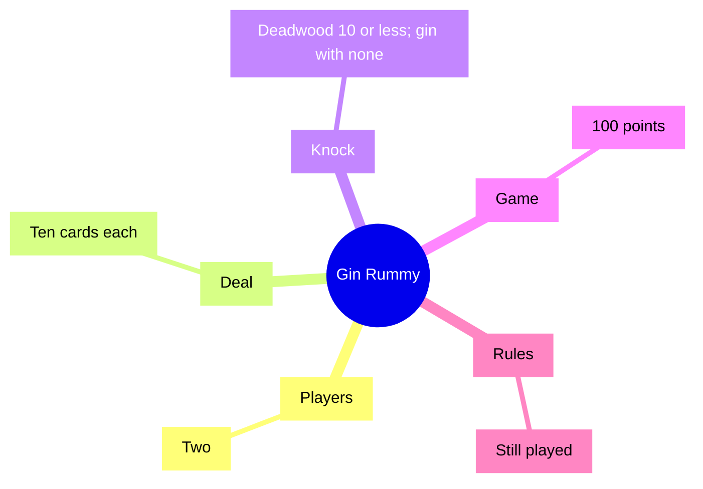
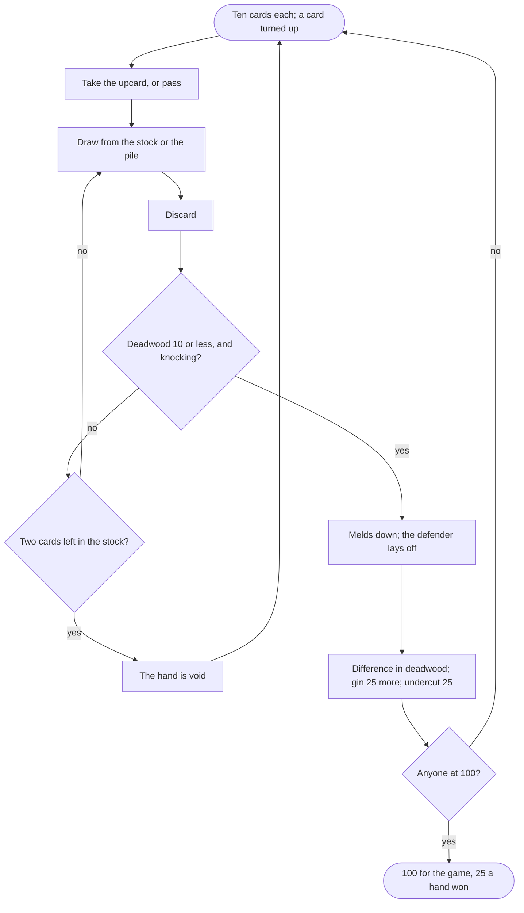

<!-- Written by tools/build-docs.mjs from the sources. Edit those, then run npm run build:docs. -->

# Gin Rummy

**Wing V · The Modern Board Game** · 1909 CE · New York, then Hollywood

[← The Landlord's Game](landlord.md) · [All games](README.md) · [Contract Bridge →](bridge.md)

| | |
| --- | --- |
| In the Archives | Playable against the Scribe |
| Rules | Still played |
| How we know them | Still played |
| Family | [Cards](README.md#cards) |
| Exhibit id | `gin`: `[librarium_archives start="gin"]` |
| Game | **To 100** · To 50 |
| Suits drawn | French by default; the Pack switch redraws it in French, German, Swiss or Italian suits |

## At a glance

| | |
| --- | --- |
| Players | Two |
| Deal | Ten cards each |
| Knock | Deadwood 10 or less; gin with none |
| Game | 100 points |

## The placard

Gin rummy was worked out in New York in 1909, or a year or two later, by Elwood T. Baker, a whist and bridge player, and his son C. Graham Baker, who named it gin, after the drink. It came from the older rummies: pagat.com names Conquian and the American game of rum, and David Parlett sees Conquian as its forerunner.

For thirty years it stayed a New York game. Then in 1941 it became a Hollywood craze, and from there it spread across the country; the next year The Bridge World published laws for it. A survey of 1947 found that as many people had learned gin during the Second World War as had learned pinochle, cribbage, poker and bridge put together.

Ten cards, one draw and one discard a turn, and the knock: stop the hand whenever your unmatched cards come to ten or less, and hope the other player cannot undercut you.

## A turn

## The rules as played here

1. Ten cards each. The next card is turned up to start the discard pile; the rest are the stock. Melds are sets of three or four of a rank, and runs of three or more in one suit (aces low). Cards outside your melds are deadwood: aces 1, courts 10, the rest as numbered.
2. On the first turn the player who did not deal may take the turned-up card or pass; then the dealer may. If both pass, the first player draws from the stock.
3. Each turn, draw the top card of the stock or of the discard pile (click it), then discard a card (click it). You may not throw back a card you just took from the pile.
4. When your deadwood after discarding is 10 or less, you may knock: press Knock, then click the card to discard face down. Melds are laid out, and the other player lays off deadwood on your melds. You score the difference in deadwood; with none at all, you are gin, score 25 more, and nothing may be laid off. If the other player's deadwood is as low or lower, they undercut you and score the difference and 25.
5. If only two cards are left in the stock and nobody has knocked, the hand is void. The first to 100 (or 50) wins the game and scores 100 more, and each side scores 25 for every hand it won.

**Source:** Gin rummy as Wikipedia describes the standard game, with its gin and undercut bonuses of 25, the box bonus of 25 a hand and the game bonus of 100; pagat.com for the play.

### Rule choices

- **Gin Rummy:** Wikipedia's standard game: ten cards each, the upcard offered first to the non-dealer, a draw and a discard each turn (not the card just taken from the pile), a knock at 10 or less, gin with none. The defender lays off on the knocker's melds (found for you, and never on a gin). The knocker scores the difference; gin scores 25 more; an undercut scores the difference and 25. A hand with two cards left in the stock is void. To 100 (or 50), with 100 for the game and 25 for each hand won.

### Game

Chosen at the table under Options. Changing it restarts the game.

| Choice | |
| --- | --- |
| To 100 | the default |
| To 50 |  |

## At the table

| | |
| --- | --- |
| The Scribe | Gentle, Fair or Sharp (see [the Scribe](../scribe.md#levels)) |
| Pass-and-play with a friend | No |
| Undo | No |
| Hint | No |
| Saved and resumed | Yes |
| Pack switch | Yes |

Keys, the move list, replays and the guide are the same at every table: see [Visiting the Archives](../visiting.md#at-a-table).

## How the Scribe plays

**Method:** Hidden information: plays only from what it can see. See [the Scribe](../scribe.md).

**Games with hidden cards and tiles:** Takes the upcard or the discard when it fits a meld or nearly does; throws the card that leaves least deadwood, keeping pairs and near-runs, and avoids feeding you cards next to those you took from the pile. Knocks as soon as it can. Sharp plays as Fair: a one-draw look-ahead and searches that played whole hands out were tried, and none played better

**Measured strength**

| Fair vs Gentle | Sharp vs Fair | Games |
| --- | --- | --- |
| 147–53 | as Fair | 200 games to 100; at gin Sharp plays as Fair |

## Sources

Checked in [the placard fact-check](../fact-check.md):

- **Claims:** Devised in New York by Elwood T. Baker and his son C. Graham Baker, 1909 (Wikipedia) or about 1911 (pagat.com); named after the drink; from Conquian and rum; a New York game until the Hollywood craze of 1941; laws in The Bridge World, 1942; the survey of 1947 **Source:** Wikipedia, Gin rummy; pagat.com, Gin Rummy

The sources for every placard are listed in [Historical notes and sources](../sources.md).

## In the code

| | |
| --- | --- |
| Rules and the Scribe | [`src/rules/gin.js`](../../src/rules/gin.js) |
| Table presenter | [`src/hall/table-card-room-6.js`](../../src/hall/table-card-room-6.js) |
| 3D model | [`src/hall/build-card-room-6.js`](../../src/hall/build-card-room-6.js) |
| Placard | [`src/hall/09-exhibit-data.js`](../../src/hall/09-exhibit-data.js) |
