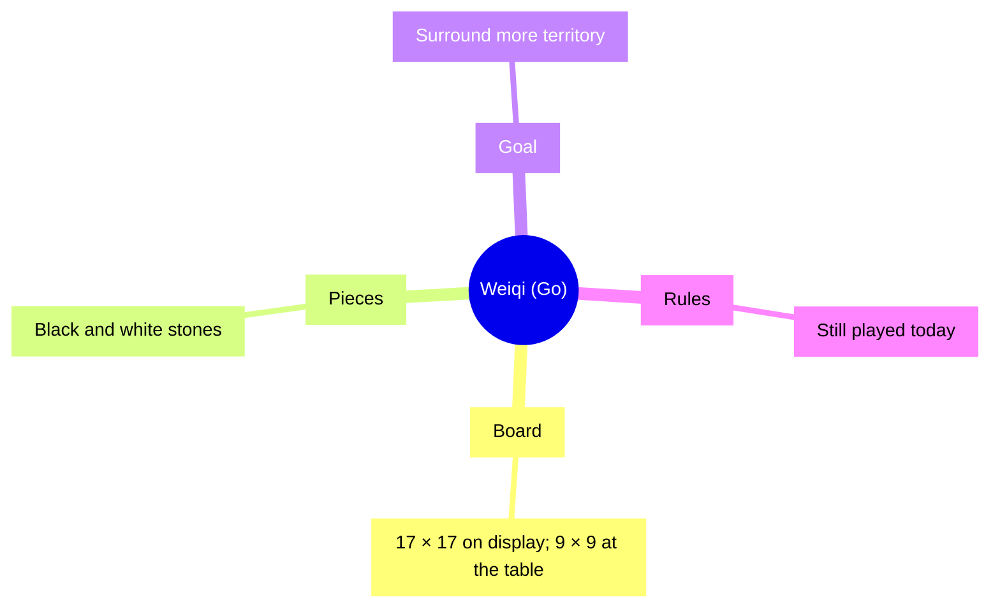
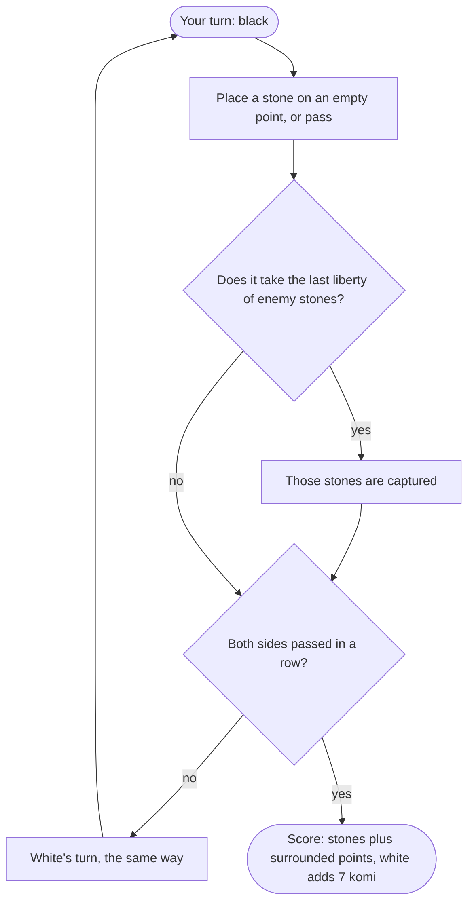

<!-- Written by tools/build-docs.mjs from the sources. Edit those, then run npm run build:docs. -->

# Weiqi (Go)

**Wing II · Strategy Takes the Table** · by the 4th century BCE · China · Zhou dynasty to Han

[← Liubo](liubo.md) · [All games](README.md) · [Ludus Latrunculorum →](latrunculi.md)

| | |
| --- | --- |
| In the Archives | Playable against the Scribe, or a friend on the same screen |
| Rules | Still played today |
| How we know them | Unbroken tradition |
| Family | [Territory and enclosure](README.md#territory-and-enclosure) |
| Exhibit id | `go`: `[librarium_archives start="go"]` |

## At a glance

| | |
| --- | --- |
| Board | 17 × 17 on display; 9 × 9 at the table |
| Pieces | Black and white stones |
| Goal | Surround more territory |

## The placard

Weiqi, known in the West by its Japanese name Go, is the oldest board game still played in much the same form. The Zuo Zhuan, a history compiled around the 4th century BCE, mentions it in a story set in 548 BCE, and both Confucius's Analects and the book of Mencius refer to it. Legend credits the sage-emperor Yao with inventing it to teach his son discipline.

The oldest complete board, carved in stone during the Eastern Han dynasty (25–220 CE) and found in Hebei province in 1954, has a 17 × 17 grid like this one. The 19 × 19 board was standard by the Tang dynasty. Go reached Korea and Japan by the 7th century, and it became one of the four arts expected of a cultivated scholar, alongside calligraphy, painting and the zither-like guqin.

At this table you play on the 9 × 9 board used today for quick games and teaching, with modern Chinese scoring. The Scribe plays Go differently from the other games: before each move it plays thousands of quick random games from the position and picks the move that wins most often.

## A turn

## The rules as played here

1. You play black and move first. Take turns placing a stone on an empty point where the lines cross. Stones never move.
2. A stone or a chain of stones joined along the lines is captured when the other side fills every empty point next to it.
3. You may not play a stone that would have no empty point next to it, unless it captures. Ko: you may not take back a single stone straight away if that would repeat the board.
4. Use Pass when there is nothing useful left to play. When both players pass in a row, the game ends.
5. Each side scores its stones plus the empty points it alone surrounds. Stones that could not escape capture are counted as captured. White adds 7 points (komi) for moving second; the higher total wins.

**Source:** Modern rules: Chinese area scoring on the 9 × 9 board used for quick games, with a komi of 7.

## At the table

| | |
| --- | --- |
| The Scribe | Gentle, Fair or Sharp (see [the Scribe](../scribe.md#levels)) |
| Pass-and-play with a friend | Yes |
| Undo | Yes |
| Hint | Yes |
| Saved and resumed | Yes |

Keys, the move list, replays and the guide are the same at every table: see [Visiting the Archives](../visiting.md#at-a-table).

## How the Scribe plays

**Method:** Monte Carlo: random playouts with RAVE. See [the Scribe](../scribe.md).

**Game by game:** Monte Carlo with RAVE (above)

## Sources

The sources for every placard are listed in [Historical notes and sources](../sources.md).

## In the code

| | |
| --- | --- |
| Rules and the Scribe | [`src/rules/go.js`](../../src/rules/go.js) |
| Table presenter | [`src/hall/table-go.js`](../../src/hall/table-go.js) |
| 3D model | [`src/hall/build-weiqi.js`](../../src/hall/build-weiqi.js) |
| Placard | [`src/hall/09-exhibit-data.js`](../../src/hall/09-exhibit-data.js) |
