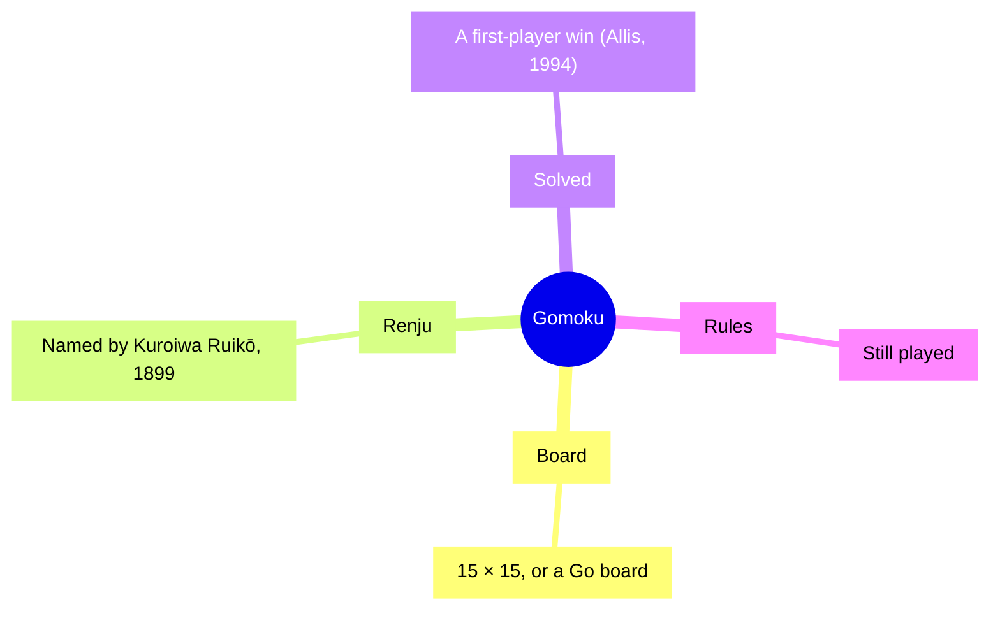
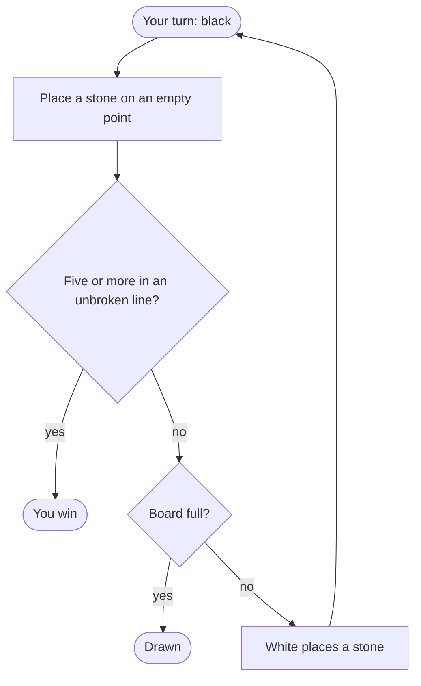

<!-- Written by tools/build-docs.mjs from the sources. Edit those, then run npm run build:docs. -->

# Gomoku

**Wing VI · Games of the World** · named renju in 1899 · Japan

[← Shogi](shogi.md) · [All games](README.md) · [Hanafuda →](koikoi.md)

| | |
| --- | --- |
| In the Archives | Playable against the Scribe, or a friend on the same screen |
| Rules | Still played |
| How we know them | Still played |
| Family | [Alignment, connection and blocking](README.md#alignment-connection-and-blocking) |
| Exhibit id | `gomoku`: `[librarium_archives start="gomoku"]` |

## At a glance

| | |
| --- | --- |
| Board | 15 × 15, or a Go board |
| Renju | Named by Kuroiwa Ruikō, 1899 |
| Solved | A first-player win (Allis, 1994) |

## The placard

Gomoku narabe, "five pieces in a row", is played with the stones and board of Go: whoever first sets five stones in an unbroken line wins. Games of getting five in a row are played across East Asia, as wuziqi in China, omok in Korea and caro in Vietnam.

On 6 December 1899 the Japanese journalist Kuroiwa Ruikō gave the serious game the name renju, "connected pearls", in his newspaper Yorozu Chōhō. Renju later put restrictions on black, the first player, and with good reason: in 1994 Victor Allis showed by computer that in freestyle gomoku on a 15 × 15 board, black can always win.

## A turn

## The rules as played here

1. You play black and move first. Place one stone on any empty point, where the lines cross.
2. Make an unbroken line of five or more of your stones, across, up and down, or diagonally, and you win.
3. Stones never move and are never taken. If the board fills with no line of five, the game is drawn.

**Source:** Freestyle gomoku on a 15 × 15 board: five or more in a row wins, with none of the restrictions renju later placed on black.

### Rule choices

- **Gomoku:** freestyle: five or more in a row wins, with none of renju's restrictions on black.

## At the table

| | |
| --- | --- |
| The Scribe | Gentle, Fair or Sharp (see [the Scribe](../scribe.md#levels)) |
| Pass-and-play with a friend | Yes |
| Undo | Yes |
| Hint | Yes |
| Saved and resumed | Yes |

Keys, the move list, replays and the guide are the same at every table: see [Visiting the Archives](../visiting.md#at-a-table).

## How the Scribe plays

**Measured strength**

| Fair vs Gentle | Sharp vs Fair | Games |
| --- | --- | --- |
| every game | 58–22 | 20, and 80 from varied openings |

**Game by game:** Every point near the stones ranked by the lines it makes for each side. Sharp hunts for a win by continuous fours, blocks yours, and searches a few moves scored by five-point windows

## Sources

The sources for every placard are listed in [Historical notes and sources](../sources.md).

## In the code

| | |
| --- | --- |
| Rules and the Scribe | [`src/rules/gomoku.js`](../../src/rules/gomoku.js) |
| Table presenter | [`src/hall/table-gomoku.js`](../../src/hall/table-gomoku.js) |
| 3D model | [`src/hall/build-new-tables.js`](../../src/hall/build-new-tables.js) |
| Placard | [`src/hall/09-exhibit-data.js`](../../src/hall/09-exhibit-data.js) |
