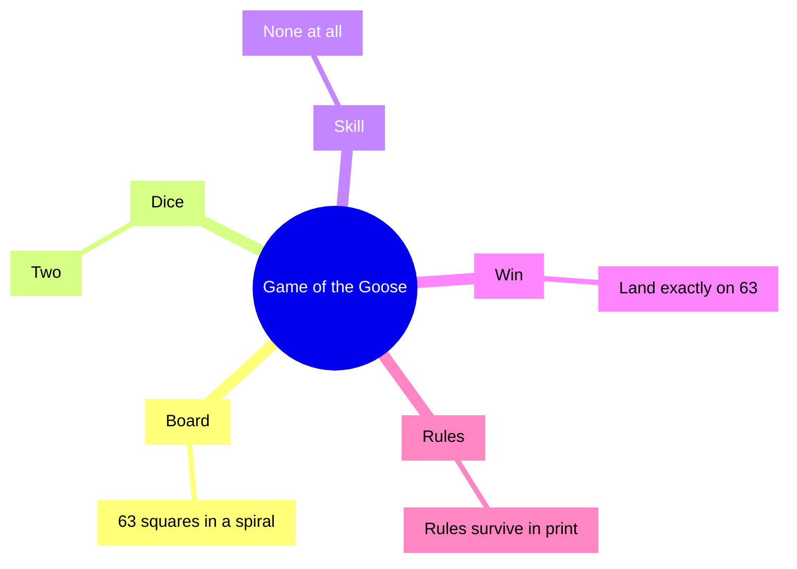
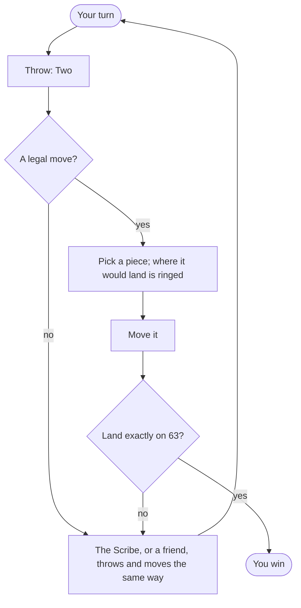

<!-- Written by tools/build-docs.mjs from the sources. Edit those, then run npm run build:docs. -->

# The Game of the Goose

**Wing IV · Printed Boards and Parlour Tables** · c. 1575 CE · Italy and Europe · 16th century

[← Court Cards](courtcards.md) · [All games](README.md) · [Ombre →](ombre.md)

| | |
| --- | --- |
| In the Archives | Playable against the Scribe, or a friend on the same screen |
| Rules | Rules survive in print |
| How we know them | Survive in print |
| Family | [Roll and move on a printed track](README.md#roll-and-move-on-a-printed-track) |
| Exhibit id | `goose`: `[librarium_archives start="goose"]` |

## At a glance

| | |
| --- | --- |
| Board | 63 squares in a spiral |
| Dice | Two |
| Skill | None at all |
| Win | Land exactly on 63 |

## The placard

The Game of the Goose is often called the first board game made to be sold. Francesco I de' Medici, Grand Duke of Tuscany, sent one to Philip II of Spain sometime between 1574 and 1587, and in June 1597 the London printer John Wolfe registered "the newe and most pleasant game of the goose".

It is pure luck: two dice, a spiral of 63 squares, and geese every four or five squares that send you flying on. Printed sheets made it cheap, and from a French game of chronology in 1638 onwards, publishers borrowed its spiral to teach history and geography.

## A turn

## The rules as played here

1. Throw two dice and move your piece that many squares along the spiral. The first to land exactly on 63 wins; overshoot and you bounce back.
2. Land on a goose and you fly on again by the same throw.
3. Throwing 9 from the start would ride the geese all the way home, so 6 and 3 takes you to 26 and 5 and 4 to 53 instead.
4. The Bridge (6) carries you to 12. The Maze (42) sends you back to 39. Death (58) sends you back to the start.
5. The Inn (19) costs one turn, the Well (31) two and the Prison (52) three.
6. Land on the other player's square and you swap places with them.

**Source:** The traditional squares. In the old game the Well and the Prison held a player until someone else landed there; with only two players we use a set number of turns instead.

### Rule choices

- **The Goose:** a throw of 9 from the start goes to 26 (6 and 3) or 53 (5 and 4), whenever the piece is at the start, since geese every nine squares would otherwise fly it straight home. With two players, the Well and the Prison hold a player for two and three turns instead of until someone else arrives.

## At the table

| | |
| --- | --- |
| The Scribe | Gentle, Fair or Sharp (see [the Scribe](../scribe.md#levels)) |
| Pass-and-play with a friend | Yes |
| Undo | No |
| Hint | No |
| Saved and resumed | No |

Keys, the move list, replays and the guide are the same at every table: see [Visiting the Archives](../visiting.md#at-a-table).

## How the Scribe plays

**Method:** Nothing to choose: the throw moves your one counter. See [the Scribe](../scribe.md).

## Sources

Checked in [the placard fact-check](../fact-check.md):

- **Claim as it stood:** "a goose about every nine squares" **What the sources say:** Geese stand on 5, 9, 14, 18, 23, 27 … : two runs nine apart, so one every four or five squares **Verdict:** Changed to "geese every four or five squares"
- **Claim as it stood:** A French game of chronology in 1638 **What the sources say:** The *Jeu chronologique* of 1638 is the earliest known teaching adaptation **Verdict:** Correct

The sources for every placard are listed in [Historical notes and sources](../sources.md).

## In the code

| | |
| --- | --- |
| Rules and the Scribe | [`src/rules/game-of-the-goose.js`](../../src/rules/game-of-the-goose.js) |
| Table presenter | [`src/hall/12-presenters.js`](../../src/hall/12-presenters.js) |
| 3D model | [`src/hall/build-the-game-of-the.js`](../../src/hall/build-the-game-of-the.js) |
| Placard | [`src/hall/09-exhibit-data.js`](../../src/hall/09-exhibit-data.js) |
