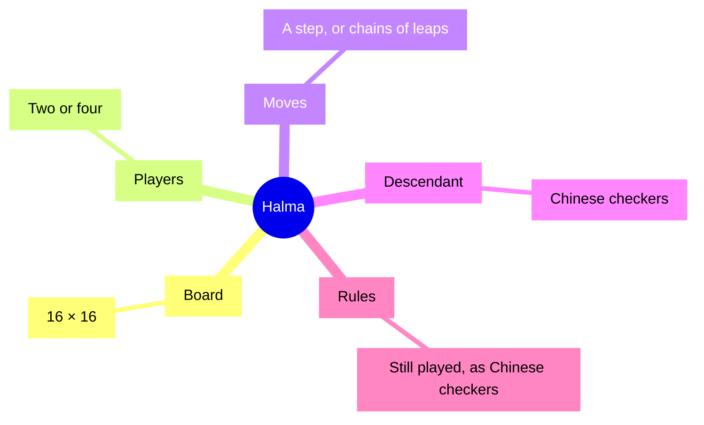
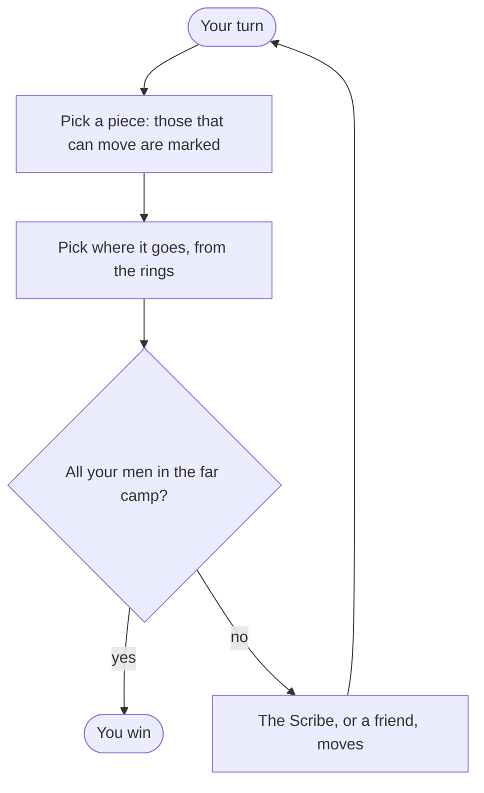

<!-- Written by tools/build-docs.mjs from the sources. Edit those, then run npm run build:docs. -->

# Halma

**Wing V · The Modern Board Game** · 1883–84 CE · Massachusetts and Germany

[← Reversi](reversi.md) · [All games](README.md) · [Dots and Boxes →](dotsboxes.md)

| | |
| --- | --- |
| In the Archives | Playable against the Scribe, or a friend on the same screen |
| Rules | Still played, as Chinese checkers |
| How we know them | Still played, as Chinese checkers |
| Family | [Running and jumping races](README.md#running-and-jumping-races) |
| Exhibit id | `halma`: `[librarium_archives start="halma"]` |

## At a glance

| | |
| --- | --- |
| Board | 16 × 16 |
| Players | Two or four |
| Moves | A step, or chains of leaps |
| Descendant | Chinese checkers |

## The placard

Halma, from the Greek for "leap", was invented in 1883 or 1884 by George Howard Monks, a surgeon at Harvard Medical School, who drew on an English game called Hoppity. Each player starts with a camp of men in one corner of a 16 × 16 board and races to move them all into the opposite corner, stepping, or leaping over any piece in chains of jumps.

In 1892 a version on a six-pointed star was published as Stern-Halma, "star Halma". Sold in America under a more exotic name, it became Chinese checkers: a game with no link to China, and none to checkers.

At this table you play the two-player game, 19 men a side. Long chains of leaps are the whole art: build ladders of your own men, and borrow the Scribe's.

## A turn

## The rules as played here

1. You play red and move first. Move all 19 of your men into the Scribe's camp in the far corner before the Scribe fills yours.
2. A man steps to any empty square next to it, across, up or down, or diagonally.
3. Or it leaps: over one piece next to it, of either colour, onto the empty square just beyond. Nothing is captured, and a man may keep leaping in the same turn, as far as the chain goes.
4. A man that reaches the far camp may move inside it but may not leave it again.
5. You win when all your men are in the far camp. If the far camp is full and at least one man in it is yours, you win too, so no one can block a camp by staying home.
6. House rule: after two hundred moves each, whoever has more men home wins, then whoever is closer overall.

**Source:** Two-player Halma as published by George Howard Monks in 1884, with the modern rule against blocking a camp.

### Rule choices

- **Halma:** a man in the far camp may not leave it, and a full far camp with at least one of your men in it wins, so neither side can block by staying home. A house rule ends the game after two hundred moves each.

## At the table

| | |
| --- | --- |
| The Scribe | Gentle, Fair or Sharp (see [the Scribe](../scribe.md#levels)) |
| Pass-and-play with a friend | Yes |
| Undo | Yes |
| Hint | Yes |
| Saved and resumed | Yes |

Keys, the move list, replays and the guide are the same at every table: see [Visiting the Archives](../visiting.md#at-a-table).

## How the Scribe plays

**Method:** Shared search: negamax with alpha-beta; captures played out at the leaves; iterative deepening; time budget per level. See [the Scribe](../scribe.md).

## Sources

The sources for every placard are listed in [Historical notes and sources](../sources.md).

## In the code

| | |
| --- | --- |
| Rules and the Scribe | [`src/rules/halma.js`](../../src/rules/halma.js) |
| Table presenter | [`src/hall/table-halma.js`](../../src/hall/table-halma.js) |
| 3D model | [`src/hall/build-halma.js`](../../src/hall/build-halma.js) |
| Placard | [`src/hall/09-exhibit-data.js`](../../src/hall/09-exhibit-data.js) |
