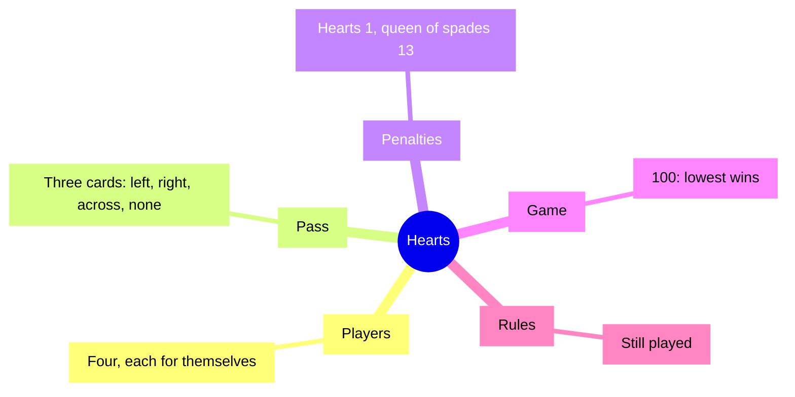
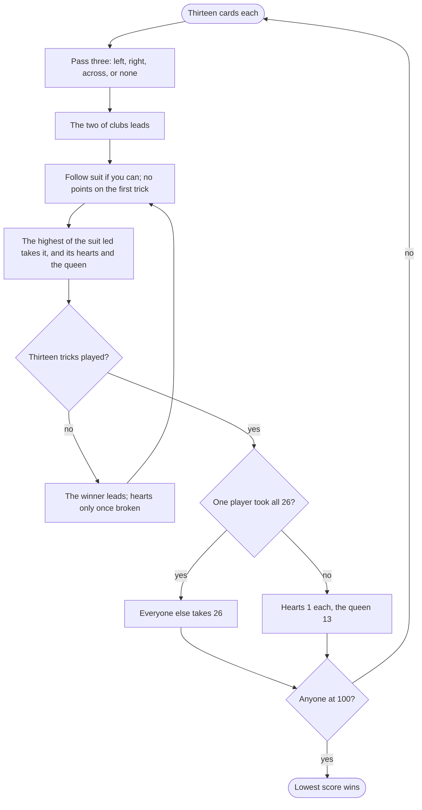

<!-- Written by tools/build-docs.mjs from the sources. Edit those, then run npm run build:docs. -->

# Hearts

**Wing V · The Modern Board Game** · 1880s CE · America, and the Black Lady

[← Halma](halma.md) · [All games](README.md) · [Dots and Boxes →](dotsboxes.md)

| | |
| --- | --- |
| In the Archives | Playable against the Scribe, in 4 seats |
| Rules | Still played |
| How we know them | Still played |
| Family | [Cards](README.md#cards) |
| Exhibit id | `hearts`: `[librarium_archives start="hearts"]` |
| Game | **To 100** · To 50 |
| Suits drawn | French by default; the Pack switch redraws it in French, German, Swiss or Italian suits |

## At a glance

| | |
| --- | --- |
| Players | Four, each for themselves |
| Pass | Three cards: left, right, across, none |
| Penalties | Hearts 1, queen of spades 13 |
| Game | 100: lowest wins |

## The placard

Hearts turned the trick-taking game inside out: you try not to win the cards that count. Its likely ancestor is Reversis, popular in Spain around 1750. Hearts itself appears in the United States in the 1880s: the Standard Hoyle of 1887 says it had been played there for "the last five years".

Black Lady, from 1909, added the queen of spades as a penalty of thirteen and the passing of cards before each hand, and became the American favourite. Shooting the moon, taking every penalty card to turn them on the others, is first recorded in Britain in 1939, where the game is also called Black Maria.

Microsoft Windows shipped a game of Hearts, in fact Black Lady, with every version from Windows 3.1 to Windows 7.

## A turn

Seats: You, West, North, East.

## The rules as played here

1. Four players, each for themselves: you against West, North and East, all played by the Scribe. Thirteen cards each. Before each hand, pass three cards: to the left, then the right, then across, then keep them, and round again. Click three cards, then pass them.
2. Whoever holds the two of clubs leads it. Follow suit if you can; if you cannot, play any card. The highest card of the suit led wins the trick (aces high), and the winner leads next. There are no trumps.
3. No heart and not the queen of spades may be played to the first trick, unless you have nothing else. Hearts may not be led until a heart has been played to a trick, unless you have only hearts.
4. Each heart you take costs 1 point and the queen of spades 13. Take all thirteen hearts and the queen, shooting the moon, and every other player takes 26 instead.
5. When anyone reaches 100 (or 50) at the end of a hand, the lowest score wins.

**Source:** Hearts as usually played today, the Black Lady form with passing, the queen of spades and shooting the moon, after Wikipedia and pagat.com.

### Rule choices

- **Hearts:** the Black Lady form as usually played today: pass three cards left, right, across, then none; the two of clubs leads; no hearts or queen of spades on the first trick; hearts may not be led until broken; hearts 1 each and the queen 13; shooting the moon gives 26 to every other player. Game to 100 or 50, lowest wins.

### Game

Chosen at the table under Options. Changing it restarts the game.

| Choice | |
| --- | --- |
| To 100 | the default |
| To 50 |  |

## At the table

| | |
| --- | --- |
| The Scribe | Gentle, Fair or Sharp (see [the Scribe](../scribe.md#levels)) |
| Pass-and-play with a friend | No |
| Undo | No |
| Hint | No |
| Saved and resumed | Yes |
| Pack switch | Yes |

Keys, the move list, replays and the guide are the same at every table: see [Visiting the Archives](../visiting.md#at-a-table).

## How the Scribe plays

**Method:** Sampling the unseen cards: deals what it cannot see at random and plays each deal out, as Tarocchi's Sharp does. See [the Scribe](../scribe.md).

**Games with hidden cards and tiles:** Passes the queen of spades (unless it holds enough spades to hide her), high spades and hearts, and the high cards of short suits. Ducks under the winning card when a trick carries points, wins clean tricks to shed high cards, and when void throws the queen, then hearts. Sharp deals the unseen cards many times, keeping known voids, and plays the card that costs it least

## Sources

Checked in [the placard fact-check](../fact-check.md):

- **Claims:** Reversis, popular in Spain around 1750, the likely ancestor; Hearts in the United States in the 1880s, the Standard Hoyle of 1887 saying "the last five years"; Black Lady, 1909, with the queen of spades and passing; shooting the moon first recorded in Britain in 1939, with Black Maria; Windows shipped Hearts (Black Lady) from 3.1 to 7 **Source:** Wikipedia, Hearts (card game)

The sources for every placard are listed in [Historical notes and sources](../sources.md).

## In the code

| | |
| --- | --- |
| Rules and the Scribe | [`src/rules/hearts.js`](../../src/rules/hearts.js) |
| Table presenter | [`src/hall/table-hearts.js`](../../src/hall/table-hearts.js) |
| 3D model | [`src/hall/build-card-room.js`](../../src/hall/build-card-room.js) |
| Placard | [`src/hall/09-exhibit-data.js`](../../src/hall/09-exhibit-data.js) |
