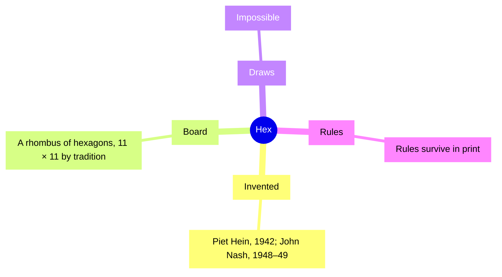
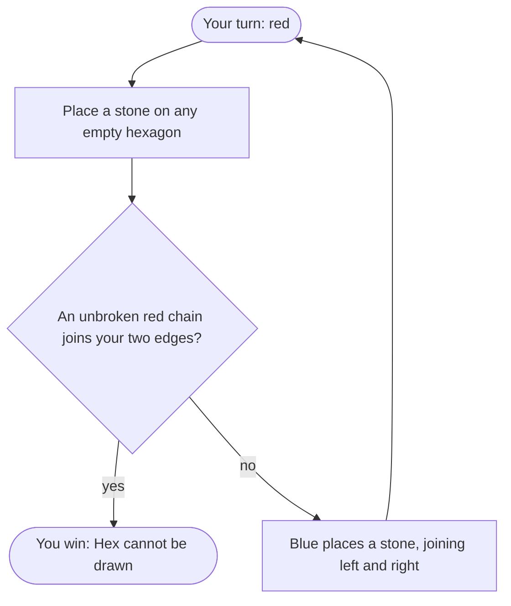

<!-- Written by tools/build-docs.mjs from the sources. Edit those, then run npm run build:docs. -->

# Hex

**Wing V · The Modern Board Game** · 1942 CE · Copenhagen and Princeton

[← Kalah](kalah.md) · [All games](README.md) · [Mū tōrere →](mutorere.md)

| | |
| --- | --- |
| In the Archives | Playable against the Scribe, or a friend on the same screen |
| Rules | Rules survive in print |
| How we know them | Still played |
| Family | [Alignment, connection and blocking](README.md#alignment-connection-and-blocking) |
| Exhibit id | `hex`: `[librarium_archives start="hex"]` |
| Board | 7 × 7 · **9 × 9** · 11 × 11 |

## At a glance

| | |
| --- | --- |
| Invented | Piet Hein, 1942; John Nash, 1948–49 |
| Board | A rhombus of hexagons, 11 × 11 by tradition |
| Draws | Impossible |

## The placard

The Danish poet and mathematician Piet Hein invented Hex at the Niels Bohr Institute in Copenhagen and published it in the newspaper Politiken on 26 December 1942, under the name Polygon. In 1948 or 1949 John Nash came up with the same game at Princeton, where his fellow students called it Nash, or John. Parker Brothers sold it as Hex in 1952, and Martin Gardner wrote it up in Scientific American in 1957.

Hex has two remarkable properties. It can never be drawn, because a full board always holds exactly one winning chain. And Nash proved that the first player can always win with perfect play, without showing how: the argument is called strategy stealing. That is why players today often use the swap rule. Here you always move first, and you can turn the swap rule on for an even game.

## A turn

## The rules as played here

1. You play red and always move first. Join the red edges, nearest and farthest from you, with an unbroken chain of red hexagons. The Scribe plays blue and joins the left and right edges.
2. On your turn, place one stone on any empty hexagon. Stones never move and are never taken.
3. Someone always wins: a full board always holds exactly one winning chain, so Hex cannot be drawn.
4. The swap rule is off, so the first move, and its advantage, stays yours. Turn the swap rule on above for an even game: the Scribe may then take your opening stone for itself.

**Source:** Hex as Piet Hein published it in 1942 and John Nash rediscovered it, with the swap rule from the modern game.

### Rule choices

- **Hex:** red (you) joins the near and far edges, blue the sides, and you always move first. The swap rule is off by default, so the first move's advantage is yours; turn it on above the board and the Scribe may take your first stone, reflected across the board into blue, after which you move again.

### Board

Chosen at the table under Options. Changing it restarts the game.

| Choice | |
| --- | --- |
| 7 × 7 |  |
| 9 × 9 | the default |
| 11 × 11 |  |

## At the table

| | |
| --- | --- |
| The Scribe | Gentle, Fair or Sharp (see [the Scribe](../scribe.md#levels)) |
| Pass-and-play with a friend | Yes |
| Undo | Yes |
| Hint | Yes |
| Saved and resumed | Yes |

Keys, the move list, replays and the guide are the same at every table: see [Visiting the Archives](../visiting.md#at-a-table).

## How the Scribe plays

**Method:** Monte Carlo: random playouts with RAVE. See [the Scribe](../scribe.md).

**Measured strength**

| Fair vs Gentle | Sharp vs Fair | Games |
| --- | --- | --- |
| 9–1 (7 × 7) | 6–0 (9 × 9) | 10 and 6 |

## Sources

The sources for every placard are listed in [Historical notes and sources](../sources.md).

## In the code

| | |
| --- | --- |
| Rules and the Scribe | [`src/rules/hex.js`](../../src/rules/hex.js) |
| Table presenter | [`src/hall/table-hex.js`](../../src/hall/table-hex.js) |
| 3D model | [`src/hall/build-new-tables.js`](../../src/hall/build-new-tables.js) |
| Placard | [`src/hall/09-exhibit-data.js`](../../src/hall/09-exhibit-data.js) |
