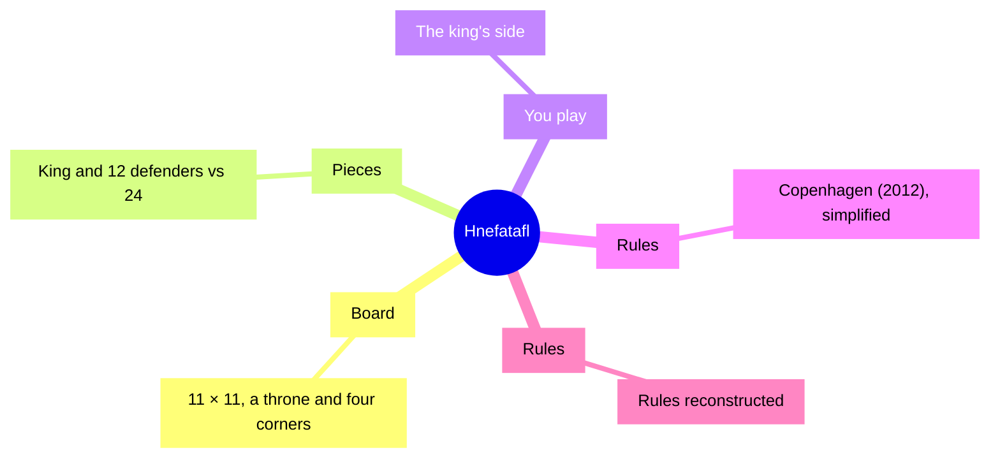
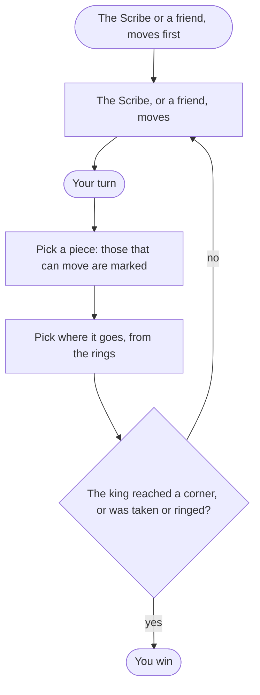

<!-- Written by tools/build-docs.mjs from the sources. Edit those, then run npm run build:docs. -->

# Hnefatafl

**Wing II · Strategy Takes the Table** · c. 400 – 1200 CE · Scandinavia · the Viking Age

[← Brandubh](brandubh.md) · [All games](README.md) · [Tables →](tables.md)

| | |
| --- | --- |
| In the Archives | Playable against the Scribe, or a friend on the same screen |
| Rules | Rules reconstructed |
| How we know them | Reconstructed (Copenhagen rules, 2012) |
| Family | [Hunt and tafl games](README.md#hunt-and-tafl-games) |
| Exhibit id | `hnefatafl`: `[librarium_archives start="hnefatafl"]` |

## At a glance

| | |
| --- | --- |
| Board | 11 × 11, a throne and four corners |
| Pieces | King and 12 defenders vs 24 |
| You play | The king's side |
| Rules | Copenhagen (2012), simplified |

## The placard

Tafl means "table", and for a long time that was all the game needed to be called. When chess and other board games reached the north, it became hnefatafl, the king's table, to tell it apart from skáktafl, chess. Its pieces turn up across the Viking world: 24 walrus-ivory men and a whalebone king in a 10th-century grave at Baldursheimur in Iceland, bone pieces at Birka in Sweden, and part of an 11 × 11 board from the early 12th century at Trondheim in Norway.

The sagas mention the game often, but they were written down long after the Viking Age, and nobody recorded its rules before chess pushed it aside. What you play here is a modern reconstruction: the Copenhagen rules, worked out in 2012 by Aage Nielsen, Adam Bartley and Tim Millar from the Fetlar rules of 2007. We leave out two of their finer points, the shieldwall capture and the exit fort, and call a very long game a draw.

## A turn

## The rules as played here

1. The Scribe commands the twenty-four attackers and moves first. You command the king and his twelve defenders, in the centre.
2. Every piece moves like a chess rook, any distance in a straight line without jumping. Only the king may stop on the throne in the centre or on the four corner squares; any piece may pass over the empty throne.
3. Capture an enemy by trapping it between two of your pieces, in a row or a column, with the move you make. A corner can stand in for one of your pieces, and so can the throne: always against attackers, and against defenders when it is empty. The king may help capture.
4. The king is taken only when attackers surround him on all four sides, or on three beside the throne. He cannot be taken on the edge of the board.
5. You win when the king reaches a corner. The Scribe wins by taking the king, or by closing an unbroken ring around him and all his defenders. A side with no move loses.
6. House rule: after 150 moves each the game is drawn. The shieldwall capture and the exit fort of the full Copenhagen rules are left out.

**Source:** A modern reconstruction: the Copenhagen rules of the Fetlar and Copenhagen Hnefatafl clubs, after aagenielsen.dk, without the shieldwall and exit fort and with a move limit in place of the ban on repetition.

### Rule choices

- **Hnefatafl:** the Copenhagen rules (Aage Nielsen, Adam Bartley and Tim Millar, 2012), simplified. 24 attackers move first against the king and 12 defenders. Pieces move like rooks; only the king may stop on the throne or the corners, and anyone may pass over the empty throne. Capture by trapping between two of yours; corners are hostile to all, the throne to attackers always and to defenders when empty. The armed king is taken by four attackers, or three beside the throne, and never on the edge. The king wins on a corner; the attackers win by taking him or by surrounding him and every defender. Left out: the shieldwall capture, the exit fort and the ban on repetition. House rule: 150 moves each is a draw.

## At the table

| | |
| --- | --- |
| The Scribe | Gentle, Fair or Sharp (see [the Scribe](../scribe.md#levels)) |
| Pass-and-play with a friend | Yes |
| Undo | Yes |
| Hint | Yes |
| Saved and resumed | Yes |

Keys, the move list, replays and the guide are the same at every table: see [Visiting the Archives](../visiting.md#at-a-table).

## How the Scribe plays

**Method:** Shared search: negamax with alpha-beta; captures played out at the leaves; iterative deepening; time budget per level. See [the Scribe](../scribe.md).

**Measured strength**

| Fair vs Gentle | Sharp vs Fair | Games |
| --- | --- | --- |
| 6–0 | 2–0, 2 draws | 6 and 4; long games reach the 150-move limit |

**Game by game:** The king's open lines to the corners now and after one more move, his room to move, attackers beside him and on the squares that seal each corner, material. Only the 36 moves nearest the king are searched

## Sources

The sources for every placard are listed in [Historical notes and sources](../sources.md).

## In the code

| | |
| --- | --- |
| Rules and the Scribe | [`src/rules/copenhagen-hnefatafl.js`](../../src/rules/copenhagen-hnefatafl.js) |
| Table presenter | [`src/hall/table-hnefatafl.js`](../../src/hall/table-hnefatafl.js) |
| 3D model | [`src/hall/build-hnefatafl.js`](../../src/hall/build-hnefatafl.js) |
| Placard | [`src/hall/09-exhibit-data.js`](../../src/hall/09-exhibit-data.js) |
