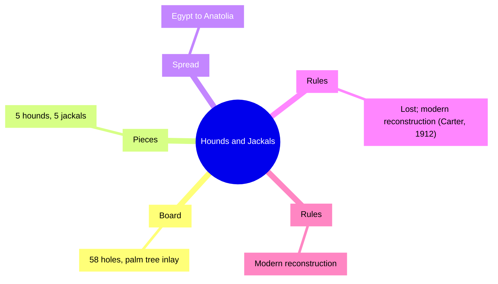
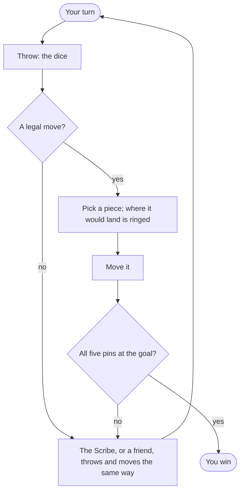

<!-- Written by tools/build-docs.mjs from the sources. Edit those, then run npm run build:docs. -->

# Hounds and Jackals

**Wing I · The Dawn of Play** · c. 2000 BCE · Egypt · Middle Kingdom

[← The First Dice](dice.md) · [All games](README.md) · [Petteia →](petteia.md)

| | |
| --- | --- |
| In the Archives | Playable against the Scribe, or a friend on the same screen |
| Rules | Modern reconstruction |
| How we know them | Lost |
| Family | [Race games](README.md#race-games) |
| Exhibit id | `hounds`: `[librarium_archives start="hounds"]` |

## At a glance

| | |
| --- | --- |
| Board | 58 holes, palm tree inlay |
| Pieces | 5 hounds, 5 jackals |
| Spread | Egypt to Anatolia |
| Rules | Lost; modern reconstruction (Carter, 1912) |

## The placard

Howard Carter, later famous for Tutankhamun's tomb, found a complete set of this game in a Theban tomb in 1910. It is now at the Metropolitan Museum of Art in New York. Ten slender pins fit its holes: five topped with hound heads and five with jackals.

The board has 58 holes in two tracks, which is why archaeologists also call it 58 Holes. Boards like it turn up from Egypt to Mesopotamia, Anatolia and the Levant. The larger hole near the top looks like the finish, but the rules themselves are lost.

The table plays a modern reconstruction, not the ancient rules. It follows the route Carter himself proposed in 1912, which most scholars still think the likeliest: each side races up its own track to the goal, the lines joining holes 6 and 20, and 8 and 10, send a pin back, and the holes marked "good" give another throw. The stick dice are our choice.

> The ancient rules are lost. This table plays a modern reconstruction: Howard Carter's, of 1912.

## A turn

## The rules as played here

1. This is a modern reconstruction. No ancient rules survive; the table follows the route Howard Carter proposed in 1912, when he found the set.
2. You have five hounds on the left track, the Scribe five jackals on the right. Each side races up its own 29 holes to the goal at the top.
3. Throw four sticks and count the white sides; no white side counts 5. Move one pin that many holes, entering at the bottom. Only one pin fits a hole, except the goal, and you must reach the goal exactly.
4. Lines join hole 6 with 20 and 8 with 10. Land on 20 and you slide back to 6; land on 10 and you slide back to 8.
5. Holes 15 and 25 are marked "good": landing there earns another throw.
6. Bring all five pins to the goal first to win.

**Source:** A modern reconstruction after Howard Carter (Carnarvon and Carter, Five Years' Explorations at Thebes, 1912), as described in "Hounds and Jackals in Modern Times" (ISAW Papers 22.4). The stick dice are our choice; Carter thought of dice or knucklebones.

## At the table

| | |
| --- | --- |
| The Scribe | Gentle, Fair or Sharp (see [the Scribe](../scribe.md#levels)) |
| Pass-and-play with a friend | Yes |
| Undo | No |
| Hint | Yes |
| Saved and resumed | No |

Keys, the move list, replays and the guide are the same at every table: see [Visiting the Archives](../visiting.md#at-a-table).

## How the Scribe plays

**Method:** Rules of thumb: scored moves for dice games. See [the Scribe](../scribe.md).

**Measured strength**

| Fair vs Gentle | Sharp vs Fair | Games |
| --- | --- | --- |
| 75% | 55% | 400 and 1,000; the two tracks never meet, so luck decides most games |

**Game by game:** Progress, reaching the goal, the "good" holes, and keeping off the holes that slide back. The two tracks never meet, so luck decides most games

## Sources

The sources for every placard are listed in [Historical notes and sources](../sources.md).

## In the code

| | |
| --- | --- |
| Rules and the Scribe | [`src/rules/hounds-and-jackals.js`](../../src/rules/hounds-and-jackals.js) |
| Table presenter | [`src/hall/table-hounds.js`](../../src/hall/table-hounds.js) |
| 3D model | [`src/hall/build-hounds-and-jackals.js`](../../src/hall/build-hounds-and-jackals.js) |
| Placard | [`src/hall/09-exhibit-data.js`](../../src/hall/09-exhibit-data.js) |
