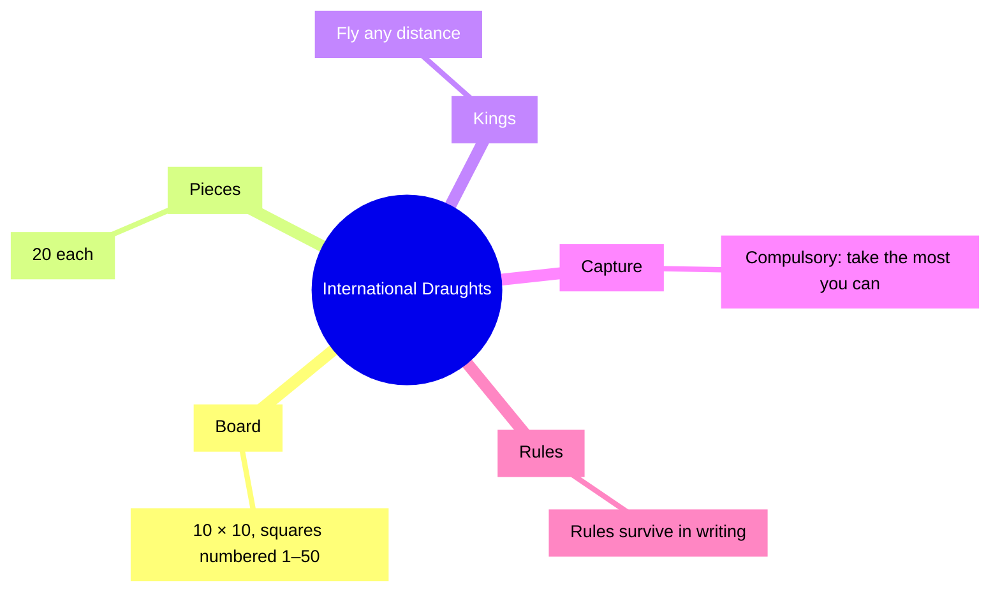
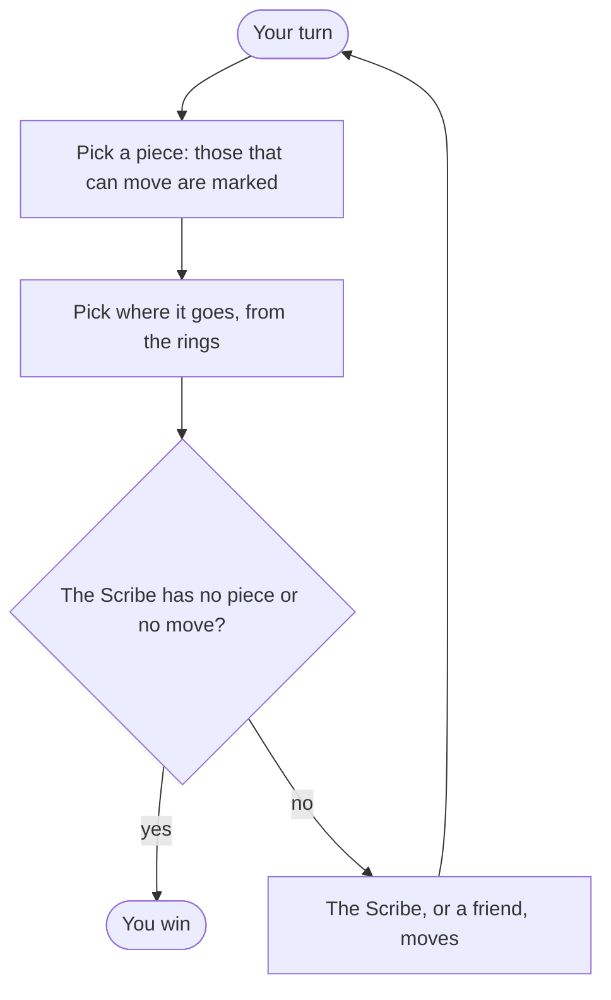

<!-- Written by tools/build-docs.mjs from the sources. Edit those, then run npm run build:docs. -->

# International Draughts

**Wing IV · Printed Boards and Parlour Tables** · c. 1550 – 1700 CE · The Netherlands · the ten-square board

[← Primero](primero.md) · [All games](README.md) · [Pachisi (Chaupar) →](pachisi.md)

| | |
| --- | --- |
| In the Archives | Playable against the Scribe, or a friend on the same screen |
| Rules | Rules survive in writing |
| How we know them | Survive in writing (FMJD) |
| Family | [Capture games](README.md#capture-games) |
| Exhibit id | `idraughts`: `[librarium_archives start="idraughts"]` |

## At a glance

| | |
| --- | --- |
| Board | 10 × 10, squares numbered 1–50 |
| Pieces | 20 each |
| Kings | Fly any distance |
| Capture | Compulsory: take the most you can |

## The placard

The bigger board grew up in the Netherlands. The Dutch historian Arie van der Stoep found that a board of ten squares by ten was probably in use there from about 1550, and that the armies grew to twenty a side between 1650 and 1700. Kings that fly the length of a diagonal, and the rule that you must take as many pieces as you can, make it a deeper game than its cousin on the chessboard.

The Dutch call it Pools, "Polish", probably after an old Dutch habit of calling any odd new idea Polish. The first world championship was played in 1894 and won by the Frenchman Isidore Weiss, and the World Draughts Federation, the FMJD, has run the title since 1948. The squares are numbered 1 to 50, so that games can be written down.

## A turn

## The rules as played here

1. You play white and move first, on the dark squares of a board of ten by ten. Each side has twenty men.
2. A man steps one square diagonally forward. It captures by jumping an enemy piece next to it into the empty square beyond, forwards or backwards, and keeps jumping while it can.
3. Capturing is compulsory, and you must take the largest number of pieces you can. Pieces taken are lifted only when the move is over, and none may be jumped twice.
4. A man that ends its move on the far row becomes a king. Kings fly: they move any distance diagonally, and capture an enemy piece at any distance along a diagonal, landing on any empty square beyond it.
5. You win when the Scribe has no pieces or no legal move. Twenty-five moves each with only kings moving and nothing taken is a draw.

**Source:** The rules of the World Draughts Federation (FMJD), with the draw rules simplified to one: twenty-five moves each of kings alone, with no capture.

### Rule choices

- **International draughts:** the FMJD rules. Men step forward and capture forward or backward; captures are compulsory and you must take the most pieces you can; taken pieces stay on the board until the move ends and none may be jumped twice; a man is crowned only if its move ends on the far row; kings fly. The one draw rule we keep is twenty-five moves each of kings alone, with nothing taken.

## At the table

| | |
| --- | --- |
| The Scribe | Gentle, Fair or Sharp (see [the Scribe](../scribe.md#levels)) |
| Pass-and-play with a friend | Yes |
| Undo | Yes |
| Hint | Yes |
| Saved and resumed | Yes |

Keys, the move list, replays and the guide are the same at every table: see [Visiting the Archives](../visiting.md#at-a-table).

## How the Scribe plays

**Method:** Shared search: negamax with alpha-beta; captures played out at the leaves; iterative deepening; time budget per level. See [the Scribe](../scribe.md).

**Measured strength**

| Fair vs Gentle | Sharp vs Fair | Games |
| --- | --- | --- |
| 6–0 | 3–0, 1 draw | 6 and 4 |

**Game by game:** Men and flying kings (a king is worth over three men), advance, the centre and the back row; the longest-capture rule keeps the search narrow

## Sources

The sources for every placard are listed in [Historical notes and sources](../sources.md).

## In the code

| | |
| --- | --- |
| Rules and the Scribe | [`src/rules/international-draughts.js`](../../src/rules/international-draughts.js) |
| Table presenter | [`src/hall/table-idraughts.js`](../../src/hall/table-idraughts.js) |
| 3D model | [`src/hall/build-international-draughts.js`](../../src/hall/build-international-draughts.js) |
| Placard | [`src/hall/09-exhibit-data.js`](../../src/hall/09-exhibit-data.js) |
