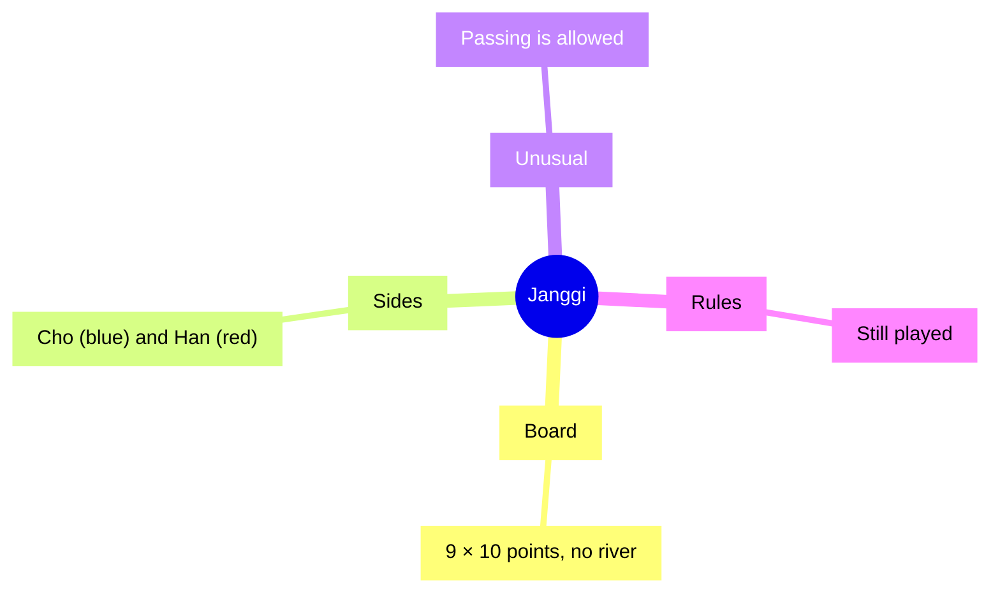
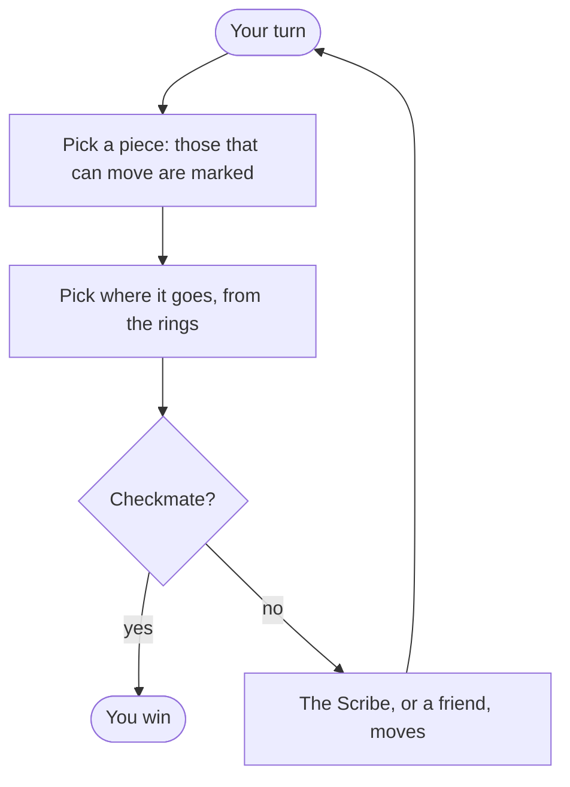

<!-- Written by tools/build-docs.mjs from the sources. Edit those, then run npm run build:docs. -->

# Janggi

**Wing VI · Games of the World** · traditional · Korea

[← Yut Nori](yut.md) · [All games](README.md) · [Fanorona →](fanorona.md)

| | |
| --- | --- |
| In the Archives | Playable against the Scribe, or a friend on the same screen |
| Rules | Still played |
| How we know them | Still played |
| Family | [The chess family](README.md#the-chess-family) |
| Exhibit id | `janggi`: `[librarium_archives start="janggi"]` |

## At a glance

| | |
| --- | --- |
| Board | 9 × 10 points, no river |
| Sides | Cho (blue) and Han (red) |
| Unusual | Passing is allowed |

## The placard

Janggi, Korean chess, grew from Chinese xiangqi and keeps its board of nine files and ten rows, its palaces and most of its pieces, but drops the river, so elephants and soldiers range freely. Its cannon must jump to move at all, and its eight-sided pieces come in three sizes, the generals largest.

The sides are named Cho and Han, after the rival states of the Chu–Han contention that followed the fall of the Qin dynasty in China. Older men still play it in Korean city parks, and the first world tournament was held in 2009. A game can be won on points: when neither side can force mate, the material left on the board decides.

## A turn

## The rules as played here

1. You play Cho (blue) and move first. Checkmate Han's general to win. Pieces stand on the points, as in Chinese chess, but there is no river.
2. General and guards: one step along the lines of their palace, diagonals included, never leaving it. Chariot: any distance in a straight line, and along the palace diagonals. Horse: one step straight then one diagonal, blocked by a piece on the first step. Elephant: one step straight then two diagonal, blocked by any piece on the way.
3. Cannon: must jump over exactly one piece to move or to capture, landing anywhere beyond. It can neither jump over nor take another cannon. In a palace it may jump along a diagonal over the centre.
4. Soldier: one step forward or sideways, and diagonally forward inside the enemy palace.
5. You may pass instead of moving, unless you are in check. If the generals face each other on an open file and the next player does not block it, the game ends and is decided on points (chariot 13, cannon 7, horse 5, elephant 3, guard 3, soldier 2, and 1.5 to Han for moving second). Two passes in a row, or two hundred moves each, are decided the same way.

**Source:** Janggi as played in Korea today, with the inner elephants setup for both sides and bikjang decided on points.

### Rule choices

- **Janggi:** the inner-elephant setup for both sides (horse, elephant, elephant, horse). Pieces move as in Korea, cannons included; you may pass unless in check. If the generals face each other on an open file (bikjang) and the next player does not block it, or both sides pass in a row, or after two hundred moves each, the game is decided on points: chariot 13, cannon 7, horse 5, elephant 3, guard 3, soldier 2, and 1.5 to Han. Repetition is not policed.

## At the table

| | |
| --- | --- |
| The Scribe | Gentle, Fair or Sharp (see [the Scribe](../scribe.md#levels)) |
| Pass-and-play with a friend | Yes |
| Undo | Yes |
| Hint | Yes |
| Saved and resumed | Yes |

Keys, the move list, replays and the guide are the same at every table: see [Visiting the Archives](../visiting.md#at-a-table).

## How the Scribe plays

**Method:** Shared search: negamax with alpha-beta; captures played out at the leaves; iterative deepening; time budget per level. See [the Scribe](../scribe.md).

**Measured strength**

| Fair vs Gentle | Sharp vs Fair | Games |
| --- | --- | --- |
| 4–0 | 2–2 | 4 each |

**Game by game (Makruk, Janggi):** Material (Janggi's tournament points), soldiers and cowries pushed forward

## Sources

The sources for every placard are listed in [Historical notes and sources](../sources.md).

## In the code

| | |
| --- | --- |
| Rules and the Scribe | [`src/rules/janggi.js`](../../src/rules/janggi.js) |
| Table presenter | [`src/hall/table-janggi.js`](../../src/hall/table-janggi.js) |
| 3D model | [`src/hall/build-round-five.js`](../../src/hall/build-round-five.js) |
| Placard | [`src/hall/09-exhibit-data.js`](../../src/hall/09-exhibit-data.js) |
