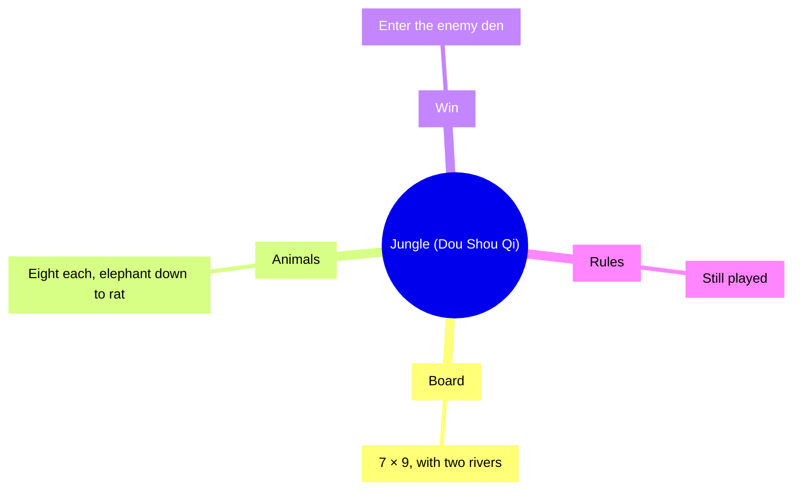
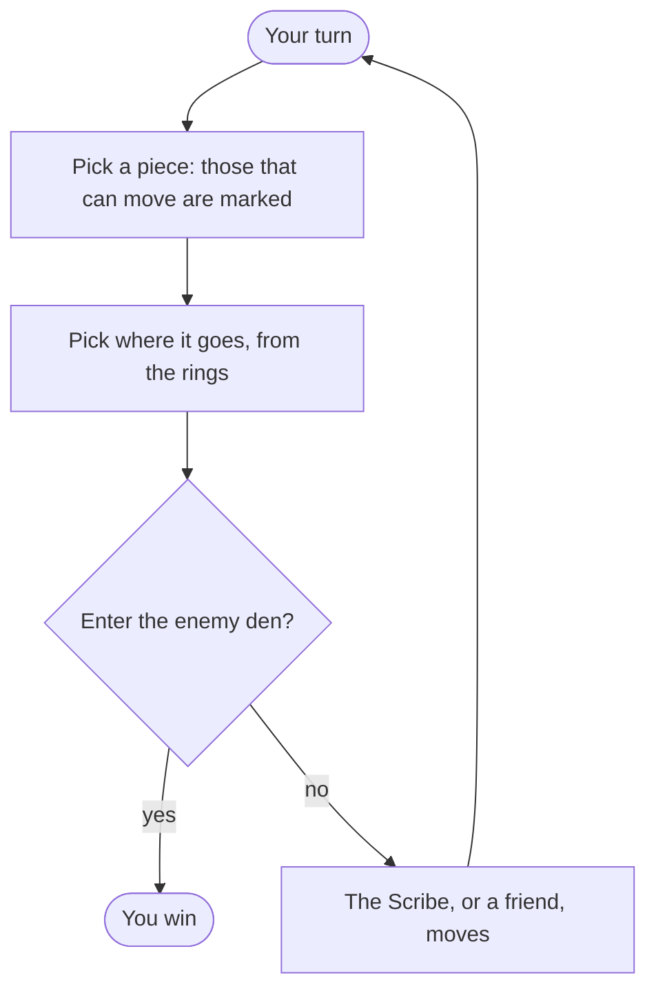

<!-- Written by tools/build-docs.mjs from the sources. Edit those, then run npm run build:docs. -->

# Jungle

**Wing VI · Games of the World** · 20th century · China

[← Bagh-chal](baghchal.md) · [All games](README.md) · [Kōnane →](konane.md)

| | |
| --- | --- |
| In the Archives | Playable against the Scribe, or a friend on the same screen |
| Rules | Still played |
| How we know them | Still played |
| Family | [The chess family](README.md#the-chess-family) |
| Exhibit id | `jungle`: `[librarium_archives start="jungle"]` |

## At a glance

| | |
| --- | --- |
| Board | 7 × 9, with two rivers |
| Animals | Eight each, elephant down to rat |
| Win | Enter the enemy den |

## The placard

Dou shou qi, "the game of fighting animals", is a Chinese board game known in English as Jungle. Its history is obscure: it is a modern game, played in China in the 20th century, and it reached Britain in printed sets such as Waddington's Jungle King in the 1950s.

Each side has eight animals, ranked from the elephant down to the rat, and a stronger animal eats a weaker one. The rat is the exception: it alone can kill the elephant, by creeping into its ear, so the story goes. The rat can also swim, while the lion and the tiger leap the rivers in one bound.

The aim is not to take every animal but to walk one into the enemy's den, past the three traps that guard it, where even an elephant is helpless.

## A turn

## The rules as played here

1. You play blue and move first. Each side has eight animals, strongest first: elephant, lion, tiger, leopard, wolf, dog, cat and rat.
2. An animal moves one square forward, back or sideways, and takes an enemy of the same rank or lower by moving onto it. The one exception runs both ways: the rat can take the elephant, and the elephant cannot take the rat.
3. Only the rat may swim. A rat in a river can be taken only by the other rat, also in the water, and a rat cannot take anything as it enters or leaves the water.
4. The lion and the tiger leap straight across a river, along a row or a column, and may take what they land on. A rat in the water on the way blocks the leap.
5. Three traps guard each den. An animal standing in its enemy's trap loses all its rank, and any enemy animal may take it.
6. Walk any animal into the Scribe's den, or take all its animals, to win. You may never enter your own den. A position repeated three times, a side left with no move, or 50 moves each without a capture, is a draw.

**Source:** Dou shou qi as played in China today. Some sets let only the lion leap sideways across the rivers; here the tiger may too.

### Rule choices

- **Jungle:** modern Chinese rules. Blue moves first; animals step one square orthogonally and take equal or lower ranks; the rat takes the elephant (only from land), swims, and blocks leaps; the lion and the tiger both leap the rivers along rows and columns (some sets allow only the lion sideways). An animal in an enemy trap has no rank. Win by entering the den or taking every animal. A threefold repetition, a side with no move, or 50 moves each without a capture is a draw.

## At the table

| | |
| --- | --- |
| The Scribe | Gentle, Fair or Sharp (see [the Scribe](../scribe.md#levels)) |
| Pass-and-play with a friend | Yes |
| Undo | Yes |
| Hint | Yes |
| Saved and resumed | Yes |

Keys, the move list, replays and the guide are the same at every table: see [Visiting the Archives](../visiting.md#at-a-table).

## How the Scribe plays

**Measured strength**

| Fair vs Gentle | Sharp vs Fair | Games |
| --- | --- | --- |
| 12–0 | 7–3, 2 draws | 12 each |

**Game by game:** Material (the rat valued above the wolf for its threat to the elephant), every animal's distance from the enemy den, and pressure next to it; repeated positions count as draws in the search

## Sources

Checked in [the placard fact-check](../fact-check.md):

- **Claim as it stood:** Waddington's Jungle King in the 1950s **What the sources say:** The V&A dates its Waddington set to the 1950s; Wikipedia says the 1960s **Verdict:** Kept, on the museum's dating

The sources for every placard are listed in [Historical notes and sources](../sources.md).

## In the code

| | |
| --- | --- |
| Rules and the Scribe | [`src/rules/jungle.js`](../../src/rules/jungle.js) |
| Table presenter | [`src/hall/table-jungle.js`](../../src/hall/table-jungle.js) |
| 3D model | [`src/hall/build-jungle.js`](../../src/hall/build-jungle.js) |
| Placard | [`src/hall/09-exhibit-data.js`](../../src/hall/09-exhibit-data.js) |
