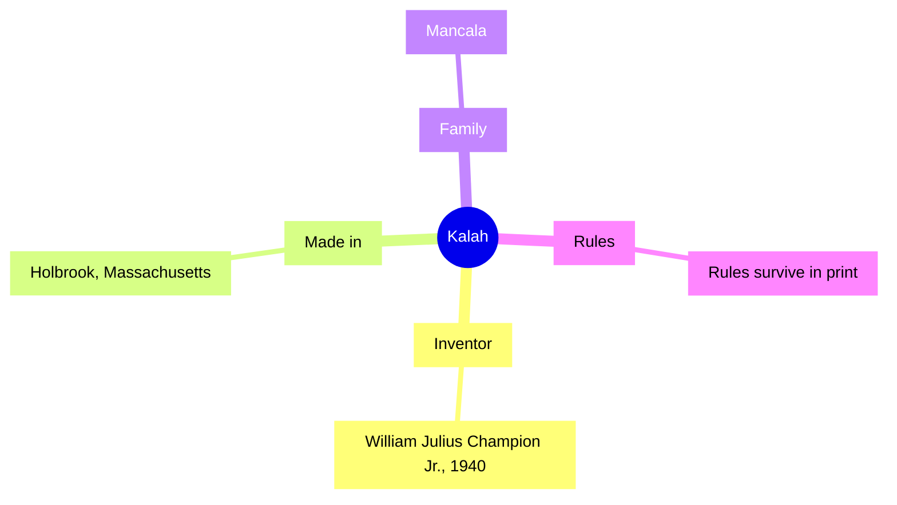
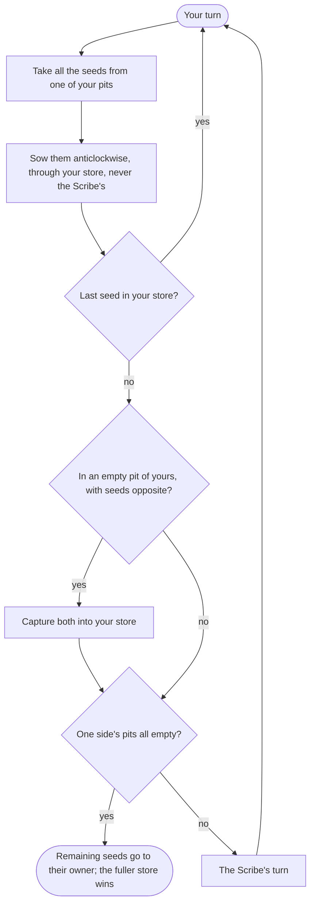

<!-- Written by tools/build-docs.mjs from the sources. Edit those, then run npm run build:docs. -->

# Kalah

**Wing V · The Modern Board Game** · 1940 CE · United States

[← Spades](spades.md) · [All games](README.md) · [Hex →](hex.md)

| | |
| --- | --- |
| In the Archives | Playable against the Scribe, or a friend on the same screen |
| Rules | Rules survive in print |
| How we know them | Survive in print |
| Family | [Mancala](README.md#mancala) |
| Exhibit id | `kalah`: `[librarium_archives start="kalah"]` |
| Seeds | 3 seeds · **4 seeds** · 6 seeds |

## At a glance

| | |
| --- | --- |
| Inventor | William Julius Champion Jr., 1940 |
| Made in | Holbrook, Massachusetts |
| Family | Mancala |

## The placard

Kalah is mancala made for the modern West. William Julius Champion Jr., a Yale graduate, devised it in 1940 from the African and Asian sowing games he had read about, began selling it in 1944, and patented it in the 1950s. His Kalah Game Company, founded in 1958 in Holbrook, Massachusetts, made sets into the 1970s.

Champion sold it as an educational game, and towns and schools held Kalah tournaments in the early 1960s. It became a favourite of computer scientists too: programs could play some sizes perfectly by 2001, and later analysis shows that with perfect play the first player usually wins.

## A turn

## The rules as played here

1. Each of you owns the six pits on your side and the store (kalah) on your right. You move first.
2. Take all the seeds from one of your pits and sow them one by one, anticlockwise, into the following pits and your own store, but never the Scribe's store.
3. If your last seed falls in your store, you move again.
4. If it falls in an empty pit on your side and the Scribe's pit opposite has seeds, you capture both: that seed and everything opposite go to your store.
5. When one side's pits are all empty, the game ends and the other side puts its remaining seeds in its own store. The fuller store wins.

**Source:** Kalah as William Julius Champion Jr. sold it from 1944, with the usual modern rules.

### Rule choices

- **Kalah:** sow anticlockwise past your own store but never the Scribe's; a last seed in your store moves again, and one in your own empty pit captures the pit opposite (if it holds seeds). When a side is empty, the other side keeps its seeds.

### Seeds

Chosen at the table under Options. Changing it restarts the game.

| Choice | |
| --- | --- |
| 3 seeds |  |
| 4 seeds | the default |
| 6 seeds |  |

## At the table

| | |
| --- | --- |
| The Scribe | Gentle, Fair or Sharp (see [the Scribe](../scribe.md#levels)) |
| Pass-and-play with a friend | Yes |
| Undo | Yes |
| Hint | Yes |
| Saved and resumed | Yes |

Keys, the move list, replays and the guide are the same at every table: see [Visiting the Archives](../visiting.md#at-a-table).

## How the Scribe plays

**Method:** Shared search: negamax with alpha-beta; captures played out at the leaves; iterative deepening; time budget per level. See [the Scribe](../scribe.md).

**Measured strength**

| Fair vs Gentle | Sharp vs Fair | Games |
| --- | --- | --- |
| 20–0 | 24–16 | 20 and 40, varied openings |

**Game by game:** Stores and seeds on each side; chains of extra moves searched as one turn

## Sources

The sources for every placard are listed in [Historical notes and sources](../sources.md).

## In the code

| | |
| --- | --- |
| Rules and the Scribe | [`src/rules/kalah.js`](../../src/rules/kalah.js) |
| Table presenter | [`src/hall/table-kalah.js`](../../src/hall/table-kalah.js) |
| 3D model | [`src/hall/build-hnefatafl.js`](../../src/hall/build-hnefatafl.js) |
| Placard | [`src/hall/09-exhibit-data.js`](../../src/hall/09-exhibit-data.js) |
