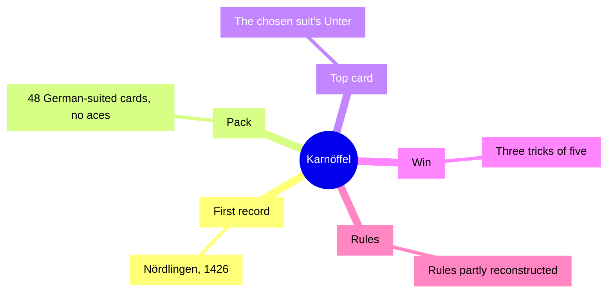
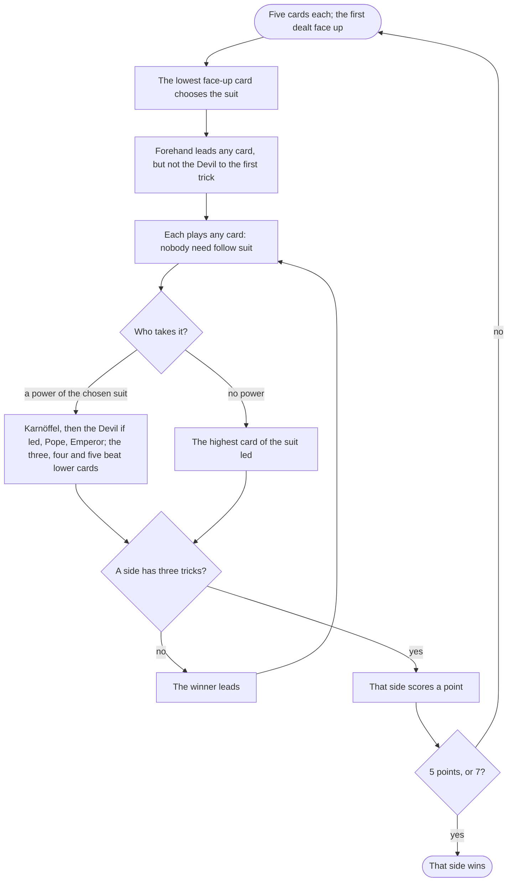

<!-- Written by tools/build-docs.mjs from the sources. Edit those, then run npm run build:docs. -->

# Karnöffel

**Wing III · Kings, Cards and Courts** · 1426 CE · Southern Germany · The oldest card game with rules

[← Playing Cards](cards.md) · [All games](README.md) · [Tarot (Tarocchi) →](tarot.md)

| | |
| --- | --- |
| In the Archives | Playable against the Scribe, in 4 seats |
| Rules | Rules partly reconstructed |
| How we know them | Partly reconstructed (the Swiss Kaiserspiel, the old descriptions) |
| Family | [Cards](README.md#cards) |
| Exhibit id | `karnoffel`: `[librarium_archives start="karnoffel"]` |
| Game | **To 5** · To 7 |
| Suits drawn | German by default; the Pack switch redraws it in French, German, Swiss or Italian suits |

## At a glance

| | |
| --- | --- |
| First record | Nördlingen, 1426 |
| Pack | 48 German-suited cards, no aces |
| Top card | The chosen suit's Unter |
| Win | Three tricks of five |

## The placard

Karnöffel is the oldest European card game whose rules can be pieced together. It first appears in 1426, in an ordinance of Nördlingen in Bavaria listing the games allowed at the town's annual fair, and a poem by Meissner from around 1450 praises it.

Its cards turn the order of the world upside down. In the chosen suit a lowly Unter, the Karnöffel, beats everything, and the Devil, the Pope and the Emperor come next, above every king. A sermon of 1496 attacked the game for it, and a satire of 1546 set the Pope and the Devil arguing over their places in the pack.

It was played in Switzerland by about 1500 and spread north to Berlin and Lübeck. Its descendants include the Swiss Kaiserspiel, found again in the 1970s, Bräus on Gotland and Brús in Iceland. Partners were free to talk and signal, so at this table you see your partner's cards.

> No full account survives from the 1400s. The table follows the Swiss Kaiserspiel and the old descriptions, and every deal is worth a point.

## A turn

Seats: You, West, North, East.

## The rules as played here

1. Four players in two partnerships: you sit South with North, played by the Scribe, against West and East. Each gets five cards from a 48-card German pack with no aces; the first card each player gets is dealt face up, and the suit of the lowest of them is chosen for the deal. Partners play with their hands open to each other: you can see North's cards.
2. Nobody has to follow suit: play any card. A trick goes to the highest card of the suit led (king, Ober, Unter, ten down to two) unless a card of the chosen suit with a power beats it.
3. The chosen suit's powers: its Unter, the Karnöffel, beats every card. Its seven, the Devil, beats everything but the Karnöffel when it is led, and is a plain seven otherwise; it may not be played to the first trick. Its six, the Pope, and its two, the Emperor, beat everything below them.
4. The chosen three beats every card but the kings and the cards above; the four every card but kings and Obers; the five every card but kings, Obers and Unters. The chosen king, Ober, ten, nine and eight have no powers.
5. The first side to take three tricks wins the deal and scores a point; play stops there. The player who led first deals next. The first side to 5 points (or 7) wins.

**Source:** After the reconstruction of the Swiss Kaiserspiel and the oldest descriptions (Wikipedia's Karnöffel and David Parlett's history). The old game raised the stake by offers made during the deal; here every deal is worth one point.

### Rule choices

- **Karnöffel:** a reconstruction after the Swiss Kaiserspiel and the descriptions gathered by Wikipedia and David Parlett. Four players in partnerships, five cards each, the first dealt face up; the lowest face-up card chooses the suit. Nobody need follow suit. The chosen Unter (the Karnöffel) beats everything; the seven (the Devil) beats all but the Karnöffel when led and may not be played to the first trick; the six (Pope) and two (Emperor) beat everything below them; the three, four and five beat all but kings, kings and Obers, and kings, Obers and Unters. Three tricks win the deal. Partners' hands are open to each other, after Parlett's note that partners advised each other freely. The old game's raising of the stake during the deal is left out: a deal is worth a point, and the game is to 5 or 7.

### Game

Chosen at the table under Options. Changing it restarts the game.

| Choice | |
| --- | --- |
| To 5 | the default |
| To 7 |  |

## At the table

| | |
| --- | --- |
| The Scribe | Gentle, Fair or Sharp (see [the Scribe](../scribe.md#levels)) |
| Pass-and-play with a friend | No |
| Undo | No |
| Hint | No |
| Saved and resumed | Yes |
| Pack switch | Yes |

Keys, the move list, replays and the guide are the same at every table: see [Visiting the Archives](../visiting.md#at-a-table).

## How the Scribe plays

**Method:** Sampling the unseen cards: deals what it cannot see at random and plays each deal out, as Tarocchi's Sharp does. See [the Scribe](../scribe.md).

**Games with hidden cards and tiles:** Partners see each other's hands, so each Scribe knows its side's ten cards. Fair leads the Devil once it may, lets its partner's sure trick stand, and otherwise wins as cheaply as it can or throws its least useful card. Sharp deals the unseen cards between the other side many times, plays each deal out with Fair's judgement, and plays the card that wins the deal most often. Gentle often plays at random

**Measured strength**

| Fair vs Gentle | Sharp vs Fair | Games |
| --- | --- | --- |
| 110–40 | 127–23 | 150 games each, to 5 |

## Sources

Checked in [the placard fact-check](../fact-check.md):

- **Claims:** First named in a Nördlingen ordinance of 1426 among the games allowed at the annual fair; Meissner's poem of about 1450; the chosen Unter beats everything, the Devil, Pope and Emperor next; a sermon of 1496 attacked the game for its upside-down order; a satirical dialogue of 1546 between the Pope and the Devil; played in Switzerland by about 1500, then Berlin and Lübeck; the Kaiserspiel found again in the 1970s; Bräus on Gotland and Brús in Iceland **Source:** Wikipedia, Karnöffel; David Parlett, The oldest card game

The sources for every placard are listed in [Historical notes and sources](../sources.md).

## In the code

| | |
| --- | --- |
| Rules and the Scribe | [`src/rules/karnoffel.js`](../../src/rules/karnoffel.js) |
| Table presenter | [`src/hall/table-karnoffel.js`](../../src/hall/table-karnoffel.js) |
| 3D model | [`src/hall/build-card-room.js`](../../src/hall/build-card-room.js) |
| Placard | [`src/hall/09-exhibit-data.js`](../../src/hall/09-exhibit-data.js) |
