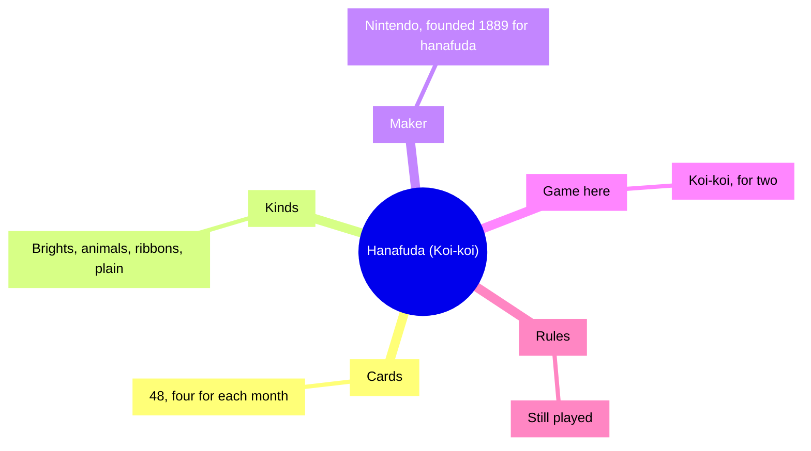
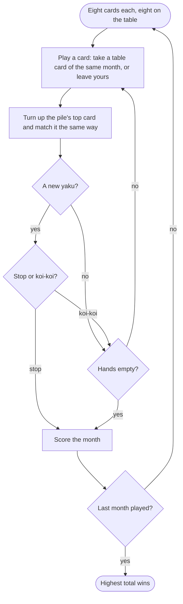

<!-- Written by tools/build-docs.mjs from the sources. Edit those, then run npm run build:docs. -->

# Hanafuda

**Wing VI · Games of the World** · Edo period onward · Japan

[← Gomoku](gomoku.md) · [All games](README.md) · [Ganjifa →](ganjifa.md)

| | |
| --- | --- |
| In the Archives | Playable against the Scribe |
| Rules | Still played |
| How we know them | Still played |
| Family | [Cards](README.md#cards) |
| Exhibit id | `koikoi`: `[librarium_archives start="koikoi"]` |
| Game | 3 months · **6 months** · 12 months |

## At a glance

| | |
| --- | --- |
| Cards | 48, four for each month |
| Kinds | Brights, animals, ribbons, plain |
| Maker | Nintendo, founded 1889 for hanafuda |
| Game here | Koi-koi, for two |

## The placard

Hanafuda, "flower cards", emerged in Edo-period Japan after repeated bans on Western-style playing cards. There are no numbers and no suits as Europe knew them: forty-eight small cards in twelve suits, one for each month, each shown by its plant, from the pine of January to the paulownia of December. By the 19th century the twelve-month pack was standard.

Each month has four cards, some worth more than others: brights such as the crane and the moon, animals such as the boar and the deer, poem ribbons, and plain cards. In 1889 a small company in Kyoto was founded to make hanafuda packs. It was called Nintendo.

Koi-koi, the game at this table, is a two-player matching game: collect combinations, then decide whether to stop or to call "koi-koi" and push your luck. These cards are drawn in our own simple style, not copied from a printed pack.

## A turn

## The rules as played here

1. Forty-eight flower cards, four for each month. Each of you holds eight, eight lie face up between you, and the rest are the draw pile. The dealer (oya) plays first; you deal the first month.
2. On your turn, play a card from your hand. If a card of the same month lies on the table, take both into your pile; if two do, choose one; if three do, take all four. If none does, your card stays on the table.
3. Then turn up the top card of the pile and match it the same way.
4. Collect combinations (yaku): five brights 10, four brights 8 (7 with the rain man), three brights 5 (not with the rain man); moon and sake 5; cherry blossom and sake 5; boar, deer and butterflies 5; the three red poem ribbons 5; the three blue ribbons 5; five animals, five ribbons or ten chaff 1, and 1 more for each card beyond.
5. When you make a new yaku you may stop and score, or call koi-koi and play on for more. If you call koi-koi and the Scribe then stops first, it scores double and you score nothing. A score of 7 or more doubles.
6. If the hands run out with no yaku, the dealer scores 1. The winner of a month deals the next. Highest total after the last month wins.

**Source:** Koi-koi as commonly played in Japan, after the rules on Wikipedia. Four of a month or four pairs dealt to a player score 6 at once; the same on the table means a redeal.

### Rule choices

- **Hanafuda (koi-koi):** eight cards each and eight face up; match by month, then turn up the pile's top card and match again (two matches, you choose; three, you take all four). Yaku: five brights 10, four 8 (with the rain man 7), three without him 5; moon and sake, cherry and sake 5 each; boar, deer and butterflies 5; red poem ribbons 5, blue ribbons 5; five animals, five ribbons or ten chaff 1 plus 1 for each beyond. After a new yaku, stop or call koi-koi; if the other side then stops first it scores double. 7 or more doubles. No yaku with the hands empty: the dealer scores 1. Four of a month or four pairs dealt to a hand scores 6; on the table, a redeal. The sake cup counts only as an animal.

### Game

Chosen at the table under Options. Changing it restarts the game.

| Choice | |
| --- | --- |
| 3 months |  |
| 6 months | the default |
| 12 months |  |

## At the table

| | |
| --- | --- |
| The Scribe | Gentle, Fair or Sharp (see [the Scribe](../scribe.md#levels)) |
| Pass-and-play with a friend | No |
| Undo | No |
| Hint | Yes |
| Saved and resumed | No |

Keys, the move list, replays and the guide are the same at every table: see [Visiting the Archives](../visiting.md#at-a-table).

## How the Scribe plays

**Method:** Hidden information: plays only from what it can see. See [the Scribe](../scribe.md).

**Games with hidden cards and tiles:** Takes the most valuable cards and yaku in the making; a card that will not match goes to the table only if its month is spent. Sharp also weighs each card a play leaves on the field by the chance you hold one of its month (counted from the cards it cannot see) and the yaku it would build for you. It stops at 7 points or with few cards left; Sharp calls koi-koi when it is ahead and the visitor is far from a yaku

**Measured strength**

| Fair vs Gentle | Sharp vs Fair | Games |
| --- | --- | --- |
| 77% | 53% to 43% | 400 and 800 games of six months; Sharp also weighs what a play leaves on the field for you, and when to call koi-koi |

## Sources

The sources for every placard are listed in [Historical notes and sources](../sources.md).

## In the code

| | |
| --- | --- |
| Rules and the Scribe | [`src/rules/koi-koi.js`](../../src/rules/koi-koi.js) |
| Table presenter | [`src/hall/table-koikoi.js`](../../src/hall/table-koikoi.js) |
| 3D model | [`src/hall/build-hanafuda.js`](../../src/hall/build-hanafuda.js) |
| Placard | [`src/hall/09-exhibit-data.js`](../../src/hall/09-exhibit-data.js) |
